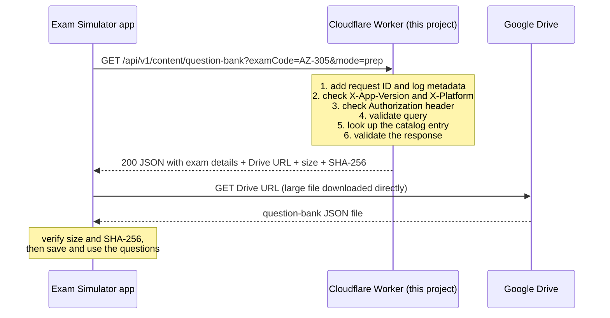

# Exam Simulator API - The Learning Book

A step-by-step book that teaches the whole project, starting from the folder structure and moving up through concepts, patterns, code walkthroughs, testing, security, and exercises.

## Who this book is for

- Beginners who know a little programming (variables, functions, `if`, loops) but have never built a web API.
- Developers new to TypeScript, Cloudflare Workers, Hono, or Zod.
- Anyone who has to maintain this project and needs to understand why it is built this way.

You do not need to know anything about Cloudflare, Hono, or Zod before starting. Every new word is explained the first time it appears, and there is a glossary in Chapter 10.

## How every topic is explained: What, Why, Pattern, Reference

Each concept in this book is taught using the same four questions, so you always know where to look:

| Question | Meaning |
| --- | --- |
| **What** | A plain definition: what is this thing? |
| **Why** | The problem it solves and why this project chose it. |
| **Pattern** | The reusable design idea behind it, with a name you can search for. |
| **Reference** | Where it appears in this project, and where to read the official documentation. |

When you see a "Where in this project" line, open that file next to the book and read the real code.

## Table of contents

| Chapter | Title | What you will learn |
| --- | --- | --- |
| 1 | [Project structure](01-project-structure.md) | Every file and folder: what it is, why it exists, and what pattern it follows. |
| 2 | [Big-picture concepts](02-big-picture-concepts.md) | Client/server, HTTP, REST, JSON, APIs, serverless, Cloudflare Workers. |
| 3 | [Toolchain and configuration](03-toolchain-and-configuration.md) | Node.js, npm, `package.json`, TypeScript, `tsconfig.json`, Wrangler, Vitest. |
| 4 | [The shared contract and Zod](04-shared-contract-and-zod.md) | Contract-first design, schemas, validation, inferred types. |
| 5 | [The Worker, line by line](05-worker-walkthrough.md) | Hono, middleware, routes, validation, error handling in `src/index.ts`. |
| 6 | [The question-bank download feature](06-question-bank-feature.md) | The "send a URL, not the data" design from end to end. |
| 7 | [Testing](07-testing.md) | Automated tests, the REST Client file, and manual testing. |
| 8 | [Security and safe logging](08-security-and-logging.md) | OWASP thinking, secrets, error envelopes, what must never be logged. |
| 9 | [Patterns catalog](09-patterns-catalog.md) | Every design pattern used, in one place, with what/why/where. |
| 10 | [Exercises, troubleshooting, glossary, references](10-exercises-glossary-references.md) | Practice tasks, common errors, vocabulary, further reading. |
| 11 | [Capstone Project: Build from Scratch](11-capstone-project-hands-on.md) | Step-by-step hands-on tutorial to build this entire working project from an empty folder. |
| 12 | [Google Drive Integration & Auth](12-google-drive-auth-and-downloads.md) | How the API & App talk to Drive, authenticated downloads, Service Accounts, and Presigned URLs. |

## Suggested reading paths

- **Complete beginner:** read Chapters 1 to 10 in order, then do Chapter 11 (the Capstone Project) to build the entire system from scratch.
- **Learn by building first:** jump straight to [Chapter 11](11-capstone-project-hands-on.md) to build the project hands-on, referring back to Chapters 1-10 whenever you want deeper theory on a topic.
- **Comfortable with web basics:** skim Chapter 2, then read 1, 3, 4, 5, 6, and build Chapter 11.
- **You only need to change the question-bank feature:** read 1, 4, 6, then 7.
- **You are reviewing security:** read 5, 8, then the "Limits" sections of 6.

## Project in one paragraph

This repository is a small web service (an API) that runs on Cloudflare Workers. A separate mobile or desktop Exam Simulator app talks to it over HTTPS. The service currently has four routes: a health check, a stub authorization route, a stub content-version route, and a route that tells the app where to download a question-bank JSON file stored on Google Drive. It is a milestone-1 (M1) project: several routes are deliberately fake ("stubs") so that the app and the API can be connected and tested before the real, secure logic is built.

## The request journey (keep this picture in mind)

The Worker never carries the big file. That is the central idea of the latest feature, and Chapter 6 explains it in depth.

## Conventions used in this book

- File paths are relative to the project root `ExamSimulatorApi/`.
- `code font` is used for file names, commands, and code identifiers.
- Commands are written for Windows PowerShell because that is what this project is developed in.
- "M1" means Milestone 1, the stub-only stage of the project.
