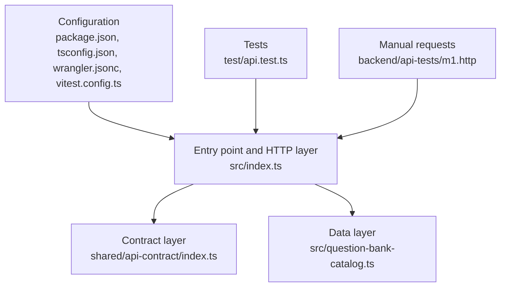
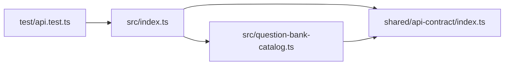

# Chapter 1 - Project Structure

Before reading any code, learn where everything lives. A well-organized project tells you a lot just from its folder names.

## 1.1 The full tree

```text
ExamSimulatorApi/
|-- .github/
|   `-- copilot-instructions.md        Rules for the AI coding assistant
|-- backend/
|   `-- api-tests/
|       `-- m1.http                    Hand-run sample requests (REST Client)
|-- docs/
|   `-- learning-guide/                This book
|-- shared/
|   `-- api-contract/
|       `-- index.ts                   Schemas and types shared by API and app
|-- src/
|   |-- index.ts                       The Worker: routes, middleware, errors
|   `-- question-bank-catalog.ts       Metadata for question banks on Drive
|-- test/
|   `-- api.test.ts                    Automated tests
|-- MANUAL-API-CONFIGURATION-AND-INTEGRATION.md   How to connect the app
|-- README.md                          Project front page
|-- package.json                       Dependencies and npm scripts
|-- tsconfig.json                      TypeScript settings
|-- vitest.config.ts                   Test runner settings
`-- wrangler.jsonc                     Cloudflare Worker settings
```

Two more folders can appear after you run commands: `node_modules/` (downloaded libraries) and `.wrangler/` (local Cloudflare working files). You never edit those by hand.

## 1.2 How to read the structure: the "layers" idea

Think of the project as layers, from the outside (what users see) to the inside (rules and data).



- **Configuration** decides how the project is built, typed, tested, and run.
- **HTTP layer** receives requests and sends responses.
- **Contract layer** defines what a valid request or response looks like.
- **Data layer** holds the facts the API reports (for example, which exam files exist).
- **Tests** prove the other layers behave as promised.

---

## 1.3 Folder-by-folder and file-by-file

Each entry uses the What / Why / Pattern / Reference format.

### `src/` - application source code

- **What:** the code that actually runs on Cloudflare.
- **Why:** keeping runtime code in one folder makes it obvious what gets deployed and what does not (tests, docs, and sample requests are not deployed).
- **Pattern:** *source folder convention* - nearly every JavaScript/TypeScript project keeps its runtime code in `src/`.
- **Reference:** Wrangler is pointed at `src/index.ts` by the `main` setting in `wrangler.jsonc`.

#### `src/index.ts`

- **What:** the Worker entry point. It creates the Hono app, registers middleware (code that runs for every request), registers four routes, and defines the not-found and error handlers.
- **Why:** Cloudflare needs exactly one module whose default export can handle web requests. Everything else is imported from here.
- **Pattern:** *front controller* - one entry point receives every request and decides which handler runs. Also *middleware pipeline* (Chapter 5).
- **Reference:** Chapter 5 walks through this file piece by piece.

#### `src/question-bank-catalog.ts`

- **What:** a small in-code list ("catalog") describing each question-bank file: exam code, title, content version, mode, file size, and SHA-256 fingerprint. It also exports `findQuestionBank()`.
- **Why:** the API must tell the app facts about a file that the API does not itself hold. Keeping those facts in one dedicated module means the route code in `index.ts` stays small, and changing a question bank means editing one place.
- **Pattern:** *repository / lookup module* - a module that hides how data is stored behind a function such as `findQuestionBank(code, mode)`. Today the data is an in-memory array; later it could be a database (D1) without changing the route.
- **Reference:** Chapter 6.

### `shared/api-contract/index.ts` - the contract

- **What:** every request shape, response shape, error code, and allowed value, written as Zod schemas, plus TypeScript types derived from them.
- **Why:** the API and the app must agree exactly on the data they exchange. If each wrote its own idea of the format, they would drift apart and break. Putting the agreement in one file gives a single source of truth.
- **Pattern:** *contract-first design* and *single source of truth*. The folder is called `shared` because the app project is meant to reuse or mirror this file.
- **Reference:** Chapter 4. Zod docs: https://zod.dev

### `test/api.test.ts` - automated tests

- **What:** 12 tests that call the app in memory and check status codes and JSON bodies.
- **Why:** tests catch breakage immediately and document how each route is supposed to behave.
- **Pattern:** *arrange-act-assert* (set up input, perform the call, check the output) and *black-box testing* (tests check outputs, not internal code).
- **Reference:** Chapter 7. Vitest docs: https://vitest.dev

### `backend/api-tests/m1.http` - manual requests

- **What:** a plain-text file of sample HTTP requests you can click and send from VS Code with the REST Client extension.
- **Why:** it is the quickest way to try the running server and see real responses, and it doubles as living documentation of how to call the API.
- **Pattern:** *executable documentation*.
- **Reference:** Chapter 7.

### `package.json`

- **What:** the project's identity card: name, version, npm scripts, and the lists of libraries it needs.
- **Why:** `npm install` reads it to download dependencies; `npm run <script>` reads it to know which command to run.
- **Pattern:** *manifest file* and *dependency declaration*.
- **Reference:** Chapter 3. Note: JSON cannot contain comments, so explanations live in the README and this book.

### `tsconfig.json`

- **What:** the rulebook for the TypeScript compiler, including `"strict": true`.
- **Why:** strict checking finds mistakes (misspelled properties, possibly-missing values) before the code runs.
- **Pattern:** *fail early / static analysis*.
- **Reference:** Chapter 3.

### `wrangler.jsonc`

- **What:** the Cloudflare Worker configuration: Worker name, entry file, compatibility date, observability, and the `QUESTION_BANK_URL` variable. The `c` in `jsonc` means "JSON with comments", so this file can explain itself.
- **Why:** Wrangler (Cloudflare's command-line tool) needs to know what to run and deploy.
- **Pattern:** *configuration as code* and *separating configuration from code* (the Drive URL is a setting, not hard-coded in `index.ts`).
- **Reference:** Chapter 3. Docs: https://developers.cloudflare.com/workers/wrangler/configuration/

### `vitest.config.ts`

- **What:** tells the test runner to execute tests inside a simulated Cloudflare Workers environment, reading the same `wrangler.jsonc`, and to look only in `test/`.
- **Why:** tests that run in the real Worker runtime behave like production; tests in plain Node.js can hide differences.
- **Pattern:** *test environment parity* (make test conditions match production).
- **Reference:** Chapter 3 and 7.

### `README.md` and `MANUAL-API-CONFIGURATION-AND-INTEGRATION.md`

- **What:** the README is the front page (what the project is, how to run it). The manual explains what is finished, what remains, and how to connect the real app.
- **Why:** people (including future you) need written orientation.
- **Pattern:** *documentation next to code*.

### `.github/copilot-instructions.md`

- **What:** rules for AI coding assistants working in this repository (for example: TypeScript strict mode, no secrets, M1 limits).
- **Why:** it keeps automated help consistent with project decisions.
- **Pattern:** *project-level policy file*.

---

## 1.4 Why these names: naming and layout conventions

| Convention | Example | Meaning |
| --- | --- | --- |
| `index.ts` | `src/index.ts` | Conventional name for "the main file of this folder". |
| `*.test.ts` | `api.test.ts` | Test runners find tests by this suffix; the config includes `test/**/*.test.ts`. |
| kebab-case file names | `question-bank-catalog.ts` | Lowercase words joined by hyphens; avoids case-sensitivity problems between operating systems. |
| `PascalCase` for types | `QuestionBankEntry`, `AppBindings` | Types and interfaces start with a capital letter. |
| `camelCase` for values | `findQuestionBank`, `requestId` | Variables and functions start lowercase. |
| `UPPER_SNAKE_CASE` for settings | `QUESTION_BANK_URL` | Environment-style configuration names. |
| `*Schema` suffix | `healthResponseSchema` | Marks a Zod validator, to distinguish it from the type of the same data. |

## 1.5 Dependency direction (an important rule)

Arrows below mean "imports from":



- The contract file imports nothing from the project (only the `zod` library). This keeps it reusable by the app.
- `src/index.ts` depends on the contract and the catalog, never the other way around.
- Tests depend on the app; the app never depends on tests.

**Pattern:** *dependency direction / layering* - lower layers (the contract) must not know about higher layers (the HTTP code). Following this rule prevents circular imports and keeps code easy to move.

## 1.6 What is deployed, and what is not

| Included in the deployed Worker bundle | Not deployed |
| --- | --- |
| `src/index.ts`, `src/question-bank-catalog.ts`, `shared/api-contract/index.ts`, the `hono`, `zod`, `@hono/zod-validator` libraries | `test/`, `docs/`, `backend/api-tests/`, README files, dev dependencies |

Wrangler starts from the `main` entry (`src/index.ts`), follows its imports, and bundles only what is reachable. That is why nothing in `test/` or `docs/` ever reaches production.

## 1.7 Self-check questions

1. Why does the contract live in `shared/` instead of `src/`?
2. Which file would you edit to change the exam title the app sees?
3. Why is `QUESTION_BANK_URL` in `wrangler.jsonc` and not inside `index.ts`?
4. If `shared/api-contract/index.ts` imported something from `src/index.ts`, what problem would that cause?
5. Which files are bundled into the deployed Worker?

Answers: (1) so the app can reuse it without taking Worker-only code; (2) `src/question-bank-catalog.ts`; (3) settings change per environment and should not need a code edit; (4) a circular dependency and a contract that is no longer reusable; (5) those reachable from `src/index.ts`.

Next: [Chapter 2 - Big-picture concepts](02-big-picture-concepts.md)
