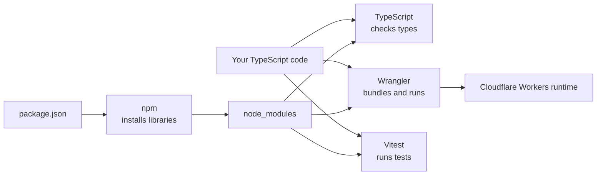

# Chapter 3 - Toolchain and Configuration

A *toolchain* is the set of programs that turn your source code into something that runs and is checked. This chapter explains each tool and each configuration file.



## 3.1 Node.js and npm

- **What:** *Node.js* runs JavaScript outside a browser. *npm* (Node Package Manager) comes with it and downloads libraries.
- **Why:** the development tools (TypeScript, Wrangler, Vitest) are themselves Node programs. Your Worker does **not** run on Node in production; Node is only the workbench.
- **Pattern:** *package management* - declare what you need, let a tool fetch exact versions.
- **Requirement:** Node.js 20 or newer (README).
- **Reference:** https://nodejs.org and https://docs.npmjs.com

Commands you will use:

| Command | What it does |
| --- | --- |
| `npm install` | Reads `package.json`, downloads dependencies into `node_modules/`. |
| `npm run typecheck` | Runs `tsc --noEmit` (checks types only). |
| `npm test` | Runs `vitest run` (all tests once). |
| `npm run test:watch` | Runs Vitest and reruns when files change. |
| `npm run dev` | Runs `wrangler dev` (local server on port 8787). |
| `npm run deploy` | Runs `wrangler deploy` (publishes). **Do not use for M1 stubs.** |
| `npx <tool>` | Runs a tool installed in this project without installing it globally. |

## 3.2 `package.json` field by field

```json
{
  "name": "exam-simulator-api",
  "version": "0.1.0",
  "private": true,
  "type": "module",
  "scripts": { ... },
  "dependencies": { ... },
  "devDependencies": { ... }
}
```

| Field | Meaning | Why |
| --- | --- | --- |
| `name`, `version` | Identity of the package. | Required metadata. |
| `private: true` | Never publish this to the public npm registry. | Prevents an accidental publish of a private project. |
| `type: "module"` | Files use modern ES module syntax (`import`/`export`). | Matches Workers and the tooling. |
| `scripts` | Named shortcuts for commands. | One memorable name instead of a long command. |
| `dependencies` | Libraries needed to *run* the Worker. | Bundled into the deployment. |
| `devDependencies` | Libraries needed only to *build/test*. | Not shipped to production. |

**Version ranges:** `^4.7.2` means "4.7.2 or any newer compatible 4.x version". The caret allows safe minor/patch updates but not a new major version, which could break things.

### The libraries

| Library | Type | What | Why here |
| --- | --- | --- | --- |
| `hono` | runtime | A small, fast web framework (router + helpers). | Routing, middleware, and context without writing it from scratch. |
| `zod` | runtime | Schema validation library. | Check untrusted input and keep types in sync (Chapter 4). |
| `@hono/zod-validator` | runtime | Glue between Hono and Zod. | Validate a request body in one line per route. |
| `typescript` | dev | The compiler/type checker. | Catch mistakes before runtime. |
| `wrangler` | dev | Cloudflare's CLI. | Run locally, bundle, deploy. |
| `@cloudflare/workers-types` | dev | Type definitions for Worker globals. | So TypeScript knows `Response`, `crypto`, etc. as Workers define them. |
| `vitest` | dev | Test runner. | Fast, TypeScript-friendly tests. |
| `@cloudflare/vitest-plugin` | dev | Runs Vitest inside the Workers runtime. | Test environment parity. |

- **Pattern:** *separation of runtime and development dependencies*; *library over framework glue*.
- **Note:** `package.json` is strict JSON and cannot hold comments, which is why this explanation lives in the docs.

## 3.3 TypeScript

- **What:** TypeScript is JavaScript plus *types*. You describe the shape of your data, and the compiler tells you when code does not match.
- **Why:** an API handles many shapes of data (requests, responses, settings). Types catch errors such as `entry.titel` (typo) or forgetting that `QUESTION_BANK_URL` may be missing, before the code ever runs.
- **Pattern:** *static typing / shift-left* (find bugs earlier, when they are cheaper).
- **Important:** TypeScript types **disappear at runtime**. They cannot check data arriving over the network. That is why Zod exists alongside it (Chapter 4).
- **Reference:** https://www.typescriptlang.org/docs/

Tiny TypeScript primer using this project's code:

```ts
// A type annotation: requestId must be text.
const requestId: string = crypto.randomUUID();

// An interface describes an object's shape.
interface AppBindings {
  QUESTION_BANK_URL?: string; // "?" means optional: could be undefined
}

// A union type: only these literal numbers are allowed.
function errorResponse(status: 400 | 401 | 404 | 500 | 503) { /* ... */ }

// An array of tuples: each item is exactly [string, string].
const queryEntries: [string, string][] = [];

// Optional chaining "?." safely reads a value that might be missing.
authorization?.startsWith("Bearer ");
```

### `tsconfig.json` option by option

| Option | Value | What it does | Why |
| --- | --- | --- | --- |
| `target` | `ES2022` | Which JavaScript version syntax to assume. | Workers support modern JavaScript. |
| `lib` | `["ES2022", "WebWorker"]` | Which built-in APIs exist. | Worker-like globals without browser-only DOM APIs. |
| `module` | `ESNext` | Keep `import`/`export` as is. | Wrangler bundles modules. |
| `moduleResolution` | `Bundler` | How import paths are resolved. | Matches how bundlers (Wrangler) work. |
| `strict` | `true` | Turns on all strict checks (no implicit `any`, null checks, etc.). | Strongest safety net; required by the project rules. |
| `noEmit` | `true` | Check only; do not write `.js` files. | Wrangler builds the real output. |
| `skipLibCheck` | `true` | Do not type-check libraries' declaration files. | Faster, avoids third-party noise. |
| `types` | workers-types, vitest/globals | Which global type packs to load. | Gives `Response`, `describe`, `it`, etc. |
| `allowImportingTsExtensions` | `true` | Allows `import ... from "./x.ts"`. | The project writes explicit `.ts` import paths. |
| `verbatimModuleSyntax` | `true` | Type-only imports must say `import type` / `type X`. | Makes it clear which imports vanish at build time. |
| `include` | folders | What gets checked. | App, shared contract, tests, Vitest config. |

You will see `type ApiErrorCode,` inside an import in `src/index.ts`: that is `verbatimModuleSyntax` at work.

## 3.4 Wrangler and `wrangler.jsonc`

- **What:** Wrangler is the Cloudflare Workers command-line tool.
- **Why:** it can run your Worker locally (`wrangler dev`), bundle it, and deploy it.
- **Reference:** https://developers.cloudflare.com/workers/wrangler/

```jsonc
{
  "$schema": "node_modules/wrangler/config-schema.json",
  "name": "exam-simulator-api-dev",
  "main": "src/index.ts",
  "compatibility_date": "2026-10-17",
  "workers_dev": true,
  "vars": { "QUESTION_BANK_URL": "https://drive.google.com/uc?export=download&id=REPLACE_WITH_FILE_ID" },
  "observability": { "enabled": true }
}
```

| Setting | Meaning |
| --- | --- |
| `$schema` | Lets your editor autocomplete and validate this file. |
| `name` | The Worker's name; `-dev` signals this is not production. |
| `main` | The entry file Cloudflare runs. |
| `compatibility_date` | Pins runtime behavior to a date so future Cloudflare changes do not silently alter your Worker. |
| `workers_dev` | Gives the Worker a `*.workers.dev` address for development deployments. |
| `vars` | Plain-text settings delivered as `context.env`. |
| `observability` | Turns on Cloudflare's built-in logs/metrics. |

**Pattern:** *pin your environment* (`compatibility_date`), *configuration as code*.

### Your to-do for the question-bank setting

Replace `REPLACE_WITH_FILE_ID` with the file ID of the JSON in Google Drive. Until then the route correctly returns 503, and the tests show how a missing/invalid URL is handled.

## 3.5 Vitest and `vitest.config.ts`

- **What:** Vitest runs your test files and reports pass/fail.
- **Why:** it understands TypeScript out of the box and is fast. The Cloudflare plugin runs tests in the Workers runtime, not plain Node.
- **Pattern:** *test environment parity*.
- **Config in plain words:** "Use the Cloudflare test plugin, read `wrangler.jsonc`, and run only `test/**/*.test.ts`."
- **Reference:** https://vitest.dev and https://developers.cloudflare.com/workers/testing/vitest-integration/

## 3.6 How the pieces connect: a worked example

You type `npm test`:

1. npm finds the script `test` = `vitest run` in `package.json`.
2. Vitest reads `vitest.config.ts`, sees the Cloudflare plugin, and loads `wrangler.jsonc`.
3. It starts a Workers-like runtime, loads `test/api.test.ts`, which imports `src/index.ts`, which imports the contract and catalog.
4. Each `it(...)` calls `app.request(...)` and asserts on the result.
5. Vitest prints how many tests passed.

You type `npm run typecheck`:

1. npm runs `tsc --noEmit`.
2. TypeScript reads `tsconfig.json`, loads every file in `include`, and reports type errors. No files are written.

## 3.7 Install, run, test (hands-on)

```powershell
Set-Location 'C:\Users\pramo\OneDrive\Desktop\RAM\ExamSimulatorApi'
npm install
npm run typecheck
npm test
npm run dev
```

With `npm run dev` running, open a second terminal:

```powershell
Invoke-RestMethod http://127.0.0.1:8787/api/health
```

Expected: an object with `status` = `ok`, `apiVersion` = `1`, and the current time.

## 3.8 Self-check questions

1. Which dependencies are shipped to production and which are not?
2. What does `^` mean in `"hono": "^4.7.2"`?
3. Why does the project need both TypeScript and Zod?
4. What would happen if you removed `compatibility_date`?
5. Why is `noEmit` true if the project is written in TypeScript?

Next: [Chapter 4 - The shared contract and Zod](04-shared-contract-and-zod.md)
