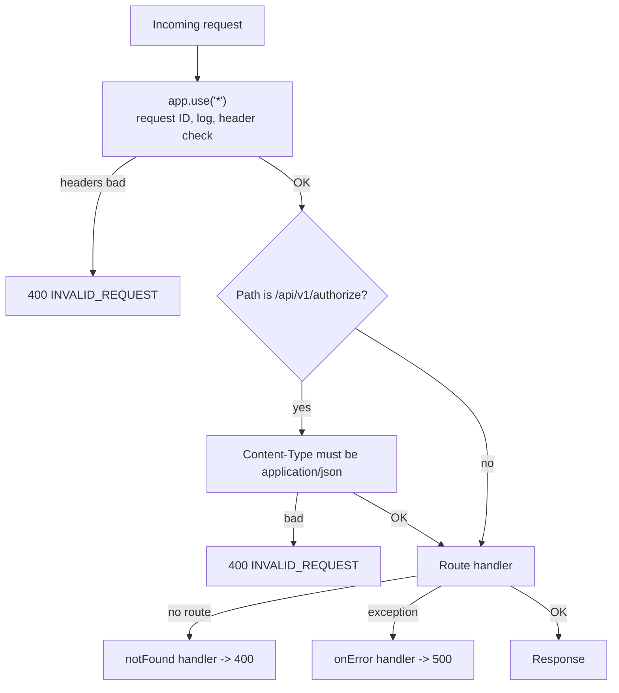

# Chapter 5 - The Worker, Line by Line

File: [src/index.ts](../../src/index.ts)

This chapter reads the file from top to bottom, in the order the code appears. The file already has a comment on every line; here we explain the reasoning behind each block.

## 5.1 Hono in one page

- **What:** Hono is a lightweight web framework built on web standards, designed for Workers and similar runtimes.
- **Why:** without a framework you would write code that inspects `request.method` and `request.url` and chooses what to do with a long chain of `if` statements. Hono gives you a *router*: you say "when a GET arrives at this path, run this function".
- **Pattern:** *router* + *middleware pipeline* + *context object*.
- **Reference:** https://hono.dev

Key ideas:

| Idea | Meaning |
| --- | --- |
| **Route** | `app.get("/path", handler)`: run `handler` for GET requests to `/path`. |
| **Handler** | A function that receives a `context` and returns a response. |
| **Context (`c`/`context`)** | One object per request: gives you `context.req` (the request), `context.json()` (make a JSON response), `context.get/set` (store per-request values), `context.env` (settings), `context.header()` (set a response header). |
| **Middleware** | A function registered with `app.use(...)` that runs *before* handlers. It calls `await next()` to continue the chain, or returns a response to stop. |
| **Generics** | `new Hono<{ Bindings: ...; Variables: ... }>()` tells TypeScript the types of `context.env` and `context.get/set`. |

## 5.2 The request pipeline at a glance



Order matters: middleware runs in the order registered. The header check runs before everything else, so an unknown route without the app headers gets the header error, not a not-found error.

## 5.3 Imports (top of file)

```ts
import { zValidator } from "@hono/zod-validator";
import { Hono } from "hono";
import { apiErrorCodeSchema, ..., questionBankResponseSchema, type ApiErrorCode } from "../shared/api-contract/index.ts";
import { findQuestionBank } from "./question-bank-catalog.ts";
```

- `import { x } from "pkg"` brings in a library export; `from "../shared/..."` brings in project code.
- `type ApiErrorCode` is a *type-only* import, required by `verbatimModuleSyntax`. It exists only for the compiler and is removed from the bundle.
- Notice the file ends in `.ts` - allowed by `allowImportingTsExtensions`.

## 5.4 Settings and per-request variables

```ts
interface AppBindings {
  QUESTION_BANK_URL?: string;
}

interface AppVariables {
  requestId: string;
}

const app = new Hono<{ Bindings: AppBindings; Variables: AppVariables }>();
```

| Name | What | Why |
| --- | --- | --- |
| `AppBindings` | The shape of `context.env`: settings given by Cloudflare. | The `?` honestly says "this may be missing", so TypeScript forces you to handle that. |
| `AppVariables` | Values *we* attach to one request using `context.set`. | The middleware stores `requestId`; handlers read it with `context.get("requestId")`. |
| `app` | The application object. | `export default app` hands it to Cloudflare. |

**Pattern:** *typed dependency/settings injection* - handlers receive settings through the context rather than reading global variables, which makes them testable (tests pass their own `env`).

## 5.5 `errorResponse` - one place to build errors

```ts
function errorResponse(code: ApiErrorCode, message: string, requestId: string,
                       status: 400 | 401 | 404 | 500 | 503): Response {
  return Response.json({ error: { code, message, requestId } }, { status });
}
```

- **What:** a helper that builds the standard error envelope from Chapter 4.
- **Why:** every failure must look identical. If each route hand-wrote its error JSON, small differences would creep in.
- **Pattern:** *factory function* and *DRY*.
- **Details:**
  - `code: ApiErrorCode` - you can only pass a valid error code; a typo is a compile error.
  - `status: 400 | 401 | ...` - a *union of literals*: only those statuses compile. When we added 404 and 503 for the question-bank route, this list was extended.
  - `Response.json(body, init)` - web-standard way to produce a JSON response with a chosen status.
  - `message` must be safe: no secrets, no stack traces, no internal paths.

## 5.6 The global middleware

```ts
app.use("*", async (context, next) => {
  const requestId = crypto.randomUUID();
  context.set("requestId", requestId);
  context.header("X-Request-Id", requestId);
  ...
  await next();
});
```

`"*"` matches every path. Step by step:

1. **Create a request ID.** `crypto.randomUUID()` yields something like `3f2c...-...`. It is random, not secret, and unique per request.
2. **Store it** with `context.set` so later code can read it.
3. **Return it** in the `X-Request-Id` response header. If a student reports an error, the ID in the error body or header lets you find the exact log line.
4. **Read the version header** safely:

   ```ts
   const appVersion = context.req.header("X-App-Version")?.trim().slice(0, 64) || "unknown";
   ```
   - `?.` avoids a crash if the header is missing.
   - `.trim()` removes spaces; `.slice(0, 64)` caps the length so an attacker cannot stuff a huge value into your logs (*log injection / log flooding* defense).
   - `|| "unknown"` provides a fallback.
5. **Validate the platform** with `platformSchema.safeParse(...)` before logging it:

   ```ts
   platform: platform.success ? platform.data : "unknown"
   ```
   Untrusted text is never logged raw. Only a known-good value or `"unknown"` appears.
6. **Log one structured line** (`JSON.stringify({...})`). Structured logs are easy to search. Notice what is **not** logged: email, tokens, device keys, bodies.
7. **Enforce required headers** for everything except health:

   ```ts
   if (context.req.path !== "/api/health") {
     if (!context.req.header("X-App-Version")?.trim() || !platform.success) {
       return context.json({ error: { code: "INVALID_REQUEST", ... } }, 400);
     }
   }
   ```
   Returning a response here **short-circuits** the pipeline: no route runs.
8. **`await next()`** passes control to the next middleware or the route handler.

**Patterns:** *middleware* / *chain of responsibility*, *correlation ID*, *structured logging*, *input sanitization before logging*, *guard clause* (check and exit early).

**Why `await next()` is needed:** if a middleware neither returns a response nor calls `next()`, the request never reaches the route.

## 5.7 The route-specific middleware

```ts
app.use("/api/v1/authorize", async (context, next) => {
  const contentType = context.req.header("Content-Type")?.split(";")[0]?.trim().toLowerCase();
  if (contentType !== "application/json") { return errorResponse(...400); }
  await next();
});
```

- Applies only to that path.
- `"application/json; charset=utf-8"` is valid too, so the code takes the part before `;`, trims, and lowercases it.
- **Why before the validator:** the JSON validator would try to parse the body; checking the declared type first gives a clearer error.

## 5.8 Route 1: `GET /api/health`

```ts
app.get("/api/health", (context) => {
  const response = healthResponseSchema.parse({ status: "ok", apiVersion: "1", time: new Date().toISOString() });
  return context.json(response);
});
```

- **What:** a liveness check: "is the Worker answering?"
- **Why:** monitoring tools and developers need a cheap call with no auth and no dependencies.
- **Pattern:** *health check endpoint*; *validate your own output* (`parse` ensures an accidental code change cannot break the documented shape).

## 5.9 Route 2: `POST /api/v1/authorize` (stub)

```ts
app.post(
  "/api/v1/authorize",
  zValidator("json", authorizeRequestSchema, (result, context) => {
    if (!result.success) { return errorResponse("INVALID_REQUEST", "Request validation failed.", ..., 400); }
  }),
  (context) => {
    const response = authorizeM1ResponseSchema.parse({ status: "stub", entitlements: [] });
    return context.json(response);
  },
);
```

- A route can have several functions: the **validator** runs first, then the **handler**.
- The validator's third argument is a *hook* that runs on failure; returning a response replaces Zod's default output, so Zod's detailed messages (which reveal internals) never reach the client.
- The handler ignores the body entirely in M1. It returns the fixed stub.
- **Pattern:** *validate at the boundary* - untrusted input is checked at the edge; code behind it can trust it.

## 5.10 Route 3: `GET /api/v1/content/version` (stub)

This route is the template that the question-bank route copies. Study its steps:

1. **Bearer presence check**
   ```ts
   const authorization = context.req.header("Authorization");
   if (!authorization?.startsWith("Bearer ") || !authorization.slice(7).trim()) {
     return errorResponse("LEASE_INVALID", "A bearer lease is required.", requestId, 401);
   }
   ```
   - `"Bearer "` has 7 characters, so `slice(7)` is the token part.
   - It only checks that *something* is there. It does **not** verify a signature. Real lease verification arrives in a later milestone.
2. **Collect query parameters** into a list and convert to an object with `Object.fromEntries`.
3. **Validate** with `safeParse`; reject extras (strict schema).
4. **Build and validate the stub response** echoing `examCode` and `mode`.

## 5.11 Route 4: `GET /api/v1/content/question-bank` (new)

```ts
app.get("/api/v1/content/question-bank", (context) => {
  // 1. auth header check            -> 401 LEASE_INVALID
  // 2. query validation             -> 400 INVALID_REQUEST
  // 3. catalog lookup               -> 404 PACKAGE_NOT_FOUND
  // 4. build + validate response    -> 503 UPSTREAM_UNAVAILABLE if URL bad
  // 5. return JSON                  -> 200
});
```

The order of these checks is deliberate: cheapest and most general first, most specific last. Each early `return` is a *guard clause*, keeping the "happy path" flat and readable at the bottom.

Key lines:

```ts
const entry = findQuestionBank(parsedQuery.data.examCode, parsedQuery.data.mode);
if (!entry) { return errorResponse("PACKAGE_NOT_FOUND", "No question bank is available.", requestId, 404); }
```

`findQuestionBank` returns `undefined` when nothing matches. TypeScript forces the `if (!entry)` check before you use `entry.exam`; that is *null safety* at work.

```ts
const result = questionBankResponseSchema.safeParse({
  apiVersion: 1,
  exam: entry.exam,
  file: { url: context.env.QUESTION_BANK_URL, sizeBytes: entry.sizeBytes, sha256: entry.sha256 },
});
if (!result.success) {
  return errorResponse("UPSTREAM_UNAVAILABLE", "Question bank is temporarily unavailable.", requestId, 503);
}
return context.json(result.data);
```

- The URL comes from **settings** (`context.env`), the rest from the **catalog**.
- Validation is used as a *runtime configuration check*: if the URL is missing, not `https`, or not a Google host, `safeParse` fails and the API answers with a calm 503 instead of sending a bad link.
- A failure here is the **server's** fault, not the client's, hence 5xx and not 4xx.
- `result.data` is the validated, trimmed data, safe to send.

### Known limitation to discuss

The bearer check is only a presence check. Anyone who sends `Authorization: Bearer anything` receives the URL. That is acceptable for M1 wiring tests and unacceptable in production. See Chapter 8.

## 5.12 The not-found handler

```ts
app.notFound((context) => errorResponse("INVALID_REQUEST", "Route not found.", context.get("requestId"), 400));
```

Without this, an unknown path would produce a framework default (often plain text or HTML). A JSON envelope keeps the client logic simple. The project uses `INVALID_REQUEST` because the agreed vocabulary has no `NOT_FOUND` code. (An improvement to propose during contract review: a dedicated not-found code and a 404 status.)

## 5.13 The error handler

```ts
app.onError((_error, context) =>
  errorResponse("INTERNAL_ERROR", "An unexpected error occurred.", context.get("requestId"), 500));
```

If any code throws, Hono calls this. The thrown error (`_error`) is **deliberately ignored**, so stack traces, SQL messages, or provider details cannot leak. The leading underscore is a convention for "unused parameter".

**Pattern:** *global exception handler* / *fail safe*.

## 5.14 Exports

```ts
export { app };
export default app;
```

- `export default app` - Cloudflare calls this as the Worker. A Hono app has the required `fetch` method.
- `export { app }` - the tests import it by name and call `app.request(...)` without starting a server.

## 5.15 A request, traced end to end

Request: `GET /api/v1/content/question-bank?examCode=AZ-305&mode=prep` with the three headers and a bearer.

1. Cloudflare calls the Worker; Hono matches the route table.
2. Global middleware: create ID, log, headers valid, `next()`.
3. No route-specific middleware matches.
4. Handler: bearer present; query valid; catalog entry found; URL valid; build response.
5. `context.json(result.data)` -> status 200 with `X-Request-Id` header.

If you remove `X-Platform`, the flow stops at step 2 with 400. If you ask for `examCode=NOPE`, it stops at step 4 with 404.

## 5.16 Self-check questions

1. What happens if a middleware forgets to call `next()` and does not return a response?
2. Why are Zod's error details not returned to the client?
3. Why does the Content-Type check split on `;`?
4. Why is the missing-URL case 503 and not 400?
5. Why does the header check come before 404 handling?

## 5.17 Exercises

1. Add a `GET /api/v1/ping` route that requires app headers and returns `{ "pong": true }`. Add a Zod schema in the contract and a test.
2. Make the notFound handler return status 404 and observe which test needs to change.

Next: [Chapter 6 - The question-bank download feature](06-question-bank-feature.md)
