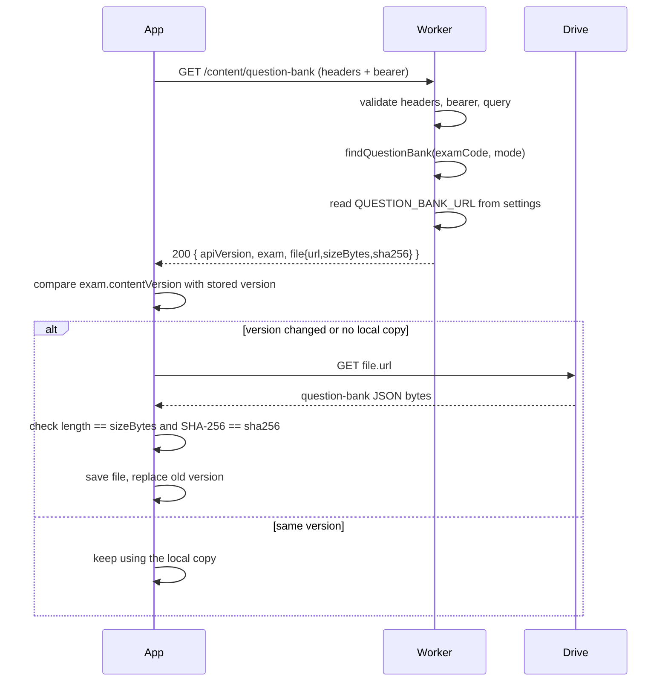

# Chapter 6 - The Question-Bank Download Feature

Files involved:

- [src/index.ts](../../src/index.ts) - the route
- [src/question-bank-catalog.ts](../../src/question-bank-catalog.ts) - the metadata
- [shared/api-contract/index.ts](../../shared/api-contract/index.ts) - the response schema
- [wrangler.jsonc](../../wrangler.jsonc) - the Drive URL setting
- `d:\ExamSimulation\worker\src\data\question-bank.sample.json` - the sample data (outside this repository)

## 6.1 The requirement

> "If we put this JSON in Google Drive, the API should just give the URL of the file path to the app, and the app will download it, to reduce the response size."

## 6.2 What / Why / Pattern / Reference

- **What:** a route `GET /api/v1/content/question-bank?examCode=...&mode=...` that returns a small JSON document: exam details, plus the file's download URL, size, and SHA-256 hash.
- **Why:**
  - The question bank is about 33 KB for 50 questions and will grow with more questions and more exams. Sending it in every API call wastes bandwidth and Worker time.
  - The app only needs the data when the content version changes, so a small "what's the latest and where is it" answer is enough.
  - Cloudflare Workers have limits on CPU time and response handling; Drive is built for file storage.
  - Updating questions becomes a *content* operation (replace the file, update the catalog) rather than a *code deployment*.
- **Pattern:** *claim check / reference instead of payload*; *metadata-then-download* (a two-step fetch); *integrity verification* using a cryptographic hash; *separation of control plane and data plane* (the API decides who gets what - the control plane; Drive carries the bytes - the data plane).
- **Reference:**
  - Claim Check pattern: https://learn.microsoft.com/azure/architecture/patterns/claim-check
  - SHA-256: https://developer.mozilla.org/docs/Web/API/SubtleCrypto/digest

## 6.3 The data flow



## 6.4 The response, explained

```json
{
  "apiVersion": 1,
  "exam": {
    "code": "AZ-305",
    "title": "AZ-305 Practice Question Bank",
    "contentVersion": "1.1.0",
    "mode": "prep"
  },
  "file": {
    "url": "https://drive.google.com/uc?export=download&id=<FILE_ID>",
    "sizeBytes": 33471,
    "sha256": "7afcb321c83d379d5320a9e6e5d30de54f229f9fb392f8a740ecd5f833a236da"
  }
}
```

The `exam` block mirrors the `exam` object at the top of the question-bank file itself. The two must agree: the catalog says `1.1.0` and the file says `"contentVersion": "1.1.0"`. If they differ, the app could download one version while believing it is another.

## 6.5 The catalog module

```ts
interface QuestionBankEntry {
  exam: { code: string; title: string; contentVersion: string; mode: ContentMode };
  sizeBytes: number;
  sha256: string;
}

const catalog: QuestionBankEntry[] = [ { exam: {...}, sizeBytes: 33471, sha256: "..." } ];

export function findQuestionBank(examCode: string, mode: ContentMode): QuestionBankEntry | undefined {
  return catalog.find((entry) => entry.exam.code === examCode && entry.exam.mode === mode);
}
```

- `Array.find` returns the first matching item or `undefined`.
- Return type `QuestionBankEntry | undefined` makes callers handle "not found".
- **Why not export `catalog` directly?** Hiding the list behind a function means callers do not care whether the data later comes from an array, a file, or a database.

### Why size and hash live in the catalog, not computed on the fly

The Worker does not read the Drive file (that would defeat the purpose and need credentials). So these facts are recorded when the file is published. This is a **manual step** you must repeat after every file change.

## 6.6 The setting: `QUESTION_BANK_URL`

In `wrangler.jsonc`:

```jsonc
"vars": {
  "QUESTION_BANK_URL": "https://drive.google.com/uc?export=download&id=REPLACE_WITH_FILE_ID"
}
```

Currently there is one URL for the single sample bank. When you add more exams, you will need one URL per catalog entry. Two reasonable evolutions:

1. Put the URL (or just the Drive file ID) inside each catalog entry.
2. Store a JSON map in one variable, keyed by `examCode:mode`.

Option 1 is simpler to read; option 2 keeps all deployment-specific data out of code. See Exercise 2 at the end of this chapter.

## 6.7 Publishing a question bank: step-by-step runbook

1. **Finish the JSON.** Validate it is well-formed JSON (open it in VS Code; errors show in red).
2. **Compute size and hash** (PowerShell):

   ```powershell
   $f = 'd:\ExamSimulation\worker\src\data\question-bank.sample.json'
   (Get-Item $f).Length
   (Get-FileHash $f -Algorithm SHA256).Hash.ToLower()
   ```
   `.ToLower()` matters because the contract requires lowercase hex.
3. **Upload to Google Drive.** Right-click > Share > General access: "Anyone with the link" (Viewer).
4. **Get the file ID.** In a share link `https://drive.google.com/file/d/<FILE_ID>/view?usp=sharing`, the part between `/d/` and `/view` is the ID.
5. **Build the direct-download URL:** `https://drive.google.com/uc?export=download&id=<FILE_ID>`.
6. **Update `QUESTION_BANK_URL`** in `wrangler.jsonc` (or the dashboard variable).
7. **Update the catalog:** `sizeBytes`, `sha256`, and `contentVersion` (increase it when questions change).
8. **Run** `npm run typecheck` and `npm test`.
9. **Smoke-test** with the request in `backend/api-tests/m1.http`.
10. **Download the URL yourself** (PowerShell `Invoke-WebRequest <url> -OutFile test.json`) and re-hash it to confirm it matches the catalog.

> Important: Drive link behavior (for example, confirmation pages for large files or download quotas) is controlled by Google and can change. Check Google's current documentation, and test the real URL from the real app before relying on it.

## 6.8 What the app must do (client-side steps)

Pseudocode for the app:

```text
1. Call GET /api/v1/content/question-bank with headers + bearer.
2. If status != 200: show a message based on error.code. Stop.
3. If response.exam.contentVersion == savedVersion and local file exists: use local file. Stop.
4. Download response.file.url (HTTPS GET, follow redirects).
5. If byteLength != response.file.sizeBytes: discard, retry later.
6. Compute SHA-256 of the bytes. If it != response.file.sha256 (compare lowercase): discard, report integrity error.
7. Parse JSON, check apiVersion == 1, and check exam.code/mode match what was requested.
8. Write to a temporary file, then atomically rename it over the old file.
9. Save contentVersion.
```

JavaScript example for step 6 (works in browsers and Workers):

```ts
async function sha256Hex(bytes: ArrayBuffer): Promise<string> {
  const digest = await crypto.subtle.digest("SHA-256", bytes);
  return [...new Uint8Array(digest)].map((b) => b.toString(16).padStart(2, "0")).join("");
}
```

Step 8 matters: writing to a temp file and renaming means a crash mid-download never corrupts the working copy (*atomic replace* pattern).

## 6.9 What is a hash, and why verify it?

- **What:** a hash function turns any data into a fixed-size fingerprint. SHA-256 outputs 256 bits, written as 64 hex characters. Change one character of the input and the hash changes completely.
- **Why:** the download travels over networks and through a third party (Drive). The hash proves the bytes the app received are exactly the bytes you published: no truncation, no corruption, no tampering.
- **Pattern:** *integrity check* / *checksum*.
- **Important:** a hash only proves integrity if the hash itself arrives from a trusted source. Here it comes from your API over HTTPS, separate from Drive, which is exactly why this design is useful.

## 6.10 Error behavior of this route

| Situation | Status | `error.code` |
| --- | --- | --- |
| Missing app headers | 400 | `INVALID_REQUEST` |
| No bearer header | 401 | `LEASE_INVALID` |
| Missing/invalid `examCode` or `mode`, or extra parameters | 400 | `INVALID_REQUEST` |
| No catalog entry for that exam and mode | 404 | `PACKAGE_NOT_FOUND` |
| `QUESTION_BANK_URL` missing, not `https`, or not a Google host | 503 | `UPSTREAM_UNAVAILABLE` |
| Unexpected exception | 500 | `INTERNAL_ERROR` |

## 6.11 Design alternatives (and why this one was chosen)

| Option | Pros | Cons |
| --- | --- | --- |
| Return the whole JSON in the response | Simplest; one call. | Large responses; costs Worker time on every call; harder to cache. |
| **Return a Drive URL (this project)** | Tiny response; file hosted for free; easy content updates. | Public link means anyone with it can download; Drive limits and behavior outside your control; manual hash maintenance. |
| Stream the file through the Worker | Can enforce auth on every byte; hides storage. | Needs Drive credentials, more code, more Worker usage; planned for later milestones. |
| Cloudflare R2 + signed URLs | Time-limited links; same platform. | Needs R2 setup; not requested. |

## 6.12 Limits and risks

1. **The link is public.** Anyone who obtains it can read the file, including the `answer` and `explanation` fields. A static `vars` URL is the same for every user. If answers must be protected, use time-limited signed URLs, stream through the Worker after a real lease check, or encrypt the file (the requirements' key-release design).
2. **No real authorization yet.** Any non-empty bearer works (M1).
3. **Stale hash/size.** If you replace the Drive file and forget the catalog, apps fail integrity checks (which is the safe failure).
4. **Drive is not a CDN.** Quotas and interstitial pages can affect downloads at scale.
5. **Project rule:** the project instructions say not to add Drive *access* in M1. This feature only returns a configured URL; the API never calls Drive and holds no Drive credentials.

## 6.13 Self-check questions

1. Why is the size and hash stored in the catalog?
2. What happens to the app if the catalog's `sha256` is uppercase? (Hint: schema.)
3. Which party decides the file is intact, and with what evidence?
4. Why is a bad `QUESTION_BANK_URL` a 503 and not a 500?
5. Name two ways the design could be hardened for production.

## 6.14 Exercises

1. Add a second exam `SC-900` (prep) to the catalog. What breaks? (Hint: one URL setting.)
2. Move the URL into each catalog entry as a `driveFileId` and build the URL in code. Update tests.
3. Write a script (PowerShell) that prints a ready-to-paste catalog entry from a JSON file path.
4. Add a `contentVersion` query parameter so the app can ask "do I already have the latest?" and receive `304`-style behavior (design the response in the contract first).

Next: [Chapter 7 - Testing](07-testing.md)
