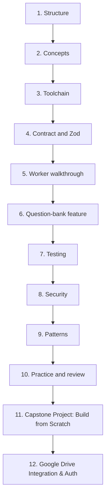

# Chapter 10 - Exercises, Troubleshooting, Glossary, and References

## 10.1 Learning roadmap



## 10.2 Progressive exercises

Do these in order. After each one, run `npm run typecheck` and `npm test`.

### Level 1 - Read and explain
1. Open `src/index.ts` and write, in your own words, what each of the four routes does.
2. List every HTTP status code the API can return and the situation that causes it.
3. Draw the dependency arrows between the five source and test files.

### Level 2 - Small changes
4. Change the catalog `title` of AZ-305 and update the matching test.
5. Add `"web"` to the allowed platforms. Find every place that must change (contract, tests, docs, `m1.http`).
6. Add `GET /api/v1/ping` returning `{ "pong": true }` with a contract schema and test.

### Level 3 - New behavior
7. Add a second catalog entry (for example `SC-900` / `prep`). Decide how to handle its Drive URL (see Chapter 6.6). Add tests for both exams.
8. Add a `releaseNotes` optional string to `exam` (contract, catalog, route, tests).
9. Change not-found to return HTTP 404 with a new `NOT_FOUND` error code. List all affected tests and documents.

### Level 4 - Design
10. Design (on paper) a `lease` response for `authorize`. Which fields, which expiry, what must be signed? Check the requirements document before inventing anything. The project rule says to resolve open decisions against the shared contract first.
11. Design the response for a version-check call so the app can skip the download when it already has the latest content.
12. Write a threat model for the question-bank route and propose two mitigations.

### Level 5 - Operations
13. Create a free Cloudflare account and deploy to a **development** Worker (not production) with a real Drive URL. Test from the app emulator. Record what you had to configure.
14. Look at Cloudflare's logs for a request and find a request ID from an error response.

## 10.3 Troubleshooting guide

| Symptom | Likely cause | Fix |
| --- | --- | --- |
| `npm` is not recognized | Node.js not installed or not on PATH | Install Node 20+, restart the terminal. |
| `npm run dev` fails to start | Port in use or Wrangler not installed | Run `npm install`; close the other process using 8787. |
| Every call returns 400 "Required app headers are missing or invalid." | `X-App-Version` or `X-Platform` missing/wrong | Send both; platform must be `android`, `ios`, or `windows`. |
| 400 "Content-Type must be application/json." | Wrong content type on `authorize` | Send `Content-Type: application/json`. |
| 401 `LEASE_INVALID` | No `Authorization: Bearer <value>` | Add the header with a non-empty value. |
| 400 "Query validation failed." | Missing `examCode`/`mode`, wrong mode, or extra parameters | Send exactly `examCode` and `mode=exam|prep`. |
| 404 `PACKAGE_NOT_FOUND` | Exam/mode not in the catalog | Use `AZ-305` + `prep`, or add the entry. |
| 503 `UPSTREAM_UNAVAILABLE` | `QUESTION_BANK_URL` missing, not https, or not a Google host | Fix the setting in `wrangler.jsonc`. |
| Type error: "implicitly has type any" | `strict` mode working as intended | Add a type annotation. |
| `import type` error mentioning `verbatimModuleSyntax` | A type imported without `type` | Write `import { type X }` or `import type { X }`. |
| App says hash mismatch | Catalog hash stale, uppercase, or the app hashed a Drive HTML page | Recompute (lowercase). Check the download is the real JSON, not a confirmation page. |
| Test passes locally but you changed settings | Tests inject their own `env` | Remember tests do not read your real `vars`. |
| Zod rejects `sha256` | Uppercase or wrong length | `Get-FileHash ... .Hash.ToLower()`; must be 64 characters. |

## 10.4 Glossary

| Term | Meaning |
| --- | --- |
| **API** | A defined way for one program to ask another to do something. |
| **Allow-list** | A list of the only permitted values. |
| **Bearer token** | A credential sent in the `Authorization` header; whoever holds it is trusted. |
| **Binding** | A resource or setting attached to a Worker (variables, secrets, databases). |
| **Bundle** | The single combined file produced for deployment. |
| **Claim check** | Sending a reference to data instead of the data. |
| **Client** | The program making requests (the Exam Simulator app). |
| **Compatibility date** | A date that fixes the Worker runtime's behavior. |
| **Context** | Hono's per-request object (`context`). |
| **Contract** | The exact agreed format of requests and responses. |
| **Correlation ID** | An identifier linking a response to log entries. |
| **D1** | Cloudflare's SQL database (not used in M1). |
| **Dependency** | A library your code uses. |
| **devDependency** | A library used only for development/testing. |
| **Edge** | Servers located near users. |
| **Endpoint / Route** | A URL + method the API answers. |
| **Entitlement** | A permission to access a specific exam/mode (future). |
| **Envelope** | A standard wrapper around data (here, errors). |
| **Guard clause** | An early `return` for an invalid situation. |
| **Handler** | A function that answers a route. |
| **Header** | Metadata attached to a request or response. |
| **Hash / SHA-256** | A fixed-size fingerprint of data. |
| **Hono** | The web framework used. |
| **HTTP** | The protocol of the web. |
| **Isolate** | A lightweight sandbox in which a Worker runs. |
| **JSON** | A text data format. |
| **Lease** | A short-lived, signed permission to use content offline (future). |
| **M1** | Milestone 1: stubs only. |
| **Middleware** | A function that runs before route handlers. |
| **Mode** | `exam` or `prep`. |
| **npm** | Node's package manager. |
| **Observability** | Logs, metrics, and traces for understanding a running system. |
| **Parse** | Convert/check raw data into a trusted typed value. |
| **Query string** | `?key=value&...` part of a URL. |
| **REST** | A resource-oriented web API style. |
| **Router** | Component that maps URL + method to a handler. |
| **Schema** | A description of a data shape used for validation. |
| **Secret** | A sensitive configuration value, stored encrypted. |
| **Serverless** | Running code without managing servers. |
| **Stub** | A fixed placeholder implementation. |
| **Strict mode (TypeScript)** | The strongest set of type checks. |
| **Strict object (Zod)** | An object schema that rejects unknown keys. |
| **Ticket** | A short-lived, single-use permission for key release (future). |
| **Type guard / narrowing** | Code that proves a value's type, e.g. `if (!entry)`. |
| **Union type** | A type that is one of several options. |
| **Vitest** | The test runner. |
| **Worker** | A Cloudflare serverless program. |
| **Wrangler** | Cloudflare's command-line tool. |
| **Zod** | The validation library. |

## 10.5 Command cheat sheet

```powershell
# Setup
npm install

# Daily loop
npm run typecheck
npm test
npm run dev

# File facts for the catalog
(Get-Item 'path\to\file.json').Length
(Get-FileHash 'path\to\file.json' -Algorithm SHA256).Hash.ToLower()

# Try the API (server running)
Invoke-RestMethod http://127.0.0.1:8787/api/health
$h = @{ 'X-App-Version'='0.1.0'; 'X-Platform'='android'; Authorization='Bearer m1-placeholder' }
Invoke-RestMethod 'http://127.0.0.1:8787/api/v1/content/question-bank?examCode=AZ-305&mode=prep' -Headers $h
```

## 10.6 Where to go after M1

From `MANUAL-API-CONFIGURATION-AND-INTEGRATION.md`, the production work still remaining:

- Approved-student lookup, rate limits, one-active-device rule.
- Real signed leases (ES256), key rotation, renewal.
- D1 schema and migrations; entitlements; package metadata; audit retention.
- Tickets and Drive service-account access; streaming downloads with digest verification.
- Single-use key release and the key-wrapping format.
- Production configuration, secret management, admin scripts, end-to-end tests with the real app.

Each of these will use the same habits learned in this book: define the contract first, validate at the boundary, keep errors safe, log carefully, and test unhappy paths.

## 10.7 Reference library

### Official documentation
- Cloudflare Workers: https://developers.cloudflare.com/workers/
- Wrangler configuration: https://developers.cloudflare.com/workers/wrangler/configuration/
- Workers Vitest integration: https://developers.cloudflare.com/workers/testing/vitest-integration/
- Hono: https://hono.dev
- Zod: https://zod.dev
- TypeScript Handbook: https://www.typescriptlang.org/docs/handbook/intro.html
- TSConfig reference: https://www.typescriptlang.org/tsconfig
- Vitest: https://vitest.dev
- MDN HTTP: https://developer.mozilla.org/docs/Web/HTTP
- MDN `fetch`, `Request`, `Response`: https://developer.mozilla.org/docs/Web/API/Fetch_API
- Node.js: https://nodejs.org/docs
- npm: https://docs.npmjs.com

### Security
- OWASP Top 10: https://owasp.org/www-project-top-ten/
- OWASP API Security Top 10: https://owasp.org/API-Security/
- OWASP Logging Cheat Sheet: https://cheatsheetseries.owasp.org/cheatsheets/Logging_Cheat_Sheet.html

### Patterns and design
- Claim Check pattern: https://learn.microsoft.com/azure/architecture/patterns/claim-check
- Twelve-Factor App (config): https://12factor.net/config
- REST API design guidance: https://learn.microsoft.com/azure/architecture/best-practices/api-design

### Project documents
- `README.md` - quick start and the M1 boundary.
- `MANUAL-API-CONFIGURATION-AND-INTEGRATION.md` - connecting the app, what remains.
- `.github/copilot-instructions.md` - project rules.
- Parent folder: `3.Exam Simulator API Requirements.txt` - the authoritative requirements.

## 10.8 Final review quiz

1. Name the four steps of how every concept is taught in this book.
2. In which file is each of these: the Drive URL setting, the response schema, the route, the exam title?
3. Explain why the API returns a URL and not the questions, and list two drawbacks.
4. Why must `sha256` be lowercase, and how do you generate it?
5. Trace a request through the middleware chain to a 200 and to a 404.
6. What is the difference between `parse` and `safeParse`, and where is each used?
7. What does `.strict()` protect against?
8. Name five things that must never be logged.
9. Why do tests pass their own `env`?
10. List three things that must change before this can be used in production.

Congratulations: finishing this book means you can read, run, test, extend, and review every part of this project.
