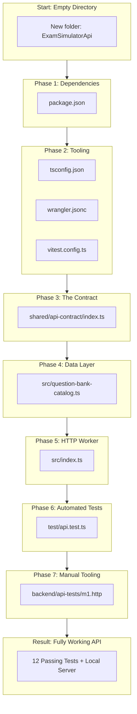

# Chapter 11 - Capstone Project: Build ExamSimulatorApi from Scratch

This chapter is the **hands-on capstone project**. You will start with an **empty directory** on your machine and build the entire `ExamSimulatorApi` project step by step, phase by phase.

By the end of this chapter, you will have built the complete, working project with your own hands, with strict TypeScript, Hono routing, Zod contracts, all 4 routes, safe structured logging, and all 12 passing automated tests.

Every phase follows the **What and Why** approach:
- **What:** What you are doing, which files you are creating, and the exact code.
- **Why:** Why this decision was made, why this pattern was chosen, and what problem it prevents.
- **Checkpoint:** The exact command to run and the expected output so you know you are on track.

---

## 11.1 Project Overview & Architecture Blueprint



---

## Phase 0: Workspace & Tool Prerequisites

### What
You need Node.js (version 20 or newer), npm, Windows PowerShell (or your terminal), and VS Code.

### Why
- **Node.js 20+:** Required for modern ECMAScript features and modern package ecosystem support.
- **Wrangler / TypeScript / Vitest:** These are Node-based development tools that build, check, and test your Cloudflare Worker before deployment.

### Hands-on Step 0.1: Check your tools
Open PowerShell and run:

```powershell
node --version
npm --version
```

If `node --version` shows `v20.x.x` or higher, you are ready.

### Hands-on Step 0.2: Create an empty project directory
```powershell
# Navigate to where you want to store your project
Set-Location 'C:\Users\pramo\OneDrive\Desktop\RAM' # (or your chosen path)
New-Item -ItemType Directory -Name 'ExamSimulatorApi-Capstone' -Force
Set-Location 'ExamSimulatorApi-Capstone'
```

---

## Phase 1: Project Initialization & Dependency Manifest (`package.json`)

### What
Create `package.json` with project metadata, execution scripts, runtime dependencies (`hono`, `zod`, `@hono/zod-validator`), and development dependencies (`typescript`, `wrangler`, `vitest`, `@cloudflare/vitest-plugin`, `@cloudflare/workers-types`).

### Why
- **`"private": true`:** Prevents accidental publishing of private code to the public npm registry.
- **`"type": "module"`:** Uses standard ES modules (`import`/`export`) required by modern Workers.
- **Separation of dependencies:** Runtime libraries are bundled into the Worker; development tools are kept on your computer only.
- **Shortcuts in `"scripts"`:** Team members run `npm test` and `npm run dev` instead of memorizing long flags.

### Hands-on Step 1.1: Create `package.json`
Create a file named `package.json` in the root of your project:

```json
{
  "name": "exam-simulator-api",
  "version": "0.1.0",
  "private": true,
  "type": "module",
  "scripts": {
    "dev": "wrangler dev",
    "test": "vitest run",
    "test:watch": "vitest",
    "typecheck": "tsc --noEmit",
    "deploy": "wrangler deploy"
  },
  "dependencies": {
    "@hono/zod-validator": "^0.7.2",
    "hono": "^4.7.2",
    "zod": "^3.24.2"
  },
  "devDependencies": {
    "@cloudflare/vitest-plugin": "^1.4.4",
    "@cloudflare/workers-types": "^5.20261016.1",
    "typescript": "^5.7.3",
    "vitest": "^4.1.12",
    "wrangler": "^4.2.0"
  }
}
```

### Hands-on Step 1.2: Install dependencies
Run in PowerShell:
```powershell
npm install
```

### Checkpoint 1
Check that `node_modules/` folder and `package-lock.json` file now exist in your directory.

---

## Phase 2: Compiler & Toolchain Configuration

### What
Create the configuration files that govern how TypeScript compiles, how Wrangler runs the Worker, and how Vitest executes tests.

### Why
- **`tsconfig.json` (`strict: true`, `noEmit: true`):** Enforces TypeScript's strictest rules to catch bugs at compile time. Cloudflare Workers have no DOM, so we target `ES2022` and `WebWorker` libs.
- **`wrangler.jsonc` (`compatibility_date`, `vars`):** Cloudflare requires a configuration file to know what entry point to run (`src/index.ts`), how old runtime behavior should be pinned (`compatibility_date`), and what environment variables (`vars`) to supply.
- **`vitest.config.ts`:** Tells Vitest to run tests using `@cloudflare/vitest-plugin`, guaranteeing tests run in the real Worker isolate environment instead of plain Node.js.

### Hands-on Step 2.1: Create `tsconfig.json`
Create `tsconfig.json` in the project root:

```json
{
  "compilerOptions": {
    "target": "ES2022",
    "lib": ["ES2022", "WebWorker"],
    "module": "ESNext",
    "moduleResolution": "Bundler",
    "strict": true,
    "noEmit": true,
    "skipLibCheck": true,
    "types": ["@cloudflare/workers-types", "vitest/globals"],
    "allowImportingTsExtensions": true,
    "verbatimModuleSyntax": true
  },
  "include": ["src/**/*.ts", "shared/**/*.ts", "test/**/*.ts", "vitest.config.ts"]
}
```

### Hands-on Step 2.2: Create `wrangler.jsonc`
Create `wrangler.jsonc` in the project root:

```jsonc
{
  "$schema": "node_modules/wrangler/config-schema.json",
  "name": "exam-simulator-api-dev",
  "main": "src/index.ts",
  "compatibility_date": "2026-10-17",
  "workers_dev": true,
  "vars": {
    "QUESTION_BANK_URL": "https://drive.google.com/uc?export=download&id=REPLACE_WITH_FILE_ID"
  },
  "observability": {
    "enabled": true
  }
}
```

### Hands-on Step 2.3: Create `vitest.config.ts`
Create `vitest.config.ts` in the project root:

```ts
import { cloudflareTest } from "@cloudflare/vitest-plugin";
import { defineConfig } from "vitest/config";

export default defineConfig({
  plugins: [
    cloudflareTest({
      wrangler: { configPath: "./wrangler.jsonc" },
    }),
  ],
  test: {
    include: ["test/**/*.test.ts"],
  },
});
```

### Checkpoint 2
Verify that the configuration files are syntactically valid by running:
```powershell
npm run typecheck
```
*(It will report zero errors or a note about no inputs if directories don't exist yet, but won't crash on invalid JSON).*

---

## Phase 3: The Contract-First Foundation (`shared/api-contract/index.ts`)

### What
Create the shared contract using Zod schemas for platforms, content modes, error codes, error envelopes, authorization requests, query parameters, health responses, and the question-bank pointer response.

### Why
- **Contract-first architecture:** Defining the data schema before writing server logic guarantees both the API and client app agree on every field name and type.
- **`z.infer`:** Generates TypeScript types automatically from Zod schemas so types and validation rules never go out of sync.
- **`.strict()`:** Rejects untrusted or smuggled fields.
- **Host allow-list:** Restricts the download URL to trusted Google Drive hostnames.

### Hands-on Step 3.1: Create directory & file
Run in PowerShell:
```powershell
New-Item -ItemType Directory -Path 'shared\api-contract' -Force
```

Now create `shared/api-contract/index.ts`:

```ts
import { z } from "zod"; // Zod schemas validate both incoming requests and API response fixtures.

// These are the only platform labels accepted in the app's X-Platform header.
export const platformSchema = z.enum(["android", "ios", "windows"]);
// Exam and Prep are the two business modes named in the API requirements.
export const contentModeSchema = z.enum(["exam", "prep"]);

// Keep the full agreed error vocabulary in one place so clients do not invent variants.
export const apiErrorCodeSchema = z.enum([
  "INVALID_REQUEST", // The request body, query, or required header is invalid.
  "LEASE_INVALID", // A supplied lease is invalid or missing on a protected route.
  "LEASE_EXPIRED", // A lease has passed its permitted validity interval.
  "NOT_AUTHORIZED", // The student is unknown or revoked; those cases must not be distinguished.
  "ACCESS_EXPIRED", // The student's separately managed access validity has ended.
  "NOT_ENTITLED", // The student lacks entitlement to the requested exam or mode.
  "PACKAGE_NOT_FOUND", // No active package exists for the assigned exam/mode/version.
  "DEVICE_LIMIT_REACHED", // The student already has a different active device.
  "DEVICE_KEY_MISMATCH", // A known device ID is presented with a different public key.
  "VERSION_NOT_ASSIGNED", // The requested package version differs from the assigned version.
  "TICKET_ALREADY_USED", // A one-time key-release ticket has already been redeemed.
  "TICKET_INVALID", // A ticket is unknown, expired, or cancelled.
  "RATE_LIMITED", // The caller exceeded an endpoint rate limit.
  "UPSTREAM_UNAVAILABLE", // A required upstream service could not complete the request.
  "INTERNAL_ERROR", // A safe catch-all for unexpected server failures.
]);

// Define the standard JSON error envelope; strict objects reject undocumented fields.
export const apiErrorSchema = z
  .object({
    error: z
      .object({
        code: apiErrorCodeSchema, // Machine-readable value used by client-side error mapping.
        message: z.string(), // Safe display text that must not reveal implementation details.
        requestId: z.string().min(1), // Correlation value for support logs.
      })
      .strict(), // Reject undocumented properties in the nested error object.
  })
  .strict(); // Reject undocumented top-level properties too.

// Describe exactly what the M1 authorization stub accepts from a client.
export const authorizeRequestSchema = z
  .object({
    email: z.string().trim().email().max(320), // Normalize surrounding whitespace and require an email-shaped value.
    deviceId: z.string().min(1).max(128), // Require a bounded, non-empty client device identifier.
    devicePublicKey: z.string().min(1).max(2048), // Accept the encoded public key; M1 does not cryptographically inspect it.
  })
  .strict(); // Reject client-supplied fields such as unrestricted exam or version choices.

// Define the intentionally non-production response returned by M1 authorization.
export const authorizeM1ResponseSchema = z
  .object({
    status: z.literal("stub"), // Makes placeholder behavior explicit to client developers.
    entitlements: z.tuple([]), // M1 grants no exams and returns no lease.
  })
  .strict(); // Prevent accidental production-looking fields from being added silently.

// Validate only the query keys documented for the optional content-version endpoint.
export const contentVersionQuerySchema = z
  .object({
    examCode: z.string().min(1).max(64), // Identifies the requested exam using a bounded code.
    mode: contentModeSchema, // Restricts the request to the documented Exam or Prep mode.
  })
  .strict(); // Reject unknown query parameter names.

// Define the M1 placeholder response separately from any future production response.
export const contentVersionM1ResponseSchema = z
  .object({
    status: z.literal("stub"), // States that this is not a package-assignment decision.
    examCode: z.string(), // Echoes the validated request value for client wiring tests.
    mode: contentModeSchema, // Echoes the validated requested mode.
  })
  .strict(); // Reject package fields until their final shared contract is agreed.

// Hosts allowed to serve the question-bank file so a bad config cannot point the app elsewhere.
const questionBankHosts = ["drive.google.com", "drive.usercontent.google.com", "docs.google.com"]; // Only these web addresses (hostnames) are trusted.

// Describe the download pointer returned instead of the full question bank.
export const questionBankResponseSchema = z // A Zod schema checks that data has exactly the shape we expect.
  .object({ // The response must be a JSON object.
    apiVersion: z.literal(1), // Matches the apiVersion field inside the question-bank file.
    exam: z // The "exam" property describes which question bank this is.
      .object({ // The exam property is itself an object.
        code: z.string().min(1), // Exam identifier, for example AZ-305.
        title: z.string().min(1), // Display title of the question bank.
        contentVersion: z.string().min(1), // Version the app compares with its cached copy.
        mode: contentModeSchema, // Exam or Prep content mode.
      }) // End of the exam object definition.
      .strict(), // Reject any extra, undocumented properties inside exam.
    file: z // The "file" property tells the app where to download the questions.
      .object({ // The file property is also an object.
        url: z // The download address must pass every check below.
          .string() // It must be text.
          .url() // It must look like a valid web address.
          .refine((value) => { // Add our own custom rule on top of the built-in checks.
            const parsed = new URL(value); // Split the address into parts such as protocol and hostname.
            return parsed.protocol === "https:" && questionBankHosts.includes(parsed.hostname); // Must be secure (https) and on a trusted host.
          }, "Download URL must be an https Google Drive URL."), // Message used when the custom rule fails.
        sizeBytes: z.number().int().positive(), // Lets the app show progress and sanity-check the download.
        sha256: z.string().regex(/^[0-9a-f]{64}$/), // 64 lowercase hex characters; lets the app verify file integrity after download.
      }) // End of the file object definition.
      .strict(), // Reject any extra, undocumented properties inside file.
  }) // End of the top-level object definition.
  .strict(); // Reject any extra, undocumented top-level properties.

// Validate the public health payload and require a UTC-compatible ISO date string.
export const healthResponseSchema = z
  .object({
    status: z.literal("ok"), // Indicates the Worker can answer a health request.
    apiVersion: z.literal("1"), // Identifies the current API version.
    time: z.string().datetime({ offset: true }), // Requires an ISO 8601 timestamp with timezone information.
  })
  .strict(); // Keep the health response minimal and stable.

// Derive TypeScript types from the schemas so runtime validation and compile-time types stay aligned.
export type ApiErrorCode = z.infer<typeof apiErrorCodeSchema>; // Canonical set of API error identifiers.
export type ApiError = z.infer<typeof apiErrorSchema>; // Standard JSON error body shape.
export type AuthorizeRequest = z.infer<typeof authorizeRequestSchema>; // Authorization request body shape.
export type AuthorizeM1Response = z.infer<typeof authorizeM1ResponseSchema>; // M1-only authorization response shape.
export type ContentMode = z.infer<typeof contentModeSchema>; // Supported exam content modes.
export type ContentVersionM1Response = z.infer<typeof contentVersionM1ResponseSchema>; // M1-only version response shape.
export type HealthResponse = z.infer<typeof healthResponseSchema>; // Public health response shape.
export type QuestionBankResponse = z.infer<typeof questionBankResponseSchema>; // Question-bank download pointer shape.
```

### Checkpoint 3
Run typecheck to verify the contract has zero syntax or type errors:
```powershell
npm run typecheck
```

---

## Phase 4: The Question-Bank Metadata Catalog (`src/question-bank-catalog.ts`)

### What
Create the repository module that encapsulates question-bank metadata (code, title, version, mode, byte size, and SHA-256 hash).

### Why
- **Repository pattern:** Keeps data lookup isolated from HTTP routing.
- **Claim-check data integrity:** Stores the expected SHA-256 fingerprint so the client application can verify that the downloaded file from Google Drive has not been modified or corrupted.

### Hands-on Step 4.1: Create directory & file
Run in PowerShell:
```powershell
New-Item -ItemType Directory -Path 'src' -Force
```

Now create `src/question-bank-catalog.ts`:

```ts
import type { ContentMode } from "../shared/api-contract/index.ts"; // Reuse the shared "exam" | "prep" type (type-only import, erased at build time).

interface QuestionBankEntry { // Describes the details we store for one question-bank file.
  exam: { code: string; title: string; contentVersion: string; mode: ContentMode }; // Which exam this is and which version of its content.
  sizeBytes: number; // File size in bytes, so the app can check the download.
  sha256: string; // Fingerprint of the file, so the app can detect a corrupted or changed download.
} // End of the entry description.

// Update sizeBytes and sha256 whenever the file on Drive is replaced, or app integrity checks will fail.
const catalog: QuestionBankEntry[] = [ // The list of all question banks this API knows about.
  { // First (and currently only) entry.
    exam: { // Exam details shown to the app.
      code: "AZ-305", // Exam identifier the app sends in the examCode query parameter.
      title: "AZ-305 Practice Question Bank", // Human-readable name.
      contentVersion: "1.1.0", // Version of the question content; change it when the questions change.
      mode: "prep", // This bank is for practice (prep) mode.
    }, // End of exam details.
    sizeBytes: 33471, // Size of question-bank.sample.json in bytes.
    sha256: "7afcb321c83d379d5320a9e6e5d30de54f229f9fb392f8a740ecd5f833a236da", // SHA-256 hash of question-bank.sample.json.
  }, // End of the AZ-305 entry.
]; // End of the catalog list.

// Find the entry matching an exam code and mode; returns undefined when none matches.
export function findQuestionBank(examCode: string, mode: ContentMode): QuestionBankEntry | undefined { // Exported so src/index.ts can use it.
  return catalog.find((entry) => entry.exam.code === examCode && entry.exam.mode === mode); // Return the first entry where both code and mode match.
} // End of the lookup function.
```

### Checkpoint 4
Run typecheck:
```powershell
npm run typecheck
```

---

## Phase 5: The Core Worker Implementation (`src/index.ts`)

### What
Create the Cloudflare Worker entry point using Hono. This implements:
1. `AppBindings` and `AppVariables` types.
2. The `errorResponse()` factory.
3. Global middleware (`*`) for request ID generation, structured logging, and header validation (`X-App-Version`, `X-Platform`).
4. Route-specific middleware for `/api/v1/authorize` requiring `Content-Type: application/json`.
5. `GET /api/health`: public health probe.
6. `POST /api/v1/authorize`: input-validated M1 stub.
7. `GET /api/v1/content/version`: query-validated M1 version stub with bearer check.
8. `GET /api/v1/content/question-bank`: metadata lookup, setting validation, and claim-check pointer response.
9. `app.notFound()` and `app.onError()` handlers.

### Why
- **Front Controller:** One entry point processes all requests.
- **Middleware pipeline:** Cross-cutting concerns (request correlation, app header verification, log sanitization) execute before any route handler runs.
- **Fail-safe logging:** Never logs PII, passwords, complete tokens, or device keys.
- **Safe error envelope:** Never returns HTML or stack traces to callers.

### Hands-on Step 5.1: Create `src/index.ts`
Create `src/index.ts`:

```ts
import { zValidator } from "@hono/zod-validator"; // Connects Zod schemas to Hono route validation.
import { Hono } from "hono"; // Provides the router and typed request context used by this Worker.
import {
  apiErrorCodeSchema, // Supplies the canonical error-code vocabulary shared with the client.
  authorizeM1ResponseSchema, // Validates the deliberately limited M1 authorization stub.
  authorizeRequestSchema, // Validates the JSON fields accepted by the authorization route.
  contentVersionM1ResponseSchema, // Validates the deliberately limited M1 version response.
  contentVersionQuerySchema, // Validates required version query parameters and rejects extras.
  healthResponseSchema, // Ensures the public health response has the documented shape.
  platformSchema, // Limits platform headers to the supported client platforms.
  questionBankResponseSchema, // Validates the download pointer returned for a question bank.
  type ApiErrorCode, // Gives error responses a compile-time checked shared code.
} from "../shared/api-contract/index.ts";
import { findQuestionBank } from "./question-bank-catalog.ts"; // Metadata for question-bank files hosted on Drive.

// Worker bindings; the Drive download URL is configuration, not code.
interface AppBindings { // Describes the settings Cloudflare gives the Worker at runtime.
  QUESTION_BANK_URL?: string; // Public Google Drive download URL of the question-bank JSON (the ? means it may be missing).
} // End of the settings description.

// Hono stores per-request values in this typed variable map.
interface AppVariables {
  requestId: string; // Correlates a response with its safe operational log entry.
}

// Create the router with the request-ID variable available to every route.
const app = new Hono<{ Bindings: AppBindings; Variables: AppVariables }>();

// Build the common safe JSON error envelope used by route and framework errors.
function errorResponse(
  code: ApiErrorCode, // The canonical machine-readable error identifier.
  message: string, // A safe description that must not expose secrets or internals.
  requestId: string, // The ID also emitted in the response header and request log.
  status: 400 | 401 | 404 | 500 | 503, // Only statuses used by this API are accepted here.
): Response {
  // Keep the response envelope consistent with the shared contract.
  return Response.json(
    {
      error: {
        code, // Lets the application handle the error without parsing prose.
        message, // Gives the caller a safe, human-readable explanation.
        requestId, // Allows support staff to correlate this failure with logs.
      },
    },
    { status }, // Set the HTTP status independently of the JSON error body.
  );
}

// Run common request setup and header checks before any API route handler.
app.use("*", async (context, next) => {
  const requestId = crypto.randomUUID(); // Generate a non-secret identifier for this request.
  context.set("requestId", requestId); // Make the identifier available to later handlers.
  context.header("X-Request-Id", requestId); // Return it in a response header for diagnostics.

  // Bound the logged version value and use a fallback so malformed headers cannot create huge log entries.
  const appVersion = context.req.header("X-App-Version")?.trim().slice(0, 64) || "unknown";
  const platformHeader = context.req.header("X-Platform"); // Read the platform supplied by the native app.
  const platform = platformSchema.safeParse(platformHeader); // Validate before writing the value to logs.
  // Log only request metadata; never include email, device keys, leases, or request bodies.
  console.info(
    JSON.stringify({
      event: "api_request", // Names the structured log event for filtering.
      requestId, // Supports safe error-to-log correlation.
      appVersion, // Captures the caller version required by the API requirements.
      platform: platform.success ? platform.data : "unknown", // Avoids logging invalid platform input.
    }),
  );

  // Health is public and intentionally does not depend on client headers or D1.
  if (context.req.path !== "/api/health") {
    // Every other app route must identify its app version and supported platform.
    if (!context.req.header("X-App-Version")?.trim() || !platform.success) {
      // Stop before route logic and use the standard safe error envelope.
      return context.json(
        {
          error: {
            code: apiErrorCodeSchema.enum.INVALID_REQUEST, // Use the shared request-validation code.
            message: "Required app headers are missing or invalid.", // Do not echo untrusted header values.
            requestId, // Preserve correlation even when rejecting before routing.
          },
        },
        400, // Missing or unsupported required headers are client request errors.
      );
    }
  }

  // Continue through the route chain after common checks succeed.
  await next();
});

// Require JSON specifically on authorization because its request body is a JSON contract.
app.use("/api/v1/authorize", async (context, next) => {
  // Ignore optional parameters such as charset, and compare the media type case-insensitively.
  const contentType = context.req.header("Content-Type")?.split(";")[0]?.trim().toLowerCase();
  // Reject other formats before asking the JSON validator to parse the body.
  if (contentType !== "application/json") {
    return errorResponse(
      "INVALID_REQUEST", // Identify the contract violation with a stable code.
      "Content-Type must be application/json.", // Explain the required request representation.
      context.get("requestId"), // Keep the response linked to the request log.
      400, // A media type mismatch is a malformed client request.
    );
  }
  // The content type is valid, so allow the body validator and route to run.
  await next();
});

// Public liveness endpoint: do not read D1 or require app-specific headers here.
app.get("/api/health", (context) => {
  // Validate the response too, so accidental edits cannot silently break its contract.
  const response = healthResponseSchema.parse({
    status: "ok", // Indicates that the Worker process can answer requests.
    apiVersion: "1", // Identifies the current API route family version.
    time: new Date().toISOString(), // Reports the current UTC time in ISO 8601 format.
  });
  // Return the validated health payload as JSON with the default success status.
  return context.json(response);
});

// M1 authorization route validates input but does not perform real authorization.
app.post(
  "/api/v1/authorize",
  // Reject malformed bodies and unknown properties before the handler runs.
  zValidator("json", authorizeRequestSchema, (result, context) => {
    // Convert all schema failures into a generic safe response rather than exposing Zod internals.
    if (!result.success) {
      return errorResponse(
        "INVALID_REQUEST", // Use the shared error code for invalid request content.
        "Request validation failed.", // Keep detailed schema issues out of the public response.
        context.res.headers.get("X-Request-Id") ?? crypto.randomUUID(), // Reuse the middleware ID when available.
        400, // Invalid JSON shape or field values are client errors.
      );
    }
  }),
  // This handler is intentionally a fixed stub until a later milestone implements student lookup and leases.
  (context) => {
    // Validate the fixed response against the M1-only shared schema.
    const response = authorizeM1ResponseSchema.parse({
      status: "stub", // Makes it explicit that this is not a real authorization decision.
      entitlements: [], // The stub grants no exam access and avoids inventing student data.
    });
    // Return the M1 payload; no lease is issued or implied.
    return context.json(response);
  },
);

// M1 content-version route checks bearer-header presence but does not validate a lease.
app.get("/api/v1/content/version", (context) => {
  const requestId = context.get("requestId"); // Reuse the ID created by the common middleware.
  const authorization = context.req.header("Authorization"); // Read the required protected-route header.
  // This presence check is only a stub boundary; it does not verify a JWT or device binding.
  if (!authorization?.startsWith("Bearer ") || !authorization.slice(7).trim()) {
    // Keep the protected-route behavior visible without pretending that real auth exists.
    return errorResponse("LEASE_INVALID", "A bearer lease is required.", requestId, 401);
  }

  // Collect every query pair so the strict Zod object can reject unknown parameter names.
  const queryEntries: [string, string][] = [];
  // URLSearchParams.forEach works with the Worker TypeScript libraries used in this project.
  new URL(context.req.url).searchParams.forEach((value, key) => {
    // Preserve each key/value pair for schema validation.
    queryEntries.push([key, value]);
  });
  // Object.fromEntries produces the plain object expected by the query schema.
  const parsedQuery = contentVersionQuerySchema.safeParse(Object.fromEntries(queryEntries));
  // Reject missing, invalid, or additional query fields before building the response.
  if (!parsedQuery.success) {
    // Do not expose validator internals; the caller receives a stable safe error.
    return errorResponse("INVALID_REQUEST", "Query validation failed.", requestId, 400);
  }

  // Validate the M1-only response shape while echoing the requested identifiers for wiring tests.
  const response = contentVersionM1ResponseSchema.parse({
    status: "stub", // Marks this as placeholder metadata, not an assigned package result.
    examCode: parsedQuery.data.examCode, // Echoes the validated exam requested by the client.
    mode: parsedQuery.data.mode, // Echoes the validated mode requested by the client.
  });
  // Return only the stub values; no entitlement or package availability is asserted.
  return context.json(response);
});

// Return a small pointer to the question-bank file on Drive so the app downloads it directly.
app.get("/api/v1/content/question-bank", (context) => { // Runs when the app sends GET to this path.
  const requestId = context.get("requestId"); // Read the ID the common middleware created for this request.
  const authorization = context.req.header("Authorization"); // Read the Authorization header sent by the app.
  // Reject when the header is missing, does not start with "Bearer ", or has an empty value after it.
  if (!authorization?.startsWith("Bearer ") || !authorization.slice(7).trim()) {
    return errorResponse("LEASE_INVALID", "A bearer lease is required.", requestId, 401); // Reply 401 (not authenticated) and stop.
  } // End of the authorization check.

  const queryEntries: [string, string][] = []; // Empty list that will hold each ?key=value pair from the address.
  new URL(context.req.url).searchParams.forEach((value, key) => { // Loop over every query parameter in the request address.
    queryEntries.push([key, value]); // Save the pair so it can be validated below.
  }); // End of the loop.
  const parsedQuery = contentVersionQuerySchema.safeParse(Object.fromEntries(queryEntries)); // Check examCode and mode without throwing an error.
  if (!parsedQuery.success) { // The query was missing a field, had a bad value, or had extra fields.
    return errorResponse("INVALID_REQUEST", "Query validation failed.", requestId, 400); // Reply 400 (bad request) and stop.
  } // End of the query check.

  const entry = findQuestionBank(parsedQuery.data.examCode, parsedQuery.data.mode); // Look up the question-bank details for this exam and mode.
  if (!entry) { // Nothing is registered for the requested exam and mode.
    return errorResponse("PACKAGE_NOT_FOUND", "No question bank is available.", requestId, 404); // Reply 404 (not found) and stop.
  } // End of the lookup check.

  const result = questionBankResponseSchema.safeParse({ // Build the response and validate it before sending.
    apiVersion: 1, // Version of the question-bank format.
    exam: entry.exam, // Exam code, title, content version and mode from the catalog.
    file: { url: context.env.QUESTION_BANK_URL, sizeBytes: entry.sizeBytes, sha256: entry.sha256 }, // Drive URL from settings plus size and hash from the catalog.
  }); // End of the response being validated.
  // A missing or non-Drive URL is a server configuration problem, not a client error.
  if (!result.success) { // The URL setting is missing or is not an https Google Drive address.
    return errorResponse("UPSTREAM_UNAVAILABLE", "Question bank is temporarily unavailable.", requestId, 503); // Reply 503 (service unavailable) and stop.
  } // End of the response check.
  return context.json(result.data); // Send the validated pointer to the app as JSON with status 200.
}); // End of the question-bank route.

// Give unknown routes a safe shared error instead of a framework-generated HTML response.
app.notFound((context) =>
  // This codebase uses INVALID_REQUEST as its current shared not-found error representation.
  errorResponse("INVALID_REQUEST", "Route not found.", context.get("requestId"), 400),
);

// Hide unexpected exception details and expose only a request-correlated safe error.
app.onError((_error, context) =>
  // Never serialize stack traces, SQL errors, or upstream provider details to the client.
  errorResponse("INTERNAL_ERROR", "An unexpected error occurred.", context.get("requestId"), 500),
);

export { app }; // Expose the Hono app so tests can exercise routes without starting a server.
export default app; // Wrangler uses this default export as the Worker entry point.
```

### Checkpoint 5
Run typecheck:
```powershell
npm run typecheck
```
It should finish cleanly with zero errors.

---

## Phase 6: Automated Test Suite (`test/api.test.ts`)

### What
Create the complete 12-test automated test suite in `test/api.test.ts`.

### Why
- **In-memory testing:** `app.request()` tests the application directly without spinning up a network socket.
- **Dependency injection testing:** Injects fake test URLs (`driveUrl`) through the third `env` parameter of `app.request()` so tests are 100% deterministic and isolated.
- **Contract guarantees:** Tests both positive scenarios (200 OK) and negative security boundaries (400, 401, 404, 503).

### Hands-on Step 6.1: Create directory & file
Run in PowerShell:
```powershell
New-Item -ItemType Directory -Path 'test' -Force
```

Now create `test/api.test.ts`:

```ts
import { describe, expect, it } from "vitest"; // Supplies the test grouping and assertion functions.
import { app } from "../src/index.ts"; // Import the router directly so tests need no running server.

// Reuse the required app identity headers for requests to business endpoints.
const appHeaders = {
  "X-App-Version": "0.1.0", // Represents the version of the app making this test request.
  "X-Platform": "android", // Uses one of the supported platform labels.
};

// Group behavior checks for the intentionally limited M1 routes.
describe("M1 API stubs", () => {
  // Prove health is public and does not require app headers or a database binding.
  it("serves health without app headers or a database", async () => {
    // Hono's in-memory request helper invokes the route without opening a port.
    const response = await app.request("/api/health");
    // Treat parsed JSON as unknown until assertions inspect the expected fields.
    const body: unknown = await response.json();

    // Health should be a successful response and include its correlation header.
    expect(response.status).toBe(200);
    expect(response.headers.get("X-Request-Id")).toBeTruthy();
    // Check the stable health fields while leaving the timestamp value dynamic.
    expect(body).toMatchObject({ status: "ok", apiVersion: "1" });
    // Confirm the time looks like an ISO timestamp returned by the Worker.
    expect((body as { time: string }).time).toMatch(/^\d{4}-\d{2}-\d{2}T/);
  });

  // Ensure business routes reject callers that omit either required app header.
  it("rejects missing required app headers", async () => {
    // Send a structurally valid body but omit X-App-Version and X-Platform.
    const response = await app.request("/api/v1/authorize", {
      method: "POST",
      headers: { "Content-Type": "application/json" },
      body: JSON.stringify({
        email: "student@example.com", // Supply an email-shaped value for request validation.
        deviceId: "device-1", // Supply a non-empty test device identifier.
        devicePublicKey: "public-key", // Supply a placeholder; M1 does not inspect its cryptography.
      }),
    });

    // The request fails at shared header validation and uses the standard error code.
    expect(response.status).toBe(400);
    await expect(response.json()).resolves.toMatchObject({
      error: { code: "INVALID_REQUEST" },
    });
  });

  // Check both authorization request validation and its explicit stub result.
  it("validates authorization input and returns an explicit M1 stub", async () => {
    // Send the documented JSON shape with all required app headers.
    const response = await app.request("/api/v1/authorize", {
      method: "POST",
      headers: { ...appHeaders, "Content-Type": "application/json" },
      body: JSON.stringify({
        email: "student@example.com", // Email must pass Zod's email validation.
        deviceId: "device-1", // Identifies the requesting device in the contract.
        devicePublicKey: "public-key", // Placeholder public-key text for this non-cryptographic milestone.
      }),
    });

    // The route succeeds as a stub and grants no access or lease.
    expect(response.status).toBe(200);
    await expect(response.json()).resolves.toEqual({ status: "stub", entitlements: [] });
  });

  // Protect the contract from silently accepting client-selected business fields.
  it("rejects unknown authorization fields", async () => {
    // Add an exam choice that is not in the authorization request schema.
    const response = await app.request("/api/v1/authorize", {
      method: "POST",
      headers: { ...appHeaders, "Content-Type": "application/json" },
      body: JSON.stringify({
        email: "student@example.com", // Valid baseline identity input.
        deviceId: "device-1", // Valid baseline device input.
        devicePublicKey: "public-key", // Valid placeholder public key.
        examCode: "UNTRUSTED", // Unknown field must be rejected rather than trusted.
      }),
    });

    // Strict Zod object validation should reject the extra examCode field.
    expect(response.status).toBe(400);
    await expect(response.json()).resolves.toMatchObject({
      error: { code: "INVALID_REQUEST" },
    });
  });

  // Enforce the documented JSON media type before parsing authorization input.
  it("requires JSON content type for authorization", async () => {
    // The body resembles JSON but is sent with an incorrect declared media type.
    const response = await app.request("/api/v1/authorize", {
      method: "POST",
      headers: { ...appHeaders, "Content-Type": "text/plain" },
      body: "{}",
    });

    // The request is rejected without attempting normal authorization processing.
    expect(response.status).toBe(400);
  });

  // Verify the protected-route boundary and the M1-only response behavior.
  it("requires a bearer header and returns only an M1 version stub", async () => {
    // A protected route without an Authorization header must fail.
    const missingLease = await app.request(
      "/api/v1/content/version?examCode=DEMO&mode=exam",
      { headers: appHeaders },
    );
    // The stub reports the absent bearer as a lease-related error.
    expect(missingLease.status).toBe(401);

    // Any non-empty bearer value passes M1 presence checking; it is not verified as a token.
    const response = await app.request(
      "/api/v1/content/version?examCode=DEMO&mode=exam",
      { headers: { ...appHeaders, Authorization: "Bearer m1-placeholder" } },
    );

    // The response echoes validated parameters and explicitly identifies itself as a stub.
    expect(response.status).toBe(200);
    await expect(response.json()).resolves.toEqual({
      status: "stub",
      examCode: "DEMO",
      mode: "exam",
    });
  });

  // Confirm the mode enum prevents unsupported business values.
  it("rejects invalid content version queries", async () => {
    // 'unknown' is not one of the allowed 'exam' or 'prep' modes.
    const response = await app.request(
      "/api/v1/content/version?examCode=DEMO&mode=unknown",
      { headers: { ...appHeaders, Authorization: "Bearer m1-placeholder" } },
    );

    // Invalid query values must not reach response construction.
    expect(response.status).toBe(400);
  });

  // Confirm the strict query schema rejects undocumented parameter names.
  it("rejects unknown content version query parameters", async () => {
    // The extra query parameter is intentionally outside the shared contract.
    const response = await app.request(
      "/api/v1/content/version?examCode=DEMO&mode=exam&unexpected=value",
      { headers: { ...appHeaders, Authorization: "Bearer m1-placeholder" } },
    );

    // Strict parsing returns the normal safe invalid-request error.
    expect(response.status).toBe(400);
    await expect(response.json()).resolves.toMatchObject({
      error: { code: "INVALID_REQUEST" },
    });
  });
});

describe("question-bank download pointer", () => { // Groups the tests for the new endpoint.
  const url = "/api/v1/content/question-bank?examCode=AZ-305&mode=prep"; // A valid request address reused by the tests.
  const headers = { ...appHeaders, Authorization: "Bearer m1-placeholder" }; // App headers plus a placeholder bearer value.
  const driveUrl = "https://drive.google.com/uc?export=download&id=abc123"; // A fake but valid-looking Drive URL for testing.

  it("returns metadata and the Drive URL instead of the questions", async () => { // Happy path: everything is valid.
    const response = await app.request(url, { headers }, { QUESTION_BANK_URL: driveUrl }); // Call the route; the 3rd argument supplies the setting.

    expect(response.status).toBe(200); // The request should succeed.
    await expect(response.json()).resolves.toEqual({ // The JSON body must match exactly.
      apiVersion: 1, // Format version.
      exam: { // Exam details from the catalog.
        code: "AZ-305", // Requested exam code.
        title: "AZ-305 Practice Question Bank", // Catalog title.
        contentVersion: "1.1.0", // Catalog content version.
        mode: "prep", // Requested mode.
      }, // End of exam details.
      file: { // Download information.
        url: driveUrl, // The URL we supplied as the setting.
        sizeBytes: 33471, // Size from the catalog.
        sha256: "7afcb321c83d379d5320a9e6e5d30de54f229f9fb392f8a740ecd5f833a236da", // Hash from the catalog.
      }, // End of download information.
    }); // End of the body check.
  }); // End of the happy-path test.

  it("requires a bearer header", async () => { // Calling without Authorization must fail.
    const response = await app.request(url, { headers: appHeaders }, { QUESTION_BANK_URL: driveUrl }); // Send the request without the bearer header.
    expect(response.status).toBe(401); // 401 means the caller is not authenticated.
  }); // End of the bearer test.

  it("returns 404 for an exam without a question bank", async () => { // Unknown exam codes must be reported clearly.
    const response = await app.request( // Send a request for an exam that is not in the catalog.
      "/api/v1/content/question-bank?examCode=NOPE&mode=prep", // NOPE is not a registered exam.
      { headers }, // Valid headers so only the exam code is wrong.
      { QUESTION_BANK_URL: driveUrl }, // Valid URL setting.
    ); // End of the request.
    expect(response.status).toBe(404); // 404 means not found.
    await expect(response.json()).resolves.toMatchObject({ error: { code: "PACKAGE_NOT_FOUND" } }); // The error code must name the cause.
  }); // End of the 404 test.

  it("returns 503 when the URL is missing or not a Google Drive https URL", async () => { // Bad server configuration must not leak a bad URL.
    const missing = await app.request(url, { headers }, {}); // No QUESTION_BANK_URL setting at all.
    expect(missing.status).toBe(503); // 503 means the service is temporarily unavailable.

    const wrongHost = await app.request(url, { headers }, { QUESTION_BANK_URL: "https://evil.example.com/x.json" }); // A URL on a non-Google host.
    expect(wrongHost.status).toBe(503); // The untrusted host must also be refused.
  }); // End of the configuration test.
}); // End of the question-bank test group.
```

### Checkpoint 6: Run the full test suite
Execute in PowerShell:
```powershell
npm test
```
**Expected output:**
```text
 Test Files  1 passed (1)
      Tests  12 passed (12)
```
All 12 tests pass!

---

## Phase 7: Manual Tooling & Interactive Testing (`backend/api-tests/m1.http`)

### What
Create the REST Client file for manual API testing from VS Code.

### Why
- **Executable documentation:** Gives developers an immediate set of live requests they can run with a single click.

### Hands-on Step 7.1: Create directory & file
Run in PowerShell:
```powershell
New-Item -ItemType Directory -Path 'backend\api-tests' -Force
```

Now create `backend/api-tests/m1.http`:

```http
# Base URL for Wrangler's local development server.
@baseUrl = http://127.0.0.1:8787
# App version and platform headers required by all non-health routes.
@appVersion = 0.1.0
@platform = android

### Health is public and does not depend on D1
# No app headers or authorization are needed for this liveness check.
GET {{baseUrl}}/api/health

### M1 authorize stub (does not authenticate students or issue a real lease)
# This route validates the request shape but always returns the fixed M1 stub.
POST {{baseUrl}}/api/v1/authorize
# Tell the Worker the body is JSON so the request passes its media-type check.
Content-Type: application/json
# Identify the client build and platform as required by the API.
X-App-Version: {{appVersion}}
X-Platform: {{platform}}

# The body has only the required contract fields: email, deviceId, and devicePublicKey.
# The values below are placeholders because M1 does not look up students or use device keys.
{
  "email": "student@example.com",
  "deviceId": "device-1",
  "devicePublicKey": "base64-p256-public-key-placeholder"
}

### M1 content-version stub (bearer presence only; no lease verification)
# Use a temporary local placeholder; it is not a credential and must not be used in production.
GET {{baseUrl}}/api/v1/content/version?examCode=DEMO&mode=exam
# M1 checks only that a non-empty Bearer value is present.
Authorization: Bearer m1-placeholder
# The protected business route still requires app identification headers.
X-App-Version: {{appVersion}}
X-Platform: {{platform}}

### Question-bank download pointer (returns the Drive URL, not the questions)
GET {{baseUrl}}/api/v1/content/question-bank?examCode=AZ-305&mode=prep
Authorization: Bearer m1-placeholder
X-App-Version: {{appVersion}}
X-Platform: {{platform}}
```

---

## Phase 8: Running and Verifying the Local Worker

### What
Start the local Worker dev server and verify endpoints via PowerShell.

### Why
Confirms that the code bundles properly under Wrangler and can answer HTTP calls on localhost (`127.0.0.1:8787`).

### Hands-on Step 8.1: Start dev server
In your primary PowerShell terminal, run:
```powershell
npm run dev
```
Wrangler will compile the Worker and display:
`Ready on http://127.0.0.1:8787`

### Hands-on Step 8.2: Run live smoke test
In a second PowerShell terminal, run:
```powershell
# 1. Health check
Invoke-RestMethod -Uri 'http://127.0.0.1:8787/api/health'

# 2. Question bank pointer check
$headers = @{
  'X-App-Version' = '0.1.0'
  'X-Platform'    = 'android'
  'Authorization' = 'Bearer m1-placeholder'
}
Invoke-RestMethod -Uri 'http://127.0.0.1:8787/api/v1/content/question-bank?examCode=AZ-305&mode=prep' -Headers $headers
```

**Expected output:**
```json
{
  "apiVersion": 1,
  "exam": {
    "code": "AZ-305",
    "title": "AZ-305 Practice Question Bank",
    "contentVersion": "1.1.0",
    "mode": "prep"
  },
  "file": {
    "url": "https://drive.google.com/uc?export=download&id=REPLACE_WITH_FILE_ID",
    "sizeBytes": 33471,
    "sha256": "7afcb321c83d379d5320a9e6e5d30de54f229f9fb392f8a740ecd5f833a236da"
  }
}
```

---

## 11.2 Capstone Mastery Checklist

You have successfully completed the capstone project when:
- [x] Node.js & npm project initialized with correct dependencies.
- [x] Strict TypeScript configuration and Worker typing enabled.
- [x] Centralized, single-source-of-truth contract in `shared/api-contract/index.ts`.
- [x] Metadata catalog with claim-check verification in `src/question-bank-catalog.ts`.
- [x] Hono Worker with middleware, structured safe logging, error envelope, and all 4 routes.
- [x] `npm run typecheck` reports 0 errors.
- [x] `npm test` runs 12/12 passing tests under the Cloudflare Workers Vitest plugin.
- [x] Interactive test file `backend/api-tests/m1.http` is functional.
- [x] Local server responds correctly at `http://127.0.0.1:8787`.

You now possess the entire working codebase and deep architectural understanding of why every single line was written this way!
