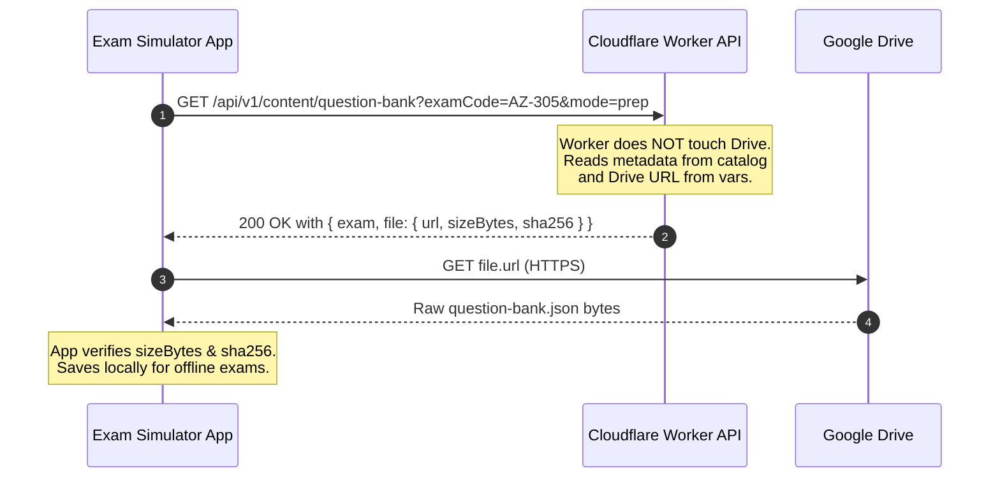
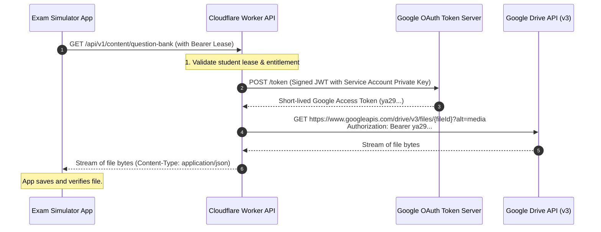
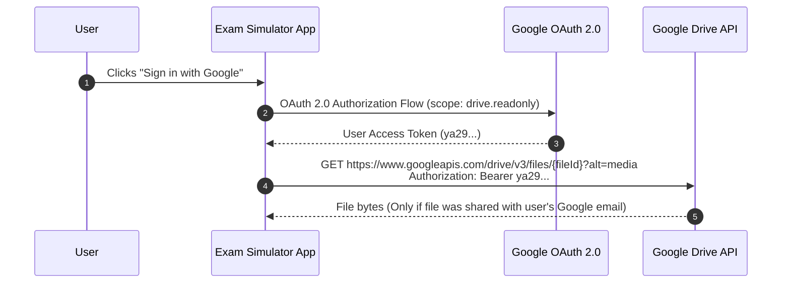
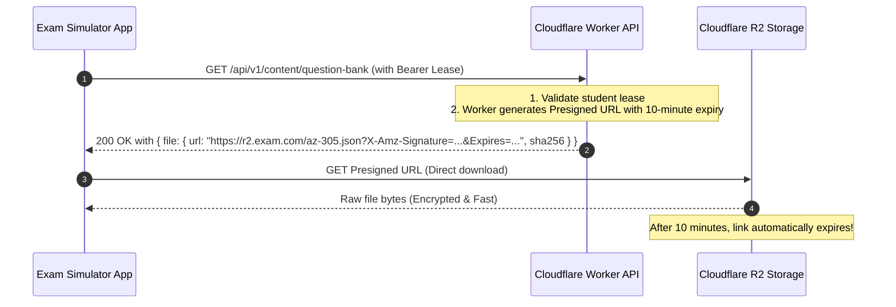

# Chapter 12 - Google Drive Integration & Authenticated Downloads

This chapter explains in detail how Google Drive fits into this system, how the API and client application interact with Drive, and whether and how Google Drive supports **authenticated file downloads**.

Every topic follows the **What and Why** approach.

---

## 12.1 The Core Questions

1. **Does the Cloudflare Worker API currently download the data from Google Drive?**
2. **How does the client App calling this API get the question bank file?**
3. **Does Google Drive have an authenticated way for the download call from the App?**
4. **What are the production alternatives when files cannot be publicly shared?**

---

## 12.2 How the Current System Works: The "Public Claim-Check" Flow

### What
In the current Milestone 1 (M1) codebase, the Cloudflare Worker API **does not connect to Google Drive at all**. 

Instead:
1. The question bank JSON is stored in Google Drive with the sharing permission set to *"Anyone with the link can view"*.
2. The Cloudflare Worker stores the direct-download link in its configuration (`QUESTION_BANK_URL` in `wrangler.jsonc`).
3. When the client App requests `/api/v1/content/question-bank?examCode=AZ-305&mode=prep`, the Worker responds with a small JSON metadata payload containing the URL:
   ```json
   {
     "apiVersion": 1,
     "exam": { "code": "AZ-305", "title": "AZ-305 Practice Question Bank", "contentVersion": "1.1.0", "mode": "prep" },
     "file": {
       "url": "https://drive.google.com/uc?export=download&id=YOUR_FILE_ID",
       "sizeBytes": 33471,
       "sha256": "7afcb321c83d379d5320a9e6e5d30de54f229f9fb392f8a740ecd5f833a236da"
     }
   }
   ```
4. The client App receives this response, takes `file.url`, and makes an HTTP `GET` request directly to Google Drive.
5. The client App streams the bytes from Google Drive, calculates the SHA-256 hash, checks that it matches `file.sha256`, and saves the file locally.

### Why
- **Bandwidth & CPU Savings:** The question bank file can grow to megabytes with hundreds of questions. By having the App download directly from Google Drive, the Cloudflare Worker only processes a ~300-byte JSON response, reducing Worker execution time and bandwidth costs to near zero.
- **Milestone 1 Simplicity:** M1 forbids adding Google service account secrets or streaming large payloads through the Worker. This design delivers the required functionality without violating project boundary rules.



---

## 12.3 Does Google Drive Have an Authenticated Way for Downloads?

**Yes.** However, Google Drive **does not support anonymous presigned temporary download URLs** in the way Amazon S3 or Cloudflare R2 does. 

Google Drive requires requests to be authenticated through the **Google Drive API (v3)** using OAuth 2.0.

There are three distinct architectural approaches to authenticated downloads:

---

## Architecture Pattern A: The Backend Service Account Proxy (Recommended for Google Drive)

### What
The file in Google Drive remains **strictly private** (no public link). The Cloudflare Worker authenticates directly to Google Drive using a **Google Cloud Service Account**, retrieves the file stream, and pipes the bytes back to the client application.



### Why
- **Complete Privacy:** Nobody on the internet can download the questions without an authorized request through your Worker.
- **Zero Client-Side Credentials:** The mobile/desktop application never holds any Google credentials or API keys.
- **Enforces Student Leases:** The Worker validates student authorization, device binding, and exam entitlement *before* opening the download stream.

### Implementation Blueprint
1. **Google Cloud Console:**
   - Create a Google Cloud Project.
   - Enable the **Google Drive API**.
   - Create a **Service Account** (e.g. `exam-worker@my-project.iam.gserviceaccount.com`).
   - Generate a private key in JSON format.
2. **Google Drive:**
   - Share the private folder containing your question-bank files with `exam-worker@my-project.iam.gserviceaccount.com` (Viewer role).
3. **Cloudflare Worker Secret:**
   - Store the service account private key securely in Cloudflare using:
     ```powershell
     npx wrangler secret put GOOGLE_SERVICE_ACCOUNT_KEY
     ```
4. **Worker Download Endpoint:**
   - Generates an OAuth 2.0 JWT assertion signed with the private key (using Web Crypto RS256).
   - Exchanges the assertion for an access token at `https://oauth2.googleapis.com/token`.
   - Calls the Drive API file download endpoint:
     ```http
     GET https://www.googleapis.com/drive/v3/files/{fileId}?alt=media
     Authorization: Bearer ya29.c.b0...
     ```
   - Pipes the `ReadableStream` directly into the HTTP response.

---

## Architecture Pattern B: Client-Side Google OAuth 2.0 (Direct App Authentication)

### What
The client application prompts the student to sign in with their own Google account using Google Sign-In SDK (OAuth 2.0). The application receives a user access token and calls the Google Drive API directly from the mobile or desktop device.



### Why & When to Use
- **When to use:** Enterprise or university scenarios where every student has an official institutional Google Workspace account (`student@university.edu`), and access is granted to Google Groups.
- **Why NOT recommended for ExamSimulator:**
  1. Requires every customer to have a Google account.
  2. Requires manual or automated sharing of Drive permissions for each student email.
  3. Complicates offline exam scenarios.

---

## Architecture Pattern C: Cloudflare R2 / AWS S3 Presigned URLs (The Industry Standard)

### What
Instead of Google Drive, store the question bank files in **Cloudflare R2** (object storage located inside Cloudflare's own network). 

When the App requests a download, the Worker generates an **authenticated, temporary Presigned URL** valid for 10 minutes. The App downloads directly from R2 without needing any credentials.



### Why
- **Best of both worlds:** The Worker never streams the file (saving bandwidth/CPU), **AND** the file remains completely private.
- **Time-Limited Access:** The URL self-destructs after 10 minutes. If someone copies and shares the link, it will quickly stop working.
- **Native to Cloudflare:** R2 has zero egress (bandwidth) fees and integrates with Workers without external OAuth overhead.

---

## 12.4 Summary Comparison Matrix

| Evaluation Criteria | Pattern 1: Public Drive Link (Current M1) | Pattern 2: Service Account Proxy | Pattern 3: Client Google OAuth | Pattern 4: Cloudflare R2 Presigned URLs |
|---|---|---|---|---|
| **Storage Location** | Google Drive | Google Drive | Google Drive | Cloudflare R2 / AWS S3 |
| **File Privacy** | Public ("Anyone with link") | Private | Private (per-user) | Private |
| **Worker Bandwidth** | Negligible (~300 B) | Streams full file (~33 KB+) | Zero | Negligible (~300 B) |
| **App Authentication** | Bearer header to API only | Bearer header to API only | Google Account login required | Bearer header to API only |
| **Direct Download from Storage?** | Yes | No (Piped via Worker) | Yes | Yes |
| **URL Expiration** | Never expires | N/A (URL is internal) | Token expires in 1 hr | Expires in 10-15 minutes |
| **Complexity** | Very low | Medium | High | Low - Medium |
| **Recommended Milestone** | Milestone 1 (Stubs & Wiring) | Production with Drive | Enterprise Google Workspace | Production Standard |

---

## 12.5 Self-Check Questions

1. Why does the current API return a Google Drive URL instead of fetching the file and returning its contents?
2. What happens if you try to download a private Google Drive file using an unauthenticated `GET https://drive.google.com/uc?export=download&id=...` request?
3. How does a Google Cloud Service Account allow the Worker to read private Drive files without user login?
4. What is a "Presigned URL", and why is it preferred over a permanent public download link?
5. If you use Pattern A (Proxy), what does the client App need to change about its download logic?
   *(Answer: The client App downloads directly from the Worker endpoint rather than from Google Drive).*
