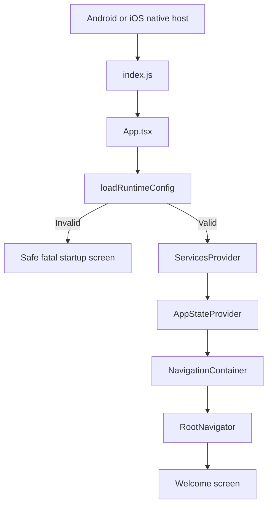
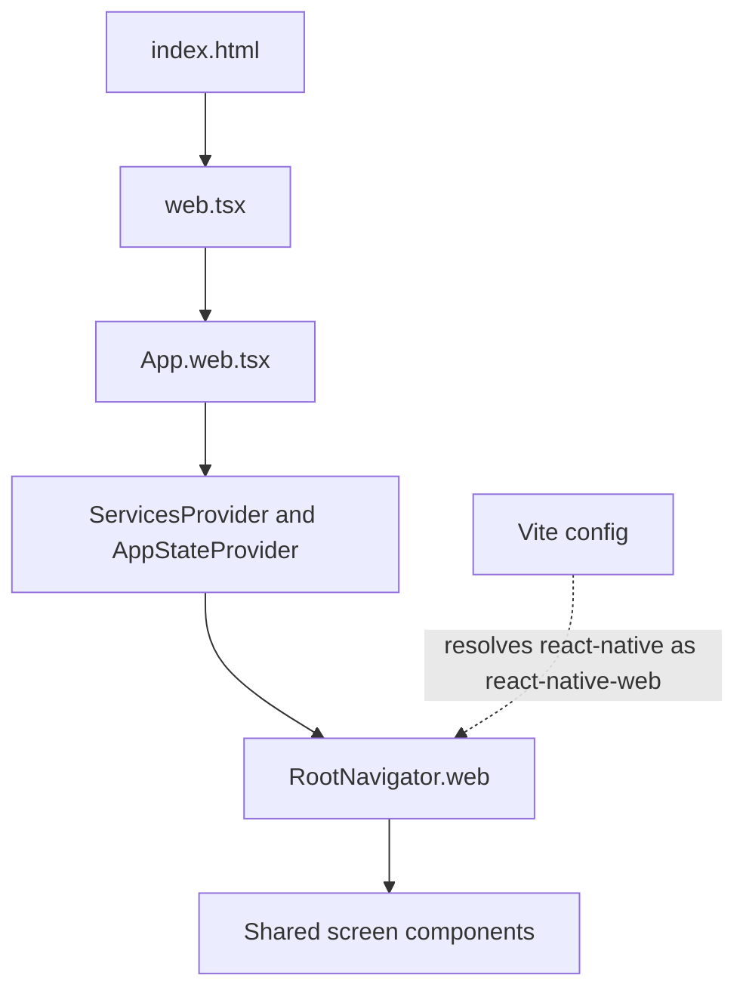
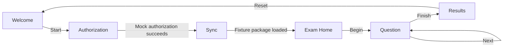

# From Project Structure to a Cross-Platform Exam App

## A Hands-On Front-End Learning Book Using ExamSimulator

**Audience:** beginner to intermediate college students  
**Primary stack:** React Native Community CLI, React, TypeScript, React Native Web, Vite, Jest  
**Project scope:** the M1 ExamSimulator learning foundation in this repository

---

## How to Use This Book

This is a guided reading and hands-on lab book for the ExamSimulator codebase. Read it in order the first time. Keep the project open in your editor and follow the linked files as you read. Each chapter moves through four questions:

1. **What is the idea?** Define the concept using plain language.
2. **Why is it useful?** Explain the problem it solves and its tradeoffs.
3. **Where does this project use it?** Connect the concept to actual files and behavior.
4. **How can I prove I understand it?** Complete the exercise and run a check.

The code shown here explains the existing architecture and demonstrates important patterns. It is not a line-by-line duplicate of every source file. The complete implementation remains in the linked project files. Open a file when a chapter asks you to compare a snippet with its full implementation.

### The Project's Honest Scope

ExamSimulator M1 is a teaching foundation, not a finished commercial examination system. Its six screens are real UI, but many capabilities behind them are deterministic mocks:

- Authorization does not verify a real candidate or entitlement.
- Connectivity always reports online in the current service container.
- Sync requests questions from the Worker sample API through the gateway layer; if the API is unreachable it falls back to a bundled 10-question set. Downloaded content lives in memory only.
- The encryption transform returns the input unchanged.
- Answers are recorded in memory and scored per session, but nothing is persisted.
- The optional Worker returns fixed sample data and performs no real authorization.
- ZIP archives contain ordinary JSON; ZIP is not encryption.

A strong student explains these limits accurately rather than describing intended future work as completed functionality.

### Learning Outcomes

By the end, a learner should be able to:

- Read the project tree and find the owner of a behavior.
- Trace app startup on native and web targets.
- Explain React components, JSX, props, state, effects, context, and reducers.
- Explain why typed interfaces and a composition root separate UI from infrastructure.
- Trace all six routes and describe `navigate` versus `replace`.
- Follow asynchronous work and explain cleanup and error handling.
- Describe the package schema, ZIP fixture, Node validator, and browser preview.
- Understand why static TypeScript types do not validate untrusted runtime data.
- Run and interpret tests and type checks.
- Make a small change safely and demonstrate it with evidence.

---

# Part I: Read the Project Before the Code

## 1. Project Structure: The Map

A project tree is not decoration. It communicates boundaries: where UI belongs, where shared rules belong, where platform startup lives, and where tests and authoring tools are kept. Start by understanding the map before opening files at random.

### 1.1 Main Tree

```text
ExamSimulation/
|-- App.tsx                         Native application composition
|-- App.web.tsx                     Browser application composition
|-- index.js                        React Native entry point
|-- web.tsx                         Browser entry point
|-- index.html                      Browser document loaded by Vite
|-- app.json                        Native app name and display name
|-- package.json                    Dependencies and project commands
|-- tsconfig.json                   TypeScript compiler configuration
|-- babel.config.js                 JavaScript/TypeScript transform preset
|-- metro.config.js                 React Native bundler configuration
|-- vite.config.ts                  Browser bundler configuration
|-- jest.config.js                  Test runner configuration
|-- src/
|   |-- app/
|   |   |-- navigation/
|   |   |   |-- NavigationTypes.ts
|   |   |   |-- RootNavigator.tsx
|   |   |   `-- RootNavigator.web.tsx
|   |   `-- screens/
|   |       |-- ScreenFrame.tsx
|   |       |-- WelcomeScreen.tsx
|   |       |-- AuthorizationScreen.tsx
|   |       |-- SyncScreen.tsx
|   |       |-- ExamHomeScreen.tsx
|   |       |-- QuestionScreen.tsx
|   |       `-- ResultsScreen.tsx
|   |-- core/
|   |   |-- config/AppConfig.ts
|   |   |-- content/FixturePackageLoader.ts
|   |   |-- content/PackageTypes.ts
|   |   |-- content/SampleQuestionBank.ts
|   |   |-- errors/AppError.ts
|   |   |-- gateway/QuestionBankGateway.ts
|   |   |-- gateway/QuestionBankMapper.ts
|   |   |-- logging/RedactingLogger.ts
|   |   |-- models/Question.ts
|   |   |-- services/HttpApiClient.ts
|   |   |-- services/QuestionBankServices.ts
|   |   |-- services/ServiceContainer.tsx
|   |   |-- services/ServiceContracts.ts
|   |   `-- state/AppState.tsx
|-- tests/
|   |-- unit/                         Focused behavior tests
|   `-- fixtures/                     JSON sources and ZIP test packages
|-- __tests__/App.test.tsx            Root render smoke test
|-- tools/content-preparation/
|   |-- validate-package.js           Node ZIP validator
|   `-- preview/index.html            Standalone package preview
|-- worker/                           Optional Cloudflare Worker (serves the sample question API)
|-- android/                          Native Android host and Gradle build
|-- ios/                              Native iOS host and Xcode project
`-- docs/                             Requirements and developer guides
```

The tree omits generated files and dependency contents. `node_modules/`, Android `build/`, Gradle caches, Xcode build output, and similar directories are not application source. Students should understand why they exist, but should not hand-edit them.

### 1.2 The Two Most Important Boundaries

The first major boundary is `src/app/` versus `src/core/`.

- `src/app/` is the presentation layer: routes, screens, and shared layout.
- `src/core/` is the shared application layer: configuration, state, error rules, service contracts, logging, and content types.

A screen may ask a service to authorize or load a question. It should not create the HTTP client, open a ZIP archive, or contain platform-specific networking details. This reduces coupling: UI changes and infrastructure changes can happen with fewer cross-file effects.

The second boundary separates source code from supporting systems:

- `tests/` proves behavior.
- `tools/content-preparation/` validates and previews content outside the React Native runtime.
- `worker/` is an optional server-side HTTP stub.
- `android/` and `ios/` launch the shared React Native application on their platforms.
- `docs/` explains requirements, constraints, and build status.

### 1.3 File Inventory: Root

| File | Responsibility | Beginner question to ask |
| --- | --- | --- |
| [App.tsx](../App.tsx) | Validates configuration and composes native providers/navigation. | What must exist before the first screen can render? |
| [App.web.tsx](../App.web.tsx) | Composes the browser app and web-specific navigator. | Which pieces are shared with native startup, and which are different? |
| [index.js](../index.js) | Registers the React Native root component. | How does native Android/iOS find the JavaScript app? |
| [web.tsx](../web.tsx) | Mounts React into the browser DOM root. | How does a browser page start a React component tree? |
| [index.html](../index.html) | Provides the browser document and `root` element. | Where is the DOM element that `createRoot` needs? |
| [app.json](../app.json) | Names the React Native application. | Why must this name agree with native launch code? |
| [package.json](../package.json) | Declares scripts, dependencies, and minimum Node.js version. | What does each `npm run` command execute? |
| `package-lock.json` | Records exact npm dependency resolutions. | Why should lockfiles be generated by npm, not hand-edited? |
| [tsconfig.json](../tsconfig.json) | Extends React Native TypeScript settings and includes `.ts`/`.tsx`. | Which source files are type-checked? |
| [babel.config.js](../babel.config.js) | Selects the React Native Babel preset. | Which tool transforms source syntax for a runtime? |
| [metro.config.js](../metro.config.js) | Extends the React Native Metro defaults. | Which bundler serves the native JavaScript bundle? |
| [vite.config.ts](../vite.config.ts) | Maps React Native imports to React Native Web and prioritizes web files. | How can a shared screen resolve browser-specific dependencies? |
| [jest.config.js](../jest.config.js) | Configures the React Native Jest preset and dependency transforms. | Why do tests need a transform configuration? |
| `.eslintrc.js` | Enables the React Native ESLint configuration. | How can rules catch style or correctness issues? |
| `.prettierrc.js` | Defines formatting choices. | What is formatting, and why automate it? |
| `.gitignore` | Excludes generated output, dependencies, and local settings. | What should not be committed? |
| `.watchmanconfig` | Provides file-watcher settings used by React Native tooling. | How does a development server notice saved files? |
| `Gemfile` | Constrains Ruby gems used by CocoaPods for iOS. | Why does an iOS build need Ruby tooling? |
| `.bundle/config` | Local Bundler installation options. | Why is this environment configuration not app logic? |

### 1.4 File Inventory: `src/app/`

#### Navigation files

| File | Responsibility |
| --- | --- |
| [NavigationTypes.ts](../src/app/navigation/NavigationTypes.ts) | Declares the six route names and their parameter types. |
| [RootNavigator.tsx](../src/app/navigation/RootNavigator.tsx) | Creates the typed React Navigation native stack and connects each route to a screen. |
| [RootNavigator.web.tsx](../src/app/navigation/RootNavigator.web.tsx) | Implements a small browser-only in-memory route stack with the same route names. |

#### Screen files

| File | Responsibility |
| --- | --- |
| [ScreenFrame.tsx](../src/app/screens/ScreenFrame.tsx) | Shared scrollable layout and common styles. |
| [WelcomeScreen.tsx](../src/app/screens/WelcomeScreen.tsx) | Entry screen and navigation to Authorization. |
| [AuthorizationScreen.tsx](../src/app/screens/AuthorizationScreen.tsx) | Controlled form state, local validation, service calls, loading and error display. |
| [SyncScreen.tsx](../src/app/screens/SyncScreen.tsx) | Asynchronously loads fixture session data and advances on success. |
| [ExamHomeScreen.tsx](../src/app/screens/ExamHomeScreen.tsx) | Reads session metadata and starts a practice question flow. |
| [QuestionScreen.tsx](../src/app/screens/QuestionScreen.tsx) | Loads a prompt/choices, tracks selection, advances or finishes. |
| [ResultsScreen.tsx](../src/app/screens/ResultsScreen.tsx) | Displays mock results and resets app session state. |

### 1.5 File Inventory: `src/core/`

| Folder/file | Responsibility |
| --- | --- |
| [config/AppConfig.ts](../src/core/config/AppConfig.ts) | Reads and validates the API base URL. |
| [state/AppState.tsx](../src/core/state/AppState.tsx) | Defines shared state/actions, reducer, provider, and hooks. |
| [services/ServiceContracts.ts](../src/core/services/ServiceContracts.ts) | Describes the capabilities screens may request. |
| [services/ServiceContainer.tsx](../src/core/services/ServiceContainer.tsx) | Creates the concrete services (mocks plus the gateway-backed sync and exam engine) and provides them through React Context. |
| [services/QuestionBankServices.ts](../src/core/services/QuestionBankServices.ts) | The gateway-backed sync service, the exam engine (questions, answer feedback, scoring), and the in-memory `ActiveExam`. |
| [gateway/QuestionBankGateway.ts](../src/core/gateway/QuestionBankGateway.ts) | Middle layer: requests the API payload, picks a mapper by `apiVersion`, returns a `QuestionBank`. |
| [gateway/QuestionBankMapper.ts](../src/core/gateway/QuestionBankMapper.ts) | Validates the v1 payload at runtime and translates it into model classes. |
| [models/Question.ts](../src/core/models/Question.ts) | `Question` and `QuestionBank` model classes, independent of the API's JSON shape. |
| [services/HttpApiClient.ts](../src/core/services/HttpApiClient.ts) | Wraps fetch with timeout and stable error mapping. |
| [errors/AppError.ts](../src/core/errors/AppError.ts) | Maps thrown values into stable codes and safe user messages. |
| [logging/RedactingLogger.ts](../src/core/logging/RedactingLogger.ts) | Redacts selected sensitive top-level fields from logs. |
| [content/PackageTypes.ts](../src/core/content/PackageTypes.ts) | Defines manifest, question, and closed display component types. |
| [content/SampleQuestionBank.ts](../src/core/content/SampleQuestionBank.ts) | Stores ten original sample questions and separate Prep explanations. |
| [content/FixturePackageLoader.ts](../src/core/content/FixturePackageLoader.ts) | Generates and reads a small Exam or Prep ZIP in memory. |

### 1.6 Supporting Files and Folders

| File/folder | Responsibility |
| --- | --- |
| `tests/unit/` | Core, screen, package, Worker, API client, gateway, and exam-engine test suites. |
| `tests/fixtures/` | Valid Exam/Prep, malformed, and future-schema JSON sources and ZIP files. |
| `__tests__/App.test.tsx` | Minimal root application render test. |
| `tools/content-preparation/validate-package.js` | Node-only package schema/content validator using AdmZip. |
| `tools/content-preparation/preview/index.html` | Standalone browser preview using JSZip loaded from a CDN. |
| `worker/src/index.ts` | JSON health, version, authorization-stub, and question-bank routes, plus 404 handling. |
| `worker/src/data/question-bank.sample.json` | The 50-question sample API response (v1 wire format, Prep form with explanations). |
| `worker/package.json`, `tsconfig.json`, `wrangler.toml` | Worker-specific commands, compiler types/settings, and entry-point configuration. |
| `android/` | Gradle project, Kotlin React Native host, manifest, styles, icons, and build wrapper. |
| `ios/` | Podfile, Xcode project/scheme, Swift launch lifecycle, plist and asset catalog. |
| `docs/` | Architecture, requirements, package format, authoring, known gaps, and platform notes. |

## 2. Runtime Flow: Follow One App Launch

Before learning individual components, trace one app launch. This reveals why multiple entry files exist.

### 2.1 Native Startup



1. The native host launches the registered JavaScript module.
2. `index.js` reads `appName` from `app.json` and registers `App`.
3. `App.tsx` validates configuration before normal screens are mounted.
4. The providers make services and application state available to nested components.
5. The native stack mounts and selects Welcome as its initial route.

Why validate configuration early? If it is invalid, showing a clear startup error is easier to diagnose than allowing a later screen to fail with an unrelated request error.

### 2.2 Browser Startup



Vite starts the browser build. `index.html` contains the `root` element. `web.tsx` mounts React into that element. `App.web.tsx` supplies providers and imports the browser navigator. The browser navigator renders the same React Native screen components through React Native Web.

### 2.3 User Journey



The six routes are fixed in the M1 requirements. Route changes express user flow; app state stores data needed across those route changes.

---

# Part II: What and Why Patterns

## 3. Pattern: Separate UI from Core Rules

### What

The application separates presentation code from shared rules and infrastructure boundaries. Screens live in `src/app/screens`; configuration, state, error handling, and service definitions live in `src/core`.

### Why

A screen is easier to understand when its job is rendering and responding to user actions. If a screen also constructs HTTP clients, parses archives, logs sensitive values, and validates URLs, it becomes hard to test and hard to change.

### In This Project

`AuthorizationScreen` calls `services.authorization.authorize(...)`. It does not call `fetch` directly or construct an API client. The current implementation is supplied by `ServiceContainer.tsx`.

### Tradeoff

More files and interfaces may feel slower for a tiny prototype. The benefit appears when tests need fakes, requirements change, or multiple platforms share behavior. Keep boundaries proportional to real complexity; do not add a framework just to create extra layers.

### Check Your Understanding

If the email form's visual layout changes, which files should normally change? If the authorization endpoint changes, which files should normally change? Explain why those answers differ.

## 4. Pattern: Composition Root and Service Container

### What

A composition root is the boundary where an application assembles concrete implementations and provides them to consumers. In this project, `ServiceContainer.tsx` is that root.

### Why

The UI can depend on capabilities without knowing their implementation. Production code could replace a mock later, and tests can replace it with a fake, while the screen's UI remains largely unchanged.

### In This Project

The typed `ServiceContainer` has nine capabilities: authorization, sync, repository, encryption transform, exam engine, screen renderer, connectivity, API client, and logger. `ServicesProvider` puts one container in Context. `useServices()` retrieves it inside a screen.

```tsx
const services = useServices();
const candidate = await services.authorization.authorize(
  email.trim(),
  examCode.trim(),
  mode,
);
```

### Tradeoff

Context makes dependencies convenient to access but can hide them if used carelessly. A screen's imports and hook usage should still make its dependencies visible. The project does not need a general-purpose dependency-injection framework.

## 5. Pattern: Interface Before Implementation

### What

A service interface describes what a caller can ask for, along with inputs and outputs. The interface does not dictate how the service performs the work.

```ts
export interface ConnectivityService {
  isOnline(): Promise<boolean>;
}

export interface SyncService {
  sync(examCode: string, mode: ExamMode): Promise<ContentSession>;
}
```

### Why

A stable boundary supports substitution: mock, real network, local fixture, or test fake can implement the same contract. The screen uses an operation rather than relying on transport details.

### In This Project

`ServiceContracts.ts` is the interface surface. `ServiceContainer.tsx` supplies mock behavior. Screen tests mock the service hook and control the service outcome.

### Important Limitation

TypeScript interfaces disappear at runtime. They do not check a server's JSON. Any untrusted JSON requires runtime validation before the application treats it as a trusted domain object.

## 6. Pattern: Reducer for Named State Transitions

### What

A reducer is a pure function that receives current state and an action, then returns the next state. It should not mutate its input or perform network requests.

```ts
function reducer(state: AppState, action: AppAction): AppState {
  switch (action.type) {
    case 'APP_INITIALIZED':
      return { ...state, initialized: true };
    case 'AUTHORIZED':
      return {
        ...state,
        candidate: action.candidate,
        session: {
          examCode: action.examCode,
          mode: action.mode,
          contentVersion: '',
          questionCount: 0,
        },
        synchronized: false,
      };
    case 'SYNC_COMPLETED':
      return { ...state, session: action.session, synchronized: true };
    case 'SESSION_RESET':
      return { ...initialAppState, initialized: state.initialized };
  }
}
```

### Why

Named actions make important events discoverable and testable. They are clearer than changing unrelated state fields in multiple components. A reducer can be tested as a normal function without mounting React Native UI.

### In This Project

The four actions are `APP_INITIALIZED`, `AUTHORIZED`, `SYNC_COMPLETED`, and `SESSION_RESET`. Authorization creates a session shell; sync fills the actual content metadata; reset clears candidate/session state but preserves the initialized flag.

### Tradeoff

A reducer is valuable when state transitions have meaning. For one local text input, `useState` is simpler. Avoid putting side effects inside a reducer; dispatch an action after the async work succeeds.

## 7. Pattern: Context for Shared App State

### What

Context provides a value to components below a provider without threading it through every intermediate component as props.

### Why

Candidate and session information are shared across multiple routes. Passing those values through every navigator and screen would create prop plumbing unrelated to UI.

### In This Project

`AppStateProvider` owns `useReducer`. `useAppState()` reads the state. `useAppDispatch()` sends actions. Separate contexts keep components that only dispatch from subscribing to every state value change.

### Tradeoff

Context is not a database and does not automatically persist state between app restarts. This project holds state in memory only. Avoid assuming a candidate/session survives a process restart.

## 8. Pattern: Shared Screen Frame, Focused Screens

### What

`ScreenFrame` is a reusable layout component. Each screen passes a title and child UI. The frame owns common scrolling, width, and spacing; the screen owns its specific content and interactions.

### Why

A shared frame keeps page layout consistent and avoids duplicating the same layout markup seven times. Focused screen components remain readable.

### Tradeoff

Do not put domain behavior into a visual frame. If `ScreenFrame` starts authorizing users or navigating to results, the component has taken responsibility from the screen.

## 9. Pattern: Async Effect Cleanup

### What

An effect can start an asynchronous request, then return cleanup that runs when dependencies change or the component unmounts.

```tsx
useEffect(() => {
  let active = true;
  loadQuestion(index).then(question => {
    if (active) setQuestion(question);
  });
  return () => {
    active = false;
  };
}, [index]);
```

### Why

If the screen leaves or the index changes before the promise resolves, an old result should not overwrite the current screen's data.

### In This Project

`SyncScreen` and `QuestionScreen` use the `active` flag. The flag protects UI state from stale completions. It does not cancel the underlying operation. `HttpApiClient` uses `AbortController` for request timeout cancellation.

### Tradeoff

Effects can be difficult to reason about when they mix many tasks. Keep each effect focused, list the values it uses in its dependency array, and represent loading and errors explicitly.

## 10. Pattern: Normalize Errors at Boundaries

### What

Different layers may throw different values: an `Error`, a network failure, malformed JSON, or even a string. Error normalization converts those into a small set of stable application error codes.

### Why

UI text should not depend on low-level transport messages, and raw errors may contain private details. Stable codes also make tests and UI decisions predictable.

### In This Project

`AppError.ts` defines codes and a safe message mapping. The HTTP wrapper converts statuses and transport failures into those codes. Screens call `toUserMessage(error)` instead of printing exception details.

## 11. Pattern: Versioned Content Contract

### What

A package schema describes the structure and constraints of content. Version numbers communicate which schema the app understands and which content edition is loaded.

### In This Project

- `schemaVersion` is currently `1` and tells the validator what data structure is supported.
- `contentVersion` is a string such as `1.0.0` and identifies a release of the content.
- They are intentionally independent. A content release can change without changing package structure.

### Why Validate Outside the App?

A Node tool can reject invalid author content before it reaches a phone or browser. It can use Node-specific ZIP libraries without coupling the validator to React Native.

## 12. Pattern: Test Doubles at External Boundaries

### What

A test double is a fake or mock implementation that replaces a dependency during a test.

### Why

Tests become repeatable and do not require live identity services, cloud accounts, unstable networks, or a device.

### In This Project

- API tests pass a fake `fetcher` returning constructed responses.
- Screen tests mock `useServices()` and navigation.
- Worker tests call the handler with Web `Request` objects directly.
- Package tests use known ZIP fixtures.

### Tradeoff

A mock can accidentally diverge from a real service. Tests should verify the interface contract and complement integration tests when real integrations are later approved.

---

# Part III: Reference Concepts

## 13. JavaScript, TypeScript, JSX, and TSX

- **JavaScript** is the runtime programming language.
- **TypeScript** adds compile-time type syntax and checks.
- **JSX** is syntax for describing a UI tree inside JavaScript.
- **TSX** is a TypeScript file that contains JSX.

Example:

```tsx
const title: string = 'Candidate access';
return <Text>{title}</Text>;
```

The type annotation helps the editor/typechecker. It is removed before JavaScript runs. It does not inspect values fetched at runtime.

## 14. Components, Props, and Children

A function component accepts inputs called props and returns UI. `children` represents nested UI passed between the component's opening and closing tags.

```tsx
<ScreenFrame title="Practice complete">
  <Text>7 of 10 correct</Text>
</ScreenFrame>
```

The `ScreenFrame` receives the title and a `Text` element as children. Composition means building a larger UI from smaller components.

## 15. React State and Render

When state changes, React schedules the component to render again with the new value. In the Authorization form, `email` is a local state value and the `TextInput` is controlled by it.

```tsx
const [email, setEmail] = useState('');

<TextInput value={email} onChangeText={setEmail} />
```

Do not modify a state variable directly. Call the setter. Do not assume setting state immediately changes the current variable inside the same function.

## 16. Hook Reference

| Hook | What it does | Project example |
| --- | --- | --- |
| `useState` | Stores local values that affect rendering. | Form input, loading text, selected question choice. |
| `useEffect` | Runs synchronization work after rendering and supports cleanup. | Load a question or sync a fixture session. |
| `useRef` | Stores a mutable value that persists without triggering rendering. | Prevent double submission before busy state renders. |
| `useContext` | Reads a value supplied by a parent Provider. | Read app state, dispatch, or services. |
| `useReducer` | Stores state with named transitions. | Candidate and session state. |
| `useMemo` | Reuses a computed value until dependencies change. | Avoid reconstructing the service container each render. |

Hooks are called at the top level of React components or custom hooks. Do not call them inside conditions, loops, or ordinary utility functions.

## 17. TypeScript Union Types and Interfaces

A union type lists the permitted alternatives:

```ts
type ExamMode = 'exam' | 'prep';
```

Now `mode = 'practice'` is rejected by TypeScript. An interface describes an object shape:

```ts
interface ContentSession {
  examCode: string;
  mode: ExamMode;
  contentVersion: string;
  questionCount: number;
}
```

The compiler checks code that TypeScript can see. Data parsed from JSON still needs runtime checks.

## 18. Promises and `async`/`await`

An asynchronous function returns a Promise: a value that may be available later. `await` pauses the current async function until that promise resolves or rejects.

```ts
try {
  const candidate = await services.authorization.authorize(email, examCode, mode);
  dispatch({ type: 'AUTHORIZED', candidate, examCode, mode });
} catch (error) {
  setMessage(toUserMessage(error));
} finally {
  setBusy(false);
}
```

- `try` holds work that may fail.
- `catch` handles failure.
- `finally` runs on success and failure, so it is suitable for clearing a busy flag.

## 19. Nullish Values and Fallbacks

`null` and `undefined` can represent missing data. The nullish coalescing operator `??` chooses a fallback only when the left side is null or undefined.

```ts
const questionCount = session?.questionCount ?? 10;
```

Optional chaining `?.` safely reads a property when `session` may be null. These operators prevent unsafe property access; they do not prove that an object from JSON has the shape expected.

## 20. Navigation: `navigate` and `replace`

- `navigate('Question')` adds a new route to the navigation history.
- `replace('Sync')` replaces the current route.

Authorization and sync replace their routes after success so Back does not return to an already completed form/preparation step. Back behavior is part of the user experience, not only a coding detail.

## 21. Bundlers and Development Servers

- **Metro** bundles the React Native application and serves JavaScript during native development.
- **Vite** serves and bundles the browser preview.
- **Babel** transforms supported syntax.
- **TypeScript** checks types; `tsc --noEmit` does not write compiled files.
- **Gradle** builds Android native components.
- **CocoaPods/Xcode** install native iOS dependencies and build iOS.

A development server is not the same as an API server. The `npm run web` command starts the browser app; it does not start the optional Worker.

## 22. HTTP Concepts Used by the Client

`fetch` sends an HTTP request and returns a `Response`. `response.ok` means status 200-299. `response.json()` asynchronously parses JSON. An `AbortController` can signal cancellation; a timeout can abort a request that takes too long.

Current status mapping in `HttpApiClient.ts`:

| Response/condition | Application code |
| --- | --- |
| 401 or 403 | `AUTHORIZATION_REQUIRED` |
| 5xx | `NETWORK_UNAVAILABLE` |
| Other non-2xx | `PROTOCOL_ERROR` |
| Invalid JSON | `PROTOCOL_ERROR` |
| Network failure or timeout | `NETWORK_UNAVAILABLE` |

The generic `request<T>` type is a developer promise about the expected output, not a runtime validator.

## 23. Accessibility Concepts

The code uses roles, labels, and states so assistive technology can interpret controls.

- `accessibilityRole="button"` names a pressable control as a button.
- `accessibilityLabel` gives an input/control a programmatic name.
- `accessibilityState={{ selected: ... }}` communicates choice state.
- `accessibilityRole="alert"` identifies important feedback.

A student should also test keyboard/focus behavior, screen-reader output, text scaling, contrast, and layout at narrow widths. Adding an accessibility prop does not automatically prove the whole screen is accessible.

---

# Part IV: Follow the Code from Entry to Screens

## 24. App Composition and Configuration

### Native Root: `App.tsx`

`App.tsx` has four responsibilities:

1. Imports shared providers, configuration, errors, and navigator.
2. Calls `loadRuntimeConfig(__DEV__)` inside `try/catch`.
3. Renders a safe fatal view if configuration is invalid.
4. On success, nests providers in the order needed by screens.

Provider nesting matters. A component can only call `useServices()` beneath `ServicesProvider`, and can only call `useAppState()`/`useAppDispatch()` beneath `AppStateProvider`.

### Browser Root: `App.web.tsx`

The web root uses the same config and service/state providers, but imports `RootNavigator.web`. Vite resolves `.web.tsx` for browser-specific modules. This avoids importing the native React Navigation stack into the web navigation implementation.

### Configuration: `AppConfig.ts`

`loadAppConfig(rawUrl, isDevelopment)` performs the validation in one place:

1. Reject a missing URL.
2. Parse with the platform `URL` implementation; reject malformed input.
3. Allow `https:` generally.
4. Allow `http:` only in development for `localhost`, `127.0.0.1`, and `10.0.2.2`.
5. Normalize trailing slash before returning `AppConfig`.

`loadRuntimeConfig` reads `globalThis.__EXAM_SIMULATOR_ENV__?.API_BASE_URL`. Development defaults to `http://localhost:8787`; release builds have no implicit production URL.

### Lab 1: Trace Startup

1. Open `index.js`, `App.tsx`, and `RootNavigator.tsx` in that order.
2. Write down which module imports the next module.
3. Find where configuration is checked.
4. Find where app state and services become available.
5. Find the initial route.

**Checkpoint:** Explain why configuration validation runs before a screen calls a service.

**Exercise:** Draw the equivalent browser path from `index.html` through `web.tsx` and `App.web.tsx`.

## 25. Shared Frame and Screen Components

### `ScreenFrame.tsx`

This component accepts `{ title, children }`. It uses `ScrollView` to support short or small viewports and a centered content container to keep long lines readable. It exports shared style definitions for body text, inputs, buttons, errors, and answer options.

A shared style is a named object, not a new application behavior. Keeping common colors and dimensions here makes visual adjustments consistent.

### `WelcomeScreen.tsx`

Welcome is intentionally simple: render a title, a short description, and a Start button. The button calls `navigation.navigate('Authorization')`. It does not call services. This makes the screen a good first example of props, JSX, a press handler, and route names.

### `AuthorizationScreen.tsx`

The screen uses local component state for:

- `email`
- `examCode` (initially `AZ-305`)
- `mode` (`exam` or `prep`)
- `busy`
- `message`

The `TextInput` controls display the current state and call setters. The mode button toggles between the two allowed mode values.

The async `submit()` function has a deliberate order:

1. Check the `submitting` ref to reject duplicate presses.
2. Validate non-empty fields and basic email shape.
3. Set the ref and visible busy state; clear old feedback.
4. Check the connectivity service.
5. Call the authorization service with trimmed values.
6. Dispatch the authorized candidate and selected session information.
7. Replace the route with Sync.
8. Convert failures to safe user text.
9. Clear busy state and ref in `finally`.

The email regular expression is only a basic format check. It does not verify that the mailbox exists. The mock authorization service does not contact an identity provider.

### Lab 2: Form State and Validation

1. Trace `useState` declarations in AuthorizationScreen.
2. Match each `TextInput.value` to its corresponding change handler.
3. Find where the busy state disables Continue.
4. Find which validation failures avoid calling services.
5. Find where error text becomes visible to accessibility tools.

**Exercise:** Add a test case that submits an invalid email and confirms the form does not navigate. Keep the test at the visible behavior boundary.

## 26. Navigation and Screen Routes

### Native Navigator

`RootNavigator.tsx` creates a native stack using `RootStackParamList`. Every screen registration names a route and a component. `initialRouteName="Welcome"` sets the entry screen. Header options provide titles, tint, and back-button choices.

The navigator's effect dispatches `APP_INITIALIZED` after mount. Dispatching from an effect avoids changing application state during the render itself.

### Browser Navigator

`RootNavigator.web.tsx` maps each `RouteName` to a screen component. It stores an array of route names:

- `navigate(route)` appends.
- `replace(route)` removes the current last route and appends its replacement.
- Back removes the last route, but the header hides the Back button on the first route and on `Sync` and `Results`, matching the native `headerBackVisible: false` options.

This is an intentionally small browser implementation. It is not a full URL router: the route is not encoded in the browser address bar, and it does not provide deep links or reload persistence.

### Lab 3: Route Contract

Open `NavigationTypes.ts`, then compare native and browser navigator route declarations.

**Checkpoint:** Why are there exactly six route names in the type and both navigators?

**Exercise:** Identify one example of `navigate` and one example of `replace` in screens. Explain what Back would do if `navigate` were used instead of `replace` in that location.

## 27. Shared State and Reducer Transitions

### State Shape

`AppState` includes:

- `initialized`: whether the root navigation has mounted.
- `candidate`: the authorized candidate or `null`.
- `session`: selected exam/session metadata or `null`.
- `synchronized`: whether package sync completed.

The state is minimal: it stores what screens need after navigation. It does not store every UI detail; for example, email input lives in AuthorizationScreen.

### Actions

`AppAction` is a discriminated union. The `type` field identifies the action and TypeScript narrows the available properties in each reducer case.

```ts
interface AuthorizedCandidate {
  candidateId: string;
  displayName: string;
}

type AppAction =
  | { type: 'APP_INITIALIZED' }
  | {
      type: 'AUTHORIZED';
      candidate: AuthorizedCandidate;
      examCode: string;
      mode: ContentSession['mode'];
    }
  | { type: 'SYNC_COMPLETED'; session: ContentSession }
  | { type: 'SESSION_RESET' };
```

### Reducer Lifecycle

- Initialization flips `initialized` to true.
- Authorization records the candidate and creates a session shell with no content version/count yet.
- Sync replaces the shell with returned session metadata and sets `synchronized` true.
- Reset clears candidate and session values, preserving the startup flag.

The reducer returns new objects with spread syntax. It does not mutate the old object, make network requests, or navigate. Those side effects belong to screens/effects and navigation.

### Lab 4: Reducer as a Pure Function

1. Read `initialAppState`.
2. Read each reducer case.
3. Find the unit test that drives initialization, authorization, sync, and reset.
4. Predict the state after each dispatch before reading the assertion.

**Exercise:** Add a test that verifies authorization starts with `synchronized: false`. Do not alter the reducer to satisfy a test unless the behavior requirement calls for that change.

## 28. Service Contracts, Mocks, and Provider

### Contracts

`ServiceContracts.ts` is the application-facing API for infrastructure. Examples:

- `AuthorizationService.authorize(...)` returns a candidate.
- `SyncService.sync(...)` returns a content session.
- `ExamEngine.getQuestion(index)` returns ID, prompt, and choices.
- `ExamEngine.submitAnswer(index, choice)` records an answer and returns feedback (`isCorrect`, `correctAnswer`, optional `explanation`).
- `ApiClient.request<T>(path)` returns a promised value of a declared type.

The question contract intentionally does not include `correctAnswer`; the key is returned only by `submitAnswer`, after the learner commits to a choice.

### Concrete M1 Services

`ServiceContainer.tsx` is the only app module that constructs these service objects. Current behavior includes:

- A small delay so loading states can be seen.
- Deterministic authorization data.
- Sync through the question-bank gateway, with the bundled fixture set as the offline fallback.
- `null` from the mock repository.
- Identity/pass-through transform instead of encryption.
- An exam engine that serves questions from the loaded `QuestionBank`, records answers, and scores them.
- Connectivity that always returns true.
- The HTTP client and redacting logger.

Scoring counts answers recorded in memory for the current session. It is not persisted and is not a secure assessment: the answer key is held in the app.

### Provider and Hook

`ServicesProvider` creates the container from config and makes it available through Context. `useServices()` throws if it is called outside the provider. This explicit error turns a provider wiring mistake into a readable development failure.

### Lab 5: Replaceability

1. Read the interface for authorization.
2. Read its implementation in ServiceContainer.
3. Read how AuthorizationScreen calls it.
4. Read the screen test's mock implementation.

**Checkpoint:** Which three parts depend on the service's shape? Which one contains the actual mock behavior?

**Exercise:** Sketch a hypothetical HTTP authorization implementation, but do not put it into the screen or add real credentials. Identify which interface method it would implement and what error cases it must map.

## 29. Async Sync and Local ZIP Fixtures

### Sync Screen Behavior

`SyncScreen` reads the selected exam code and mode from application state. Its effect calls the sync service, which asks the question-bank gateway for the API's question bank (Chapter 30A). A successful promise dispatches `SYNC_COMPLETED` and replaces the Sync route with Exam Home. A rejected promise becomes safe feedback. The `active` boolean in cleanup prevents stale UI updates if the component leaves.

### Fixture Loader (the offline fallback)

When the API is unreachable, the sync service falls back to the bundled sample set. `FixturePackageLoader.ts` supplies its session metadata and uses JSZip to:

1. Create an archive in memory.
2. Add `manifest.json` and `questions.json` from sample data.
3. Add `explanations.json` only for Prep mode.
4. Generate base64 ZIP bytes.
5. Load the archive bytes back through JSZip.
6. Check that manifest and question entries exist.
7. Parse manifest and return only its session metadata.

This demonstrates real ZIP manipulation, but it does not perform the complete authoring validator's checks. It also does not write to a device filesystem.

**Known gap:** if sync fails, `SyncScreen` shows a safe message but offers no retry control, and its Back button is hidden. A capstone could add a retry action; decide first whether it re-runs the effect or navigates to Authorization.

### Lab 6: Exam and Prep Differences

1. Open `PackageTypes.ts` and find the two mode values.
2. Open `FixturePackageLoader.ts` and find the Prep conditional.
3. Open the fixture tests and compare returned mode values.
4. Open the standalone package fixtures and compare the files inside each archive.

**Exercise:** Describe a test that would catch `explanations.json` accidentally being included in an Exam ZIP. Implement it only in the fixture/validator test layer, not by importing the browser renderer.

## 30. Questions and Results

`ExamHomeScreen` reads `session` from app state and starts Question. `QuestionScreen` requests the current question in an effect, stores it locally, clears the selection and feedback when the index changes, renders choices, and protects the Next action until an answer is selected.

Selecting a choice calls `examEngine.submitAnswer(index, choice)`, which records the answer and returns `AnswerFeedback` (`isCorrect`, `correctAnswer`, and an optional `explanation`). `getQuestion` never returns the answer key; it only leaves the engine after the learner commits to a choice. In Prep mode the screen shows the correct answer and explanation and locks the choice; in Exam mode it records the answer silently. On the final item the handler replaces Question with Results, and `ResultsScreen` shows `examEngine.getResults()`, which counts correct recorded answers against the bank size.

**Limits to discuss:** the answer key is still inside the app (both package modes include correct answers for offline scoring), so this is practice scoring, not secure assessment. Answers and scores are held in memory only. Both `QuestionScreen` and `SyncScreen` show a safe message when a call fails; `SyncScreen` still offers no retry and hides its Back button after a failure, a good first improvement.

### Lab 7: Trace an Answer Selection

Trace this event: press an option, selection state changes, selected visual/accessibility state updates, press Next, index increments or route changes.

**Checkpoint:** Where is the selected answer recorded outside the component? Answer: in the `ActiveExam` held by the exam engine, through `submitAnswer`.

**Exercise:** Write an acceptance criterion for answer persistence before coding it. Include last question, reset, and missing answer cases.

## 30A. The Gateway Layer: Absorbing API Changes

### What

A gateway (also called an anti-corruption layer) sits between the app and an external API. It fetches the API's JSON, translates it into the app's own model classes, and hands only those models to the rest of the app.

### Why

APIs change: fields are renamed, arrays become objects, endpoints move. If screens read the API's JSON directly, every such change ripples through the UI. With a gateway, the change is absorbed in one folder and the screens, state, and models stay untouched.

### The pieces

```text
Worker API  ->  ApiClient  ->  QuestionBankGateway  ->  QuestionBankMapper  ->  QuestionBank (model)
 (JSON v1)     (fetch, codes)   (path, version pick)    (validate + translate)   used by sync + engine
```

| File | Responsibility |
| --- | --- |
| `worker/src/data/question-bank.sample.json` | The sample API response: 50 questions in the v1 wire format. |
| `src/core/models/Question.ts` | `Question` and `QuestionBank` classes. They know nothing about the wire format. |
| `src/core/gateway/QuestionBankMapper.ts` | The only code that understands v1. Validates untrusted JSON and builds the models. |
| `src/core/gateway/QuestionBankGateway.ts` | Builds the request path, picks a mapper by `apiVersion`, converts failures to `PROTOCOL_ERROR`. |
| `src/core/services/QuestionBankServices.ts` | The sync service and exam engine that consume `QuestionBank`. |

### The wire format versus the model

The API sends options as objects and the answer as an id; the model stores plain choice text:

```json
{ "id": "q001", "text": "...", "options": [{ "id": "A", "text": "..." }], "answer": "A", "explanation": "..." }
```

```ts
new Question('q001', prompt, ['choice text', '...'], 'choice text', explanation);
```

The mapper resolves `answer: "A"` to the matching option's text. The model never sees ids like `A`.

### Defensive reading

Every field is checked at runtime (`readString`, `readArray`, ...) because a type assertion proves nothing about received data. Unknown fields such as `topic` and `difficulty` are ignored, so an API that adds fields does not break the app. A failure throws a `PayloadMappingError` whose reason is logged, while the user sees only the stable `PROTOCOL_ERROR` message.

### Adding a new API version

Suppose a v2 sends `choices: string[]` and `answerIndex`. You write one mapper and register it; nothing else changes:

```ts
const gateway = createQuestionBankGateway({
  apiClient,
  logger,
  mappers: [questionBankMapperV1, questionBankMapperV2],
  buildPath: ({ examCode, mode }) => `/v2/banks/${examCode}/${mode}`,
});
```

`tests/unit/question-gateway.test.ts` proves this with a made-up v2 payload.

### Exam versus Prep

The Worker omits `explanation` for Exam and includes it for Prep. The gateway also rejects a payload whose `exam.mode` differs from the requested mode, so Prep content cannot leak into an Exam session.

### Offline fallback

If the API is unreachable (`NETWORK_UNAVAILABLE`), sync falls back to the bundled 10-question set so the app still works. Other failures, such as a malformed payload or an authorization error, are not masked.

### Lab 7A: Run it against the live API

1. In `worker/`, run `npm install` then `npm run dev`.
2. In the repository root, run `npm run web` and open `http://localhost:5173`.
3. Choose Prep mode and continue. Exam Home should say "50 questions available".
4. Stop the Worker and repeat. It should say "10 questions available" (the fallback).

**Exercise:** Add a v2 mapper in a test, as `question-gateway.test.ts` does, then explain which files you did not have to touch.

**Exercise:** Change the sample JSON so one answer id does not match any option. Which test fails, and what does the user see when the app loads it?

---

# Part V: Content, Validation, and Tests

## 31. Package Data Model

### Manifest

A manifest describes the package as a whole:

```json
{
  "title": "AZ-305 Practice Exam",
  "questionCount": 10,
  "schemaVersion": 1,
  "contentVersion": "1.0.0",
  "examCode": "AZ-305",
  "mode": "exam"
}
```

### Question

A question includes a stable identifier, prompt, choices, display components, and correct answer:

```json
{
  "id": "az305-m1-q01",
  "prompt": "A service must remain available during a regional outage. Which design fits?",
  "choices": ["Option A", "Option B"],
  "components": [
    { "type": "paragraph", "text": "Choose the architecture that addresses the outage." }
  ],
  "correctAnswer": "Option A"
}
```

The example text is original teaching content, not real exam content. Each actual question has 2-6 unique string choices and the correct answer must exactly equal one of those choices.

### Display Component Union

The closed set is:

```ts
type DisplayComponent =
  | { type: 'paragraph'; text: string }
  | { type: 'list'; items: string[] }
  | { type: 'image'; asset: string; alt: string }
  | { type: 'video'; asset: string; alt: string };
```

Why a closed set? A package is data, but it can still influence rendering. Restricting component types prevents arbitrary executable behavior from being described in content. There are no expressions, loops, conditionals, or event handlers in package components.

## 32. Runtime Validation Is Not the Same as Type Checking

Suppose the code says:

```ts
const manifest = JSON.parse(text) as PackageManifest;
```

This only tells TypeScript to trust the programmer. It does not verify that the JSON includes a positive question count or supported schema version. At runtime, `JSON.parse` returns data whose shape must still be checked.

The Node validator checks:

- Required root files exist.
- JSON parses successfully.
- Required manifest fields have valid values.
- `schemaVersion` is supported.
- Mode is either Exam or Prep.
- Prep has explanations and Exam does not.
- Question count agrees with the manifest.
- IDs are non-empty and unique.
- Choices are 2-6 unique strings and include the correct answer.
- Components use the allowed types and allowed properties.
- Assets stay under the package's `assets/` directory, exist, and are referenced.
- Orphaned assets are rejected.

### Lab 8: Package Validator

Run:

```sh
npm run validate:package -- tests/fixtures/valid-exam.zip
npm run validate:package -- tests/fixtures/valid-prep.zip
```

Then run validation against the malformed and future-schema fixtures and read the error messages. The CLI should identify the file and explain the violation, not merely report "invalid".

**Exercise:** Add a fixture with a duplicate question ID, then add a validator test that expects rejection. Keep the test focused on the specific validation rule.

## 33. Standalone Browser Preview

`tools/content-preparation/preview/index.html` is a separate small web application. It lets a content author select a ZIP, reads JSON, and renders component DOM nodes. It does not import React Native screens or `src/` renderer modules. This independence lets package validation/preview run without bundling the mobile app.

The preview uses `textContent` when placing question text into DOM nodes. This treats package values as text rather than interpreting them as markup. Images/videos are loaded as ZIP blobs and assigned object URLs. The current page loads JSZip from a CDN, so it is not fully offline by itself.

**Exercise:** Describe how you would release object URLs after preview is replaced repeatedly. This helps prevent unnecessary browser memory use.

## 34. Testing Strategy

### Test Layers Present

| Test file | What it proves |
| --- | --- |
| `tests/unit/core.test.ts` | URL rules, reducer transitions, safe errors, redaction, service completeness. |
| `tests/unit/api-client.test.ts` | HTTP status mapping, JSON failure, timeout using a fake fetcher. |
| `tests/unit/fixture-loader.test.ts` | Exam and Prep fixture loader metadata. |
| `tests/unit/screens.test.tsx` | Visible Welcome/Authorization behavior with fake hooks/navigation. |
| `tests/unit/question-gateway.test.ts` | The 50-question sample maps into models, gateway path and version handling, malformed payloads, mode mismatch, and a made-up v2 API shape absorbed by one mapper. |
| `tests/unit/question-bank-services.test.ts` | Sync, offline fallback, answer feedback, scoring, and out-of-range handling in the exam engine. |
| `tests/unit/package-validator.test.js` | Valid package acceptance and malformed/future schema rejection. |
| `tests/unit/worker.test.ts` | Worker endpoints (health, version, authorize, questions for Exam and Prep) without deploying a cloud service. |
| `__tests__/App.test.tsx` | Root app can render in a test renderer. |

### Arrange, Act, Assert

1. **Arrange:** construct the component or function and supply test doubles.
2. **Act:** call the reducer, press a button, or await a promise.
3. **Assert:** inspect returned state, visible text, service calls, route calls, or error mapping.

A useful test checks the user-observable contract. Avoid asserting incidental style internals unless visual styling itself is the behavior under test.

### Commands

```sh
npm test -- --runInBand
npm run typecheck
npm run lint
```

The full test suite can take longer than one focused test. When a test times out, rerun it alone to distinguish a slow runner from a repeatable behavior defect. Report what actually passed; do not infer platform build status from JavaScript unit tests.

### Lab 9: Add a Screen Test

Use the Authorization test as a reference:

1. Provide fake service functions.
2. Provide fake navigation methods.
3. Render the screen.
4. Change text through the input control.
5. Press Continue.
6. Wait for the visible error/success state.
7. Assert that navigation and service calls match the scenario.

**Exercise:** Add a test that prevents duplicate authorization calls. Decide whether to invoke the handler via two quick presses or test the busy button state, and explain what user behavior the test represents.

---

# Part VI: Optional Worker and Native Hosts

## 35. The Worker Stub

`worker/src/index.ts` exports a fetch handler. It parses the request URL, compares method/path, and returns JSON responses. `/api/health` and `/api/v1/content/version` return fixed values. `GET /api/v1/questions?examCode=AZ-305&mode=exam|prep` serves the 50-question sample from `worker/src/data/question-bank.sample.json`, omitting explanations for Exam, and returns 400 for a missing exam code or invalid mode and 404 for an unknown exam. `POST /api/v1/authorize` parses JSON and checks a minimal email, exam code, and mode shape. Invalid JSON or fields return 400; unmatched routes return 404. Responses carry `Access-Control-Allow-Origin: *` so the browser app can call the Worker; that is acceptable only because the data is public sample content.

The handler is useful for teaching request routing and testable HTTP boundaries. It does not implement real authorization, persistence, D1, Google Drive, production secrets, or content delivery. The app's `ServiceContainer` does not call its authorization route, but sync does call `GET /api/v1/questions` through the gateway (see Chapter 30A).

Run and typecheck it independently from its folder:

```sh
cd worker
npm install
npm run typecheck
npm run dev
```

**Exercise:** Add a GET endpoint only if an assignment needs it; write a direct handler test first. Do not store credentials in code or Wrangler configuration.

## 36. Android and iOS Host Projects

React Native shares much UI code but still needs native projects to start the JS bundle.

### Android

- `android/settings.gradle` includes React Native Gradle plugins and app module.
- `android/build.gradle` provides shared SDK/plugin versions.
- `android/gradle.properties` selects AndroidX, architecture options, Hermes, and target architectures.
- `android/app/build.gradle` configures the app ID, React Native integration, and build variants.
- `AndroidManifest.xml` declares app permission and launch activity.
- `MainApplication.kt` creates the React Native host.
- `MainActivity.kt` returns the JavaScript component name `ExamSimulatorM1`.
- `strings.xml`, `styles.xml`, and mipmap assets provide app label, theme, and icons.

The app's JavaScript registration name, `app.json`, and Android main component name must agree. The debug keystore is not a production signing key.

### iOS

- `Podfile` configures CocoaPods and React Native native modules.
- The `.xcodeproj` and shared scheme define Xcode targets and build actions.
- `AppDelegate.swift` is a minimal application delegate that lets launch proceed; `SceneDelegate.swift` creates the React Native factory and window and starts the `ExamSimulatorM1` module, using Metro's bundle in debug and the packaged bundle in release.
- `Info.plist`, `PrivacyInfo.xcprivacy`, `LaunchScreen.storyboard`, and `Images.xcassets` define metadata, privacy declaration, launch UI, and icons.

This project runs in a Windows workspace; iOS cannot be verified without macOS/Xcode or approved macOS CI. The current platform-status document records Windows, Android, and iOS as **NOT VERIFIED**. The existence of Gradle or Xcode project files is not build evidence.

### Platform Learning Exercise

Make a verification matrix with columns for platform, required tools, command, build result, device/simulator walkthrough, date, and status. Put NOT VERIFIED where no evidence exists.

---

# Part VII: Step-by-Step Semester Learning Path

## 37. Week 1: Orientation and Baseline

**Learn:** project tree, README, Node/npm, command line, browser startup.  
**Do:** install dependencies, run `npm run web`, click through the UI.  
**Submit:** project map, screenshot, and list of what is mock.  
**Check:** can explain `web.tsx -> App.web.tsx -> RootNavigator.web.tsx`.

## 38. Week 2: React Component Basics

**Learn:** JSX, function components, props, children, reusable layout.  
**Do:** trace `ScreenFrame` and Welcome. Change a small piece of copy or styling.  
**Submit:** before/after and explanation of props.  
**Check:** no service code was added to the shared frame.

## 39. Week 3: Navigation and Types

**Learn:** route names, typed route maps, stack history, navigate/replace.  
**Do:** draw all six routes; test Back behavior in web preview.  
**Submit:** route diagram with one navigate and one replace example.  
**Check:** native/web route names remain the same.

## 40. Week 4: Forms and State

**Learn:** controlled inputs, `useState`, refs, validation, accessibility labels.  
**Do:** trace Authorization's state and duplicate-submit guard.  
**Submit:** invalid and valid form test cases.  
**Check:** email validation is explained as shape validation, not identity verification.

## 41. Week 5: Reducer and Context

**Learn:** immutable updates, discriminated unions, provider and custom hooks.  
**Do:** draw state transitions from startup to reset.  
**Submit:** reducer table: action, old value, new value, screen that dispatches.  
**Check:** reducer has no navigation, fetch, or ZIP code.

## 42. Week 6: Service Contracts

**Learn:** interfaces, mocks, composition root, test substitution, and the gateway that keeps API shapes out of the app.  
**Do:** trace authorization interface -> mock implementation -> screen call -> fake test, then trace sync -> gateway -> mapper -> `QuestionBank`.  
**Submit:** dependency map and a service contract explanation.  
**Check:** screen components do not construct concrete services or read API JSON.

## 43. Week 7: Effects and Async Work

**Learn:** Promise, async/await, loading/error state, cleanup, stale result.  
**Do:** trace Sync and Question effects.  
**Submit:** timeline diagram for a promise resolving before versus after unmount.  
**Check:** understand `active = false` prevents updates but does not cancel the underlying work.

## 44. Week 8: Content Model and ZIP

**Learn:** JSON, schema/content versions, ZIP structure, closed unions.  
**Do:** inspect valid Exam and Prep package files.  
**Submit:** a small authored sample with correct mode-specific files.  
**Check:** correctly explain why ZIP is not encryption.

## 45. Week 9: Validator and Preview

**Learn:** runtime validation, Node-only tools, DOM safety.  
**Do:** run validator on valid and invalid fixtures; inspect preview behavior.  
**Submit:** one new invalid fixture and a test.  
**Check:** validator does not import React Native renderer code.

## 46. Week 10: Test Design

**Learn:** Jest, arrange/act/assert, fakes, fixture tests.  
**Do:** add one focused test for user-visible behavior.  
**Submit:** explain why the test needs a fake and what failure it catches.  
**Check:** test does not depend on live internet.

## 47. Week 11: Errors, Logging, and HTTP

**Learn:** status codes, aborts, safe messages, redaction.  
**Do:** read the API client tests and follow a timeout.  
**Submit:** error mapping table and credential-safe logging example.  
**Check:** no raw exception message is exposed in UI.

## 48. Week 12: Worker and Deployment Boundaries

**Learn:** HTTP handler, method/path dispatch, request validation, configuration.  
**Do:** run the Worker and the web app together; compare Worker routes with the routes the app actually calls.  
**Submit:** integration diagram showing that only `GET /api/v1/questions` is used, and that authorization is still a mock.  
**Check:** does not call stub authorization production-ready.

## 49. Week 13: Accessibility and Responsive UI

**Learn:** roles, labels, selected state, keyboard, screen-reader testing.  
**Do:** inspect app at desktop/mobile browser widths and test controls.  
**Submit:** accessibility checklist with observed evidence.  
**Check:** controls remain usable without relying only on color.

## 50. Week 14: Capstone Proposal

Choose a bounded extension. Examples:

- Add robust question loading, a retry action on the Sync screen, and error states.
- Improve package validator error reporting and add edge-case fixtures.
- Persist answers and move scoring behind a trustworthy boundary (for example a Worker endpoint), since the answer key is currently held in the app.
- Add a second API version mapper and cache the downloaded question bank for offline reuse.
- Replace the authorization mock behind its service interface, following the gateway pattern.
- Improve the browser navigation history and URL behavior.
- Add a standalone offline package preview dependency strategy.

For each proposal, document user story, in-scope files, data changes, error paths, tests, privacy considerations, and what remains out of scope.

## 51. Week 15: Implementation and Review

Implement in small increments. For each change:

1. Write the acceptance behavior.
2. Identify the owning layer and interface.
3. Add/update a focused test.
4. Implement the smallest change.
5. Run the focused test, typecheck, and relevant package checks.
6. Review diff for unrelated changes.
7. Update docs and limitations.

## 52. Week 16: Demo and Reflection

Present:

- Architecture diagram.
- Six-route walkthrough.
- One feature from user event to implementation to test.
- A test report with actual commands and outcomes.
- Platform verification matrix.
- Known limitations and next safe step.
- What changed in the student's understanding of front-end architecture.

---

# Part VIII: Practical Commands and Troubleshooting

## 53. Command Reference

Run project commands from the repository root unless the table says otherwise.

| Command | What it does | Stays running? |
| --- | --- | --- |
| `npm install` | Installs root project dependencies from the lockfile. | No |
| `npm run web` | Starts Vite browser development server. | Yes |
| `npm start` | Starts Metro for React Native. | Yes |
| `npm run android` | Invokes React Native CLI to build/install Android app. | Until build/launch process ends |
| `npm test -- --runInBand` | Runs Jest serially. | No |
| `npm run typecheck` | Runs TypeScript with no emitted files. | No |
| `npm run lint` | Runs ESLint. | No |
| `npm run validate:package -- <zip>` | Validates one package ZIP. | No |
| `npm run typecheck` in `worker/` | Typechecks Worker source. | No |
| `npm run dev` in `worker/` | Starts Wrangler local Worker environment. | Yes |

## 54. Common Errors

| Symptom | Likely reason | Next check |
| --- | --- | --- |
| `npm` command not found | Node/npm are not installed or terminal PATH is stale. | Check `node --version` and `npm --version`; reopen terminal after install. |
| Missing package/module | Dependencies not installed or command run in wrong folder. | Confirm repository root and run `npm install`. |
| Native app cannot load JS in development | Metro is not running or device cannot reach it. | Start `npm start`, check device/emulator connection and platform setup. |
| Android cannot reach host `localhost` | Emulator's localhost points to emulator itself. | Use approved dev host `10.0.2.2` in app configuration. |
| Fatal startup configuration view | API URL missing/invalid under current build mode. | Check `loadRuntimeConfig` override and URL scheme/host rules. |
| Route name type error | String does not match six typed route keys. | Check `NavigationTypes.ts` and use declared route name. |
| `useServices` provider error | Screen rendered outside `ServicesProvider`. | Inspect root provider composition. |
| State provider error | Hook used outside `AppStateProvider`. | Inspect root provider composition. |
| Test timeout | Full test runner slow, unresolved async work, or real issue. | Rerun focused test and inspect awaited promises/timers. |
| Package schema error | Missing file, unsupported version, malformed content, invalid answers or assets. | Read validator's file-specific output and correct the package. |
| Type passes but JSON is malformed | Static types do not validate runtime values. | Add explicit runtime validation. |

## 55. Verification Checklist

Before handing in a capstone, confirm and record:

- [ ] Browser preview starts with `npm run web`.
- [ ] Six routes work in the expected sequence.
- [ ] Required controls have accessible names/roles/states.
- [ ] Invalid input remains on Authorization and shows safe feedback.
- [ ] Mocks are clearly identified in both UI behavior and report.
- [ ] Exam and Prep package differences are preserved.
- [ ] Validator accepts valid fixtures and rejects invalid fixtures.
- [ ] Focused and full tests are run and outcomes recorded.
- [ ] Typecheck and lint results are recorded.
- [ ] Worker checks are run only if Worker code changed.
- [ ] Android/iOS/Windows claims are based on actual build and walkthrough evidence.
- [ ] No secret or signing credential is committed.
- [ ] Documentation accurately states new behavior and remaining limitations.

---

# Part IX: Glossary and Reference

## 56. Glossary

- **API:** a defined way for software components to request data or an operation. In this project, a service interface may call an API client, but the current screens use mocks.
- **Application state:** data shared by multiple parts of the app, such as candidate and session.
- **Asset:** a media file such as an image or video referenced by package content.
- **Async/asynchronous:** work that may complete later without blocking the current JavaScript call stack.
- **Babel:** a JavaScript transformer configured with the React Native preset.
- **Bundler:** a tool that resolves imports and packages source/dependencies for a target runtime. Metro and Vite are different bundlers for different targets here.
- **Component:** a reusable React function that describes part of the UI.
- **Composition root:** the place where concrete services are created and connected; `ServiceContainer.tsx` in this app.
- **Context:** a React mechanism for providing data to descendants without passing it through every intermediate component.
- **Gateway (anti-corruption layer):** a layer between the app and an external API that fetches data and translates it into the app's own models, so API changes do not reach the UI; `QuestionBankGateway` in this app.
- **Mapper:** code that converts one data shape into another and validates it; `QuestionBankMapper` converts the v1 API payload into `QuestionBank`.
- **Model class:** an app-owned class representing a domain concept with its own behavior, such as `Question.isCorrect`.
- **Wire format:** the shape of data as sent over the network, as opposed to the app's model.
- **Controlled input:** an input whose displayed value is driven by React state.
- **Dependency:** code or a capability another module relies on.
- **Effect:** React hook for synchronizing a component with work outside its render calculation.
- **Interface:** a TypeScript description of the shape/capabilities of a value.
- **JSX:** syntax for writing UI tree structures in JavaScript/TypeScript source.
- **Metro:** the React Native bundler/development server.
- **Mock:** a deterministic implementation used in place of a real external system.
- **Navigation stack:** route history that determines which screen is current and what Back does.
- **Promise:** an object representing a value that may be produced later or fail.
- **Prop:** an input passed from a parent component to a child component.
- **Reducer:** a pure function that calculates next state from current state and an action.
- **Route:** a named screen location, such as `Question`.
- **Runtime validation:** checking actual values while a program is running, such as parsed JSON from a ZIP.
- **Schema:** a definition of valid data structure and constraints.
- **Service:** a capability such as authorization, sync, or question lookup.
- **Static type:** a compiler/editor-time description; not necessarily present or enforced at runtime.
- **Test double:** a fake/mock used by a test instead of a live dependency.
- **TypeScript union:** a type allowing one value from a defined set of alternatives.
- **ZIP archive:** a container holding files; it does not by itself encrypt them.

## 57. Review Questions

1. Why are screens in `src/app/` and service definitions in `src/core/services/`?
2. What does the `ServiceContainer` own that a screen does not?
3. Why does `SESSION_RESET` preserve `initialized`?
4. Why is a separate `useRef` double-submit guard used along with visible `busy` state?
5. What can happen if an async effect updates state after a screen has unmounted?
6. Why does TypeScript not guarantee parsed ZIP JSON is valid?
7. How do `schemaVersion` and `contentVersion` differ?
8. Which behavior shows that sync prefers the API over the bundled data, and when does it use the bundled data?
9. Which project tests require a live network? Why should the answer be none for this baseline?
10. Why is the score a practice score and not a secure assessment?
11. Why are Exam and Prep packages separate?
12. What evidence is needed before saying an Android or iOS build is verified?

### Answer Key

1. `src/app/` holds presentation; `src/core/services/` holds capability contracts so screens depend on interfaces, not infrastructure.
2. It owns construction of concrete implementations (mocks, gateway, gateway-backed sync and exam engine, HTTP client, logger); screens only consume them through `useServices()`.
3. Initialization describes the running app, not the candidate's session, so a reset should clear only session data.
4. The ref closes the gap before React commits the busy state; the state drives the visible disabled button and label.
5. It can overwrite newer data or update a screen that is gone; the `active` flag prevents that without cancelling the work.
6. Types are erased at runtime and `JSON.parse` returns unchecked data; only runtime validation checks its shape.
7. `schemaVersion` is the structure the app understands; `contentVersion` identifies a content release.
8. Exam Home shows 50 questions when the gateway loads the API payload; sync falls back to the bundled 10 only when the API is unreachable (`NETWORK_UNAVAILABLE`), not for malformed payloads or authorization errors.
9. None; API tests use a fake fetcher, screen tests mock services, package tests use local ZIP fixtures, and the gateway test calls the Worker handler in-process.
10. Both package modes include the correct answers, so the key is held in the app, and scores live in memory only; a secure assessment would score on a server.
11. They are delivered separately; both contain correct answers, but only Prep contains `explanations.json`.
12. A successful build on that platform plus a recorded walkthrough of all six routes; project files alone are not evidence.

## 58. Capstone Rubric

| Category | Strong work demonstrates |
| --- | --- |
| Project understanding | Student can trace a user action through screen, state/service boundary, and test. |
| Architecture | Screens use interfaces; concrete services stay in the composition root; validation stays platform-independent. |
| Correctness | Acceptance criteria and edge cases are defined; tests prove behavior and failure handling. |
| Type/data safety | Types describe trusted app data, and untrusted input receives runtime checks. |
| UX/accessibility | Loading, errors, controls, keyboard/screen-reader labels, and narrow layouts are considered. |
| Security/privacy | No secrets are logged/committed; error messages are sanitized; mocks are not misrepresented. |
| Verification | Test/typecheck/build results are reported from actual runs and correct environment. |
| Communication | Demo explains choices, tradeoffs, evidence, limitations, and next steps. |

## 59. Suggested First Reading Sequence

For the first guided session, open the files in this order:

1. [package.json](../package.json): identify scripts and dependencies.
2. [index.js](../index.js): find the native registration point.
3. [App.tsx](../App.tsx): find configuration and provider composition.
4. [RootNavigator.tsx](../src/app/navigation/RootNavigator.tsx): find the six native routes.
5. [WelcomeScreen.tsx](../src/app/screens/WelcomeScreen.tsx): inspect a small component.
6. [AuthorizationScreen.tsx](../src/app/screens/AuthorizationScreen.tsx): follow state, validation, service call, and navigation.
7. [AppState.tsx](../src/core/state/AppState.tsx): follow shared state transitions.
8. [ServiceContracts.ts](../src/core/services/ServiceContracts.ts): inspect capability interfaces.
9. [ServiceContainer.tsx](../src/core/services/ServiceContainer.tsx): find concrete mock implementations.
10. [screens.test.tsx](../tests/unit/screens.test.tsx): see how a screen is tested without real services.

After this reading, a learner should be able to explain one complete path: pressing Start navigates to Authorization; valid submission calls injected services; success dispatches an action; route replacement opens Sync; and tests can substitute those services.
