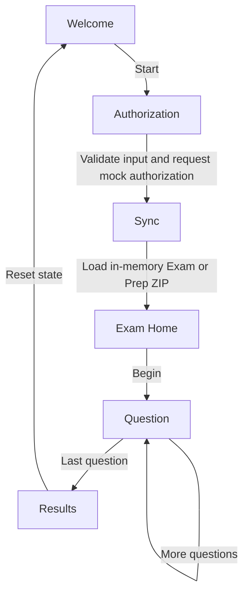

# ExamSimulator Project Learning Guide

## Audience and Purpose

This guide is for students learning how a React Native project is organized and how to turn the existing ExamSimulator M1 foundation into a semester capstone. It explains the folders, authored files, important code blocks, runtime flow, tests, and current limitations.

The guide describes logical code blocks in source order rather than hard-coded line numbers. Line numbers move whenever code changes; use the file links and the named functions, types, and sections to follow along in the editor.

This repository is a working foundation, not a finished production exam system. Authorization and connectivity are deterministic mocks, and encryption is a pass-through. Questions come from a sample API through a gateway layer, with a bundled set as the offline fallback, and scores are computed in memory per session. Treat those boundaries as learning surfaces, not as proof that authorization, encryption, secure scoring, or production content delivery is complete.

## Learning Outcomes

By studying and extending this project, a student should be able to:

- Trace an application from its native or browser entry point to a rendered screen.
- Explain React components, props, hooks, asynchronous work, and navigation.
- Model application state with TypeScript types and a reducer.
- Separate screen behavior from infrastructure using service interfaces.
- Validate and test JSON content stored in ZIP archives.
- Read test output and design tests for success, failure, and boundary cases.
- Describe what is implemented, what is mocked, and what evidence is needed before claiming a platform works.
- Plan a change, implement it, test it, document it, and present the result as a capstone.

## Start Here

### Requirements

- Node.js 22.11 or newer.
- npm, installed with Node.js.
- For browser preview: a modern browser.
- For Android: Android Studio, a compatible JDK and Android SDK, and an emulator or device.
- For iOS: macOS, Xcode, CocoaPods, and an iOS simulator or device. This Windows workspace cannot verify iOS builds.

### Install and Run the Browser App

From the repository root:

```sh
npm install
npm run web
```

Open `http://localhost:5173`. The browser build is the fastest way to study the six-screen application without installing native platform tools.

### Run Android

Complete the official React Native Android environment setup first. Open two terminal windows at the repository root:

```sh
npm start
```

In the second terminal:

```sh
npm run android
```

The first command starts Metro, which serves the JavaScript bundle to the native app. The second asks the React Native CLI to build/install and launch the Android app. Android build status is currently documented as NOT VERIFIED; do not report a successful native build until it has actually completed on your machine.

### Run Checks

```sh
npm test -- --runInBand
npm run typecheck
npm run validate:package -- tests/fixtures/valid-exam.zip
npm run validate:package -- tests/fixtures/valid-prep.zip
```

The package commands validate sample ZIPs without launching React Native. To check the Worker, run these commands from the `worker/` directory:

```sh
npm install
npm run typecheck
```

To run the Worker locally after installing its dependencies:

```sh
npm run dev
```

Worker development is separate from the mobile app. The current screens use mocks and fixture loading; they do not call the Worker authorization endpoint.

## Project Map

### Repository Root

The root contains the shared JavaScript/TypeScript application, platform build configuration, and tools.

| File or folder | Purpose |
| --- | --- |
| [App.tsx](../App.tsx) | Native application composition: validates runtime configuration and mounts providers, navigation, and the startup error view. |
| [App.web.tsx](../App.web.tsx) | Browser-specific app composition. It uses the web navigator instead of the native stack. |
| [index.js](../index.js) | React Native entry point. Registers the `App` component under the name in `app.json`. |
| [web.tsx](../web.tsx) | Browser entry point. Finds `#root` and mounts `App.web.tsx` with React. |
| [index.html](../index.html) | Vite's HTML page; it provides the root element and loads `web.tsx`. |
| [app.json](../app.json) | React Native application name and display name. The registered native component name must match this value. |
| [package.json](../package.json) | Project scripts, dependencies, and the minimum supported Node version. |
| `package-lock.json` | npm's resolved dependency versions. Commit it so installs are reproducible; do not hand-edit it. |
| [tsconfig.json](../tsconfig.json) | Extends the React Native TypeScript defaults and selects TypeScript source files for checking. |
| [babel.config.js](../babel.config.js) | Selects the React Native Babel preset that transforms JavaScript/TypeScript syntax. |
| [metro.config.js](../metro.config.js) | Starts from Metro's React Native defaults and is the place for Metro-specific bundling changes. |
| [vite.config.ts](../vite.config.ts) | Sets up the browser build, maps `react-native` imports to `react-native-web`, and prioritizes `.web` modules. |
| [jest.config.js](../jest.config.js) | Configures Jest with the React Native test preset and transforms selected React Native dependencies. |
| [.eslintrc.js](../.eslintrc.js) | Enables the React Native ESLint rules for source quality checks. |
| [.prettierrc.js](../.prettierrc.js) | Sets formatting preferences used by Prettier. |
| [.gitignore](../.gitignore) | Excludes dependencies, native build output, local machine configuration, and other generated files from source control. |
| [.watchmanconfig](../.watchmanconfig) | Watchman configuration used by React Native tooling to monitor file changes. |
| [Gemfile](../Gemfile) | Ruby dependency constraints used by CocoaPods for iOS builds. |
| `.bundle/config` | Local Bundler options. It configures a local vendor path and platform behavior; it is not application logic. |
| [README.md](../README.md) | Project overview and quick commands. |
| [.github/copilot-instructions.md](../.github/copilot-instructions.md) | Repository-specific engineering constraints and M1 requirements for coding assistants. |

### `src/app/`

This folder contains presentation and navigation. Screen components should request capabilities through service hooks; they should not construct network clients, database connections, or platform services themselves.

#### `src/app/navigation/`

| File | What to study |
| --- | --- |
| [NavigationTypes.ts](../src/app/navigation/NavigationTypes.ts) | `RootStackParamList` declares the six allowed route names. `undefined` means a route accepts no route parameters. Native navigation APIs use this type to catch misspelled routes and invalid params. |
| [RootNavigator.tsx](../src/app/navigation/RootNavigator.tsx) | Creates the typed native stack, sets `Welcome` as the first screen, registers all six route components, and dispatches `APP_INITIALIZED` after mount. Route options define header titles and back-button behavior. |
| [RootNavigator.web.tsx](../src/app/navigation/RootNavigator.web.tsx) | Implements the equivalent route list for a browser without importing the native stack. `routeStack` is a small history array; `navigate` pushes a route, `replace` swaps the current route, and the back button removes the last entry. |

The exact route sequence used in the walkthrough is `Welcome -> Authorization -> Sync -> ExamHome -> Question -> Results`. Native navigation is provided by React Navigation. Browser navigation is deliberately implemented locally so the web preview does not need the native stack package at runtime.

#### `src/app/screens/`

Every screen renders through `ScreenFrame`, uses React state for temporary UI state when needed, and receives navigation props from the navigator.

| File | Ordered code walkthrough |
| --- | --- |
| [ScreenFrame.tsx](../src/app/screens/ScreenFrame.tsx) | Imports React Native layout primitives; accepts a title and children; places them in a scrollable, centered content column; exports shared text, input, button, error, and answer-option styles. It contains presentation only, not navigation or exam rules. |
| [WelcomeScreen.tsx](../src/app/screens/WelcomeScreen.tsx) | Renders the opening message; provides a Start button; calls `navigation.navigate('Authorization')` when pressed. It makes no service call, which is verified by a screen test. |
| [AuthorizationScreen.tsx](../src/app/screens/AuthorizationScreen.tsx) | Reads services and dispatch from context; stores email, exam code, mode, busy state, and feedback in local state; uses a ref to prevent two submissions before React updates the busy state; validates required input and email shape; checks connectivity and calls the authorization service; dispatches `AUTHORIZED`; replaces the current route with Sync; maps thrown errors to safe user messages; clears the busy guard in `finally`. This is mock authorization, not identity verification. |
| [SyncScreen.tsx](../src/app/screens/SyncScreen.tsx) | Reads the current session, dispatch, and services; starts `sync()` in an effect; shows a preparation message while the promise is pending; on success dispatches `SYNC_COMPLETED` and replaces the route with Exam Home; on failure shows sanitized text; the `active` flag prevents a stale promise from updating an unmounted screen. |
| [ExamHomeScreen.tsx](../src/app/screens/ExamHomeScreen.tsx) | Reads session metadata from shared state and displays the exam code, mode, and question count; Begin navigates to Question. Fallback values make the sample screen render if session metadata is absent. |
| [QuestionScreen.tsx](../src/app/screens/QuestionScreen.tsx) | Reads the exam engine and session question count; keeps the current index, loaded question, and selected answer in component state; an effect requests a question and ignores late responses after cleanup; renders choices as radio-style controls; selecting a choice calls `submitAnswer` and stores the returned feedback; in Prep mode it shows the correct answer and explanation and locks the choice; Continue is disabled until a choice is selected; advances to the next item or replaces the final question with Results; load and submit failures show sanitized text. |
| [ResultsScreen.tsx](../src/app/screens/ResultsScreen.tsx) | Requests a result from the exam engine when mounted and displays the returned correct/total count, which is computed from the answers recorded during the session; Finish dispatches `SESSION_RESET` and replaces the route with Welcome. The score is in memory only and is practice scoring, not secure assessment. |

#### `src/core/`

Core code contains shared rules and service boundaries that should not depend on screen layout.

##### `src/core/config/`

| File | What to study |
| --- | --- |
| [AppConfig.ts](../src/core/config/AppConfig.ts) | Defines `AppConfig`; `loadAppConfig` parses a URL, permits HTTPS, and permits HTTP only for approved development hosts; `loadRuntimeConfig` reads the optional global host override and chooses the localhost default in development. Invalid settings fail early so the UI can show a configuration error. |

##### `src/core/state/`

| File | What to study |
| --- | --- |
| [AppState.tsx](../src/core/state/AppState.tsx) | Defines `AppState` and the closed `AppAction` union; supplies the initial state; `appReducer` returns a new state for initialization, authorization, sync, and reset actions; `AppStateProvider` connects React's `useReducer` to context; `useAppState` and `useAppDispatch` provide typed access and throw helpful errors if used outside the provider. Separate contexts let components that only dispatch avoid subscribing to state changes. |

The reducer transitions are:

1. `APP_INITIALIZED` sets the one-time startup flag.
2. `AUTHORIZED` stores the candidate and creates an incomplete session shell.
3. `SYNC_COMPLETED` replaces that shell with returned package metadata and marks sync complete.
4. `SESSION_RESET` clears candidate/session data but preserves the startup flag.

##### `src/core/services/`

| File | What to study |
| --- | --- |
| [ServiceContracts.ts](../src/core/services/ServiceContracts.ts) | Declares `ExamMode`, candidate/session data shapes, `AnswerFeedback`, and the interfaces for authorization, sync, repository, encryption, exam engine (`getQuestion`, `submitAnswer`, `getResults`), renderer, connectivity, HTTP, and logging. The `ServiceContainer` type requires all nine capabilities. Screens should depend on these interfaces, not implementation details. |
| [ServiceContainer.tsx](../src/core/services/ServiceContainer.tsx) | This is the composition root and the only application module that creates concrete services. `createServices` builds the HTTP client and question-bank gateway, then wires the gateway-backed sync service and exam engine alongside the remaining mocks; `ServicesProvider` shares the result through context; `useServices` retrieves it; `assertCompleteServiceContainer` checks that all required service slots exist. The config is memoized so service objects are not recreated on every render. |
| [QuestionBankServices.ts](../src/core/services/QuestionBankServices.ts) | `ActiveExam` holds the loaded `QuestionBank` and recorded answers in memory. `createGatewaySyncService` fetches through the gateway and falls back to the bundled sample set only when the API is unreachable. `createBankExamEngine` serves questions without the answer key, returns feedback from `submitAnswer`, and scores recorded answers. |
| [HttpApiClient.ts](../src/core/services/HttpApiClient.ts) | Wraps `fetch`; creates an abort controller and timeout; maps 401/403 to authorization-required, 5xx and transport errors to network-unavailable, other non-success and invalid JSON to protocol errors; clears the timer in `finally`. Its generic result type is a TypeScript expectation, not runtime schema validation. The question-bank gateway uses it; authorization does not. |

##### `src/core/gateway/` and `src/core/models/`

| File | What to study |
| --- | --- |
| [QuestionBankGateway.ts](../src/core/gateway/QuestionBankGateway.ts) | The middle layer between the app and the API. Builds the request path, selects a mapper by `apiVersion`, rejects a payload whose mode differs from the request, and converts mapping failures to `PROTOCOL_ERROR` while logging the reason. The path builder and mapper list are injectable. |
| [QuestionBankMapper.ts](../src/core/gateway/QuestionBankMapper.ts) | The only code that knows the v1 wire format. Reads every field with runtime type checks, ignores unknown fields, resolves the answer id to the option text, and builds the model classes. Add a mapper here for a new API version. |
| [Question.ts](../src/core/models/Question.ts) | The `Question` and `QuestionBank` model classes. They hold no API-specific fields, so API changes do not affect them. |

The service boundary is an important capstone lesson: a screen can call `services.authorization.authorize(...)` without knowing whether that capability is a local fake, an HTTP API, or a test double. Do not move concrete service creation into screen components.

##### Other core modules

| File | What to study |
| --- | --- |
| [AppError.ts](../src/core/errors/AppError.ts) | Defines stable error codes, wraps unknown thrown values as `UNKNOWN`, and maps codes to safe user-facing copy. UI code should display this copy rather than raw exception messages. |
| [RedactingLogger.ts](../src/core/logging/RedactingLogger.ts) | Normalizes protected field names and replaces exact top-level sensitive fields with `[REDACTED]`; informational logs are suppressed outside development. Nested objects are not recursively redacted, so callers must avoid putting credentials in nested log values. |
| [PackageTypes.ts](../src/core/content/PackageTypes.ts) | Defines the closed content component union (`paragraph`, `list`, `image`, `video`), manifest metadata, and question shape. Schema version and content version are distinct. Both exam and prep question records have correct answers. |
| [SampleQuestionBank.ts](../src/core/content/SampleQuestionBank.ts) | Holds ten original sample questions and a separate explanation map. The explanation map is for Prep only. These ten questions are the offline fallback when the API is unreachable; the 50-question set comes from the Worker. |
| [FixturePackageLoader.ts](../src/core/content/FixturePackageLoader.ts) | Creates an in-memory ZIP with a manifest and question JSON; adds `explanations.json` only for Prep; serializes to base64 and re-opens with JSZip; checks required entries; returns only session metadata. It demonstrates ZIP I/O but is not the complete package validator. |

### `tests/`

Tests document expected behavior. Run them after changing the behavior they cover; add a focused test before or alongside changes with meaningful risk.

| File or folder | Purpose |
| --- | --- |
| [__tests__/App.test.tsx](../__tests__/App.test.tsx) | Root-level smoke test that renders `App` with React Test Renderer. |
| [tests/unit/core.test.ts](../tests/unit/core.test.ts) | Tests configuration URL rules, reducer transitions/reset, safe errors, sensitive-field redaction, service completeness, and the identity encryption mock. |
| [tests/unit/api-client.test.ts](../tests/unit/api-client.test.ts) | Uses fake fetch responses to test HTTP status mapping, malformed JSON, and request timeout behavior without a server. |
| [tests/unit/fixture-loader.test.ts](../tests/unit/fixture-loader.test.ts) | Confirms the in-memory ZIP loader returns expected metadata for Exam and Prep. |
| [tests/unit/screens.test.tsx](../tests/unit/screens.test.tsx) | Renders Welcome and Authorization with mocked context hooks and fake navigation; tests visible behavior and service substitution. |
| [tests/unit/package-validator.test.js](../tests/unit/package-validator.test.js) | Runs the real Node package validator against valid and invalid ZIP fixtures. |
| [tests/unit/worker.test.ts](../tests/unit/worker.test.ts) | Calls the Worker fetch handler with Web `Request` objects; checks health, version, authorization, and question endpoints (50 questions, no explanations for Exam, 400 and 404 cases) without deploying Cloudflare resources. |
| [tests/unit/question-gateway.test.ts](../tests/unit/question-gateway.test.ts) | Feeds the 50-question sample JSON through the mapper and gateway, checks malformed payloads, unsupported versions, and mode mismatch, and proves a made-up v2 API shape is absorbed by registering one mapper. |
| [tests/unit/question-bank-services.test.ts](../tests/unit/question-bank-services.test.ts) | Tests sync, the offline fallback, answer feedback, scoring, and out-of-range handling in the exam engine. |
| `tests/fixtures/valid-exam/` | Plain JSON source files for a valid Exam package. `manifest.json` describes ten questions; `questions.json` has no explanations file. |
| `tests/fixtures/valid-prep/` | Plain JSON source files for a valid Prep package. It includes `explanations.json`. |
| `tests/fixtures/malformed/` | Invalid manifest JSON used to prove parser errors are reported. |
| `tests/fixtures/future-schema/` | A package with schema version 99 used to prove unsupported versions are rejected. |
| `tests/fixtures/*.zip` | Packaged archives consumed by the CLI validator. Each archive corresponds to its named source fixture folder. |

A useful test habit is to separate three questions: did the function return the right value, did it call the correct dependency, and did it behave safely on failure? The existing tests use unit tests for core rules and test doubles for external boundaries.

### `tools/content-preparation/`

| File | Purpose |
| --- | --- |
| [validate-package.js](../tools/content-preparation/validate-package.js) | Node-only ZIP validator using AdmZip. It checks required root entries, JSON validity, manifest fields, supported schema version, Exam/Prep explanation rules, question IDs and answers, allowed display component types, asset paths and references, and unreferenced assets. It exports `validatePackage` for tests and provides a command-line entry when run directly. |
| [preview/index.html](../tools/content-preparation/preview/index.html) | Standalone browser package preview. It loads JSZip from a CDN, reads the selected ZIP, parses the manifest/questions, and builds DOM nodes for the four permitted component types. It does not import React Native or `src/` renderer code. It is a preview, not a replacement for validation. |

The validator should reject malformed content before preview or delivery. The preview makes valid content easier to inspect, but it currently relies on a network-hosted JSZip script and expects the package's JSON files to be present.

### `worker/`

| File | Purpose |
| --- | --- |
| [worker/src/index.ts](../worker/src/index.ts) | Cloudflare Worker fetch handler. It returns fixed health and content-version JSON; serves the sample question bank at `GET /api/v1/questions` (Exam omits explanations; 400 for bad input, 404 for an unknown exam); accepts a minimally checked authorization request and returns fixed stub candidate data; returns JSON 404 for all other routes. Responses allow any origin because the data is public sample content. It has no database, identity provider, Drive integration, leases, secrets, or persistence. |
| [worker/src/data/question-bank.sample.json](../worker/src/data/question-bank.sample.json) | The sample API response: 50 original questions in the v1 wire format with options, an answer id, and an explanation. The Worker removes explanations for Exam. |
| [worker/package.json](../worker/package.json) | Separate scripts and development dependencies for Wrangler and Worker typechecking. Install dependencies from this directory. |
| `worker/package-lock.json` | Locks the Worker's npm dependency tree independently from the mobile app. |
| [worker/tsconfig.json](../worker/tsconfig.json) | Uses strict TypeScript checking, ES2022, and Cloudflare Worker type definitions; no files are emitted. |
| [worker/wrangler.toml](../worker/wrangler.toml) | Names the Worker entry point and Wrangler compatibility date. It contains no production credentials. |

### `android/`

This folder is the native Android host around the shared JavaScript application.

| File or folder | Purpose |
| --- | --- |
| `android/settings.gradle` | Includes the React Native Gradle plugin, enables autolinking, and declares the Android app module. |
| `android/build.gradle` | Defines shared Android SDK, build tools, NDK, Kotlin, and Gradle plugin versions. |
| `android/gradle.properties` | Controls AndroidX, supported CPU architectures, Hermes, New Architecture, edge-to-edge mode, and Gradle memory. |
| `android/gradlew`, `android/gradlew.bat` | Gradle wrapper launchers for Unix-like shells and Windows. Prefer these wrappers to an unrelated globally installed Gradle version. |
| `android/gradle/wrapper/gradle-wrapper.properties` | Selects the Gradle distribution used by the wrapper. |
| `android/gradle/wrapper/gradle-wrapper.jar` | Binary implementation of the Gradle wrapper; do not edit manually. |
| `android/app/build.gradle` | Configures the Android app, React Native autolinking, app ID, SDK values, build variants, signing, and Hermes/JSC dependency. The checked-in debug signing settings are for development only, not production release signing. |
| `android/app/proguard-rules.pro` | ProGuard/R8 rules for Android release shrinking. |
| `android/app/src/main/AndroidManifest.xml` | Declares the application, internet permission, launch activity, and Android behavior. |
| `android/app/src/main/java/com/examsimulatorm1/MainApplication.kt` | Creates the React Native host, resolves autolinked packages, and initializes React Native when Android starts. |
| `android/app/src/main/java/com/examsimulatorm1/MainActivity.kt` | React Native activity. Its component name must match the name registered from JavaScript in `app.json`/`index.js`. It enables the default activity delegate and Fabric flag. |
| `android/app/src/main/res/values/strings.xml` | Provides the app display string. |
| `android/app/src/main/res/values/styles.xml` | Defines the base Android theme and React Native text input background. |
| `android/app/src/main/res/mipmap-*/*` | Launcher icon images in Android density variants. These are assets, not application logic. |
| `android/app/debug.keystore` | Development signing key used by the generated debug configuration. Never treat it as a release key. |

Gradle output folders such as `android/build/`, `android/app/build/`, `.gradle/`, and `.kotlin/` are generated. They are not source files students should edit.

### `ios/`

This is the generated Xcode host for the shared JavaScript application. It requires macOS/Xcode for builds.

| File or folder | Purpose |
| --- | --- |
| [ios/Podfile](../ios/Podfile) | Resolves React Native CocoaPods scripts, selects the minimum supported iOS version, installs native modules, and runs React Native's post-install setup. |
| `ios/ExamSimulatorM1.xcodeproj/project.pbxproj` | Xcode project configuration: target membership, build phases, resources, and build settings. Usually edit through Xcode rather than manually. |
| `ios/ExamSimulatorM1.xcodeproj/xcshareddata/xcschemes/ExamSimulatorM1.xcscheme` | Shared Xcode build, run, test, profile, and archive scheme. |
| `ios/ExamSimulatorM1/AppDelegate.swift` | Native application delegate. The current implementation allows the iOS app launch lifecycle to proceed. |
| `ios/ExamSimulatorM1/SceneDelegate.swift` | Creates the React Native factory and window, starts the `ExamSimulatorM1` JavaScript module, configures the development menu, and chooses Metro's bundle in debug versus the packaged JS bundle in release. |
| `ios/ExamSimulatorM1/Info.plist` | App metadata, launch/scene configuration, supported orientations, transport security, and New Architecture flag. |
| `ios/ExamSimulatorM1/PrivacyInfo.xcprivacy` | Apple privacy manifest describing accessed API categories and collected-data declarations. Review it whenever native APIs or dependencies change. |
| `ios/ExamSimulatorM1/LaunchScreen.storyboard` | Native launch screen displayed before React Native renders. |
| `ios/ExamSimulatorM1/Images.xcassets/` | Xcode asset catalog; app icon image definitions live here. |
| `ios/.xcode.env` | Environment setup used by Xcode build scripts. `.xcode.env.local` is machine-specific and ignored. |

The iOS project is scaffolding only in this Windows workspace. iOS status remains NOT VERIFIED until an actual build/test runs on macOS/Xcode or approved macOS CI.

### `docs/`

These files describe requirements and platform/package behavior. Read them before expanding the capstone.

| File | Topic |
| --- | --- |
| [architecture.md](architecture.md) | Dependency direction, runtime choices, and M1 limits. |
| [m1-requirements.md](m1-requirements.md) | M1 scope, required architecture, and acceptance checks. |
| [package-format.md](package-format.md) | ZIP layout, metadata, schema version, question rules, and display component vocabulary. |
| [package-authoring.md](package-authoring.md) | Steps for creating and previewing packages. |
| [known-limitations.md](known-limitations.md) | Known implementation and project-scope gaps. |
| [platform-status.md](platform-status.md) | Actual verification claims for Windows, Android, and iOS. |
| [windows-build.md](windows-build.md) | Windows integration constraints and outstanding acceptance work. |
| [android-build.md](android-build.md) | Android environment and release acceptance guidance. |
| [project-learning-guide.md](project-learning-guide.md) | This student-oriented project walkthrough and capstone learning plan. |

## End-to-End Code Flow

### 1. Native App Startup

1. Android launches `MainActivity`, which asks React Native to render the registered JavaScript component.
2. `index.js` registers `App` using the application name from `app.json`.
3. `App.tsx` calls `loadRuntimeConfig(__DEV__)` before creating the normal app tree.
4. `loadAppConfig` validates the API URL. If configuration is invalid, `App.tsx` shows a safe fatal message rather than mounting workflows that may later fail unpredictably.
5. On success, providers are mounted: `SafeAreaProvider`, `ServicesProvider`, `AppStateProvider`, `NavigationContainer`, and `RootNavigator`.
6. The navigator dispatches `APP_INITIALIZED` after it mounts and displays Welcome.

### 2. Browser App Startup

1. Vite serves `index.html` and loads `web.tsx`.
2. `web.tsx` finds the HTML element with ID `root` and calls React `createRoot`.
3. `App.web.tsx` loads development configuration and mounts services, app state, and `RootNavigator.web`.
4. Vite maps React Native imports to React Native Web and resolves `.web.tsx` files first. This allows shared screens to render in a browser while keeping native navigation dependencies out of the browser route.

### 3. Candidate and Content Flow



The events and owners are:

1. Welcome calls navigation only.
2. Authorization validates input, asks connectivity and authorization services, dispatches `AUTHORIZED`, then replaces the route.
3. Sync calls the sync service. It reads the selected Exam/Prep mode from state; the service asks the question-bank gateway (`src/core/gateway/`) for a `QuestionBank` from the API, falling back to the bundled sample set if the API is unreachable. On success it dispatches `SYNC_COMPLETED` and opens Exam Home.
4. Exam Home reads the synchronized session summary from state.
5. Question asks the exam engine for prompt and choices. The engine does not return the correct answer until the learner submits a choice; Prep mode then shows the answer and explanation.
6. Results asks the exam engine for the score, which counts the correct answers recorded during the session.
7. Finish resets session state and returns to Welcome.

## Important Concepts in the Code

### Component, Props, State, and Hooks

A screen is a React function component. Navigation supplies props such as `navigation`; hooks such as `useState` store values that change while the screen is mounted; `useEffect` runs asynchronous work in response to state or service changes; context hooks provide shared state and services.

Prefer local state for short-lived presentation values such as a selected answer or loading text. Use app state for data that must survive a route change, such as the candidate and synchronized session. Do not mutate state objects directly; return a new object from the reducer.

### `async`/`await` and Effects

Network, file, and ZIP operations may finish later. `await` pauses one async function until its promise settles. A screen should show a pending state and handle errors. When an effect starts work, its cleanup may run before the promise resolves; the `active` flag pattern in Sync and Question prevents a stale result from updating an inactive screen.

### TypeScript Unions and Interfaces

`ExamMode` is a union of the two allowed strings. `AppAction` is a discriminated union: the `type` property determines which other fields are available. Interfaces describe stable boundaries, while the `DisplayComponent` union permits only four renderer shapes. These types prevent many mistakes during development, but they do not validate arbitrary JSON at runtime.

### Service Boundary and Composition Root

A service contract says what a capability does, not how it is implemented. A service container supplies implementations at the app boundary. This lets unit tests replace `useServices()` with fakes and lets a future capstone replace a mock with a real implementation without rewriting screen layout. The only application module allowed to construct concrete service objects is `ServiceContainer.tsx`.

### Errors and Sensitive Data

Throw or propagate stable `AppError` codes for known application failures. Convert unknown exceptions with `toAppError` and display `toUserMessage`; never show arbitrary raw exceptions to users. The logger redacts known top-level credential keys, but the strongest rule is not to log secrets or sensitive content in the first place.

### Package Schema and Content Version

`schemaVersion` describes the structure the application knows how to parse. `contentVersion` describes a particular release of exam content. They solve different problems and should not be combined. The package validator currently supports schema version 1 only.

A package is a ZIP with root-level `manifest.json` and `questions.json`. Prep packages also include `explanations.json`; Exam packages must not. Question records in both modes include correct answers for planned offline scoring. M1 package data is plain JSON in ZIP archives: ZIP is packaging, not encryption.

## How to Change the Project Safely

For a feature, trace the call path before editing:

1. Find the screen or tool where the behavior begins.
2. Find its service interface in `ServiceContracts.ts`.
3. Find the current implementation in `ServiceContainer.tsx` or the package tool.
4. Find the state action, type, or package schema affected by the change.
5. Find the nearest existing test and decide what observable behavior should be asserted.
6. Implement the smallest coherent change and run the focused test first.
7. Run `npm run typecheck` and the relevant full checks.
8. Update this guide or the focused design document if the architecture or commands changed.

Do not introduce Expo, Redux, Zustand, MobX, or a general dependency-injection framework. Keep exactly six routes unless the project requirements are explicitly revised. Keep package validation independent from React Native, and keep the browser package preview independent from `src/` renderer code.

## Semester Capstone Learning Plan

The following sequence builds from safe, observable changes toward a larger project. A student should agree on scope with their instructor before connecting real user data or external services.

### Milestone 1: Orientation and Baseline

- Install dependencies and run the browser app.
- Draw the startup path from `web.tsx` or `index.js` to `RootNavigator`.
- Run tests and typecheck; record exact commands and results.
- Present the six-route flow and identify every mock.

Deliverable: a one-page architecture diagram and a baseline test report.

### Milestone 2: UI and State Understanding

- Trace one user action from a button to navigation or a reducer action.
- Add a small, testable screen improvement, such as clearer loading/error feedback.
- Add or update a screen test for the behavior.

Deliverable: a small pull request with before/after behavior and test evidence.

### Milestone 3: Content Authoring and Validation

- Create a new valid fixture with a small question count.
- Add a fixture for one invalid boundary, such as duplicate question IDs, missing asset, or mode mismatch.
- Extend validator tests and use the package preview to inspect valid content.

Deliverable: package examples, validator test coverage, and a short explanation of schema versus content version.

### Milestone 4: State and Exam Behavior

- Define how answers should be stored without exposing answer keys to screens.
- Design scoring rules and result types before implementation.
- Add reducer actions and unit tests where shared session data is required.
- Test incomplete answers, final-question transitions, and reset behavior.

Deliverable: a written behavior specification, reducer/model changes, and focused tests. Scoring already counts in-memory answers; the capstone question is how to persist answers and where a trustworthy score should be computed, since the answer key is held in the app.

### Milestone 5: Service Integration Design

- The question-bank gateway already shows the pattern; choose a second integration (for example authorization) and replace its mock behind the existing service interface, preserving screen code. Use only a non-production endpoint approved by the instructor.
- Define request and response schemas and validate incoming JSON at runtime, as the mapper does.
- Add tests for success, network failure, malformed response, and timeout.

Deliverable: service contract documentation and tests. Never commit secrets, real credentials, or production data.

### Milestone 6: Platform and Quality Review

- Test the browser flow at desktop and mobile viewport sizes.
- Run platform builds only where the required SDK is available.
- Review accessibility labels, keyboard and focus behavior, error states, logging, and privacy.
- Report platform status only from actual builds/tests.

Deliverable: a capstone demo, verification matrix, known-limitations list, and retrospective.

## Capstone Evaluation Rubric

| Area | Strong evidence |
| --- | --- |
| Architecture | Screens use interfaces; concrete services remain at the composition root; platform and content tools stay appropriately separated. |
| Correctness | Acceptance criteria are written before implementation; edge cases and failure paths have tests. |
| Type and data design | Types express valid states, and untrusted JSON receives runtime validation. |
| Security and privacy | No secrets are committed or logged; user-facing errors are sanitized; data handling is explained. |
| Usability and accessibility | Loading, empty, success, and error states are understandable; controls have accessible roles and labels. |
| Verification | Commands and platform results are recorded accurately; unverified targets are not described as passing. |
| Communication | The student can explain the changed code path, tradeoffs, tests, limitations, and next step. |

## Current M1 Boundaries: Do Not Overclaim

- Authorization is a deterministic mock and does not check identity or entitlements.
- Connectivity always returns online in the current service container.
- Sync loads questions from the Worker sample API through the gateway and falls back to bundled questions when offline; content is held in memory only and not cached.
- The encryption service returns its input unchanged.
- Scores are computed from answers recorded in memory for one session; they are not persisted, and the answer key is held in the app.
- Authorization does not use the HTTP client; only the question-bank gateway does.
- The Worker returns sample data and has no database or production integrations.
- Package fixture content is unencrypted JSON inside ZIP files.
- Windows, Android, and iOS build verification must be reported according to [platform-status.md](platform-status.md); on this workspace all native statuses are documented as NOT VERIFIED.

## Suggested Questions for a Student Presentation

1. Why are services passed through interfaces instead of constructed inside screens?
2. What is the difference between component state and app-wide reducer state in this project?
3. Why does the Sync effect need cleanup logic?
4. Why is a TypeScript type not enough to validate JSON loaded from a ZIP?
5. Why are schema version and content version separate fields?
6. Which tests prove that Exam and Prep packages differ correctly?
7. Which visible behavior is still a mock, and what evidence would prove a production replacement works?
8. What parts of the project could be tested without an emulator, database, or cloud account?

## Further Reading

- [Architecture](architecture.md)
- [M1 requirements](m1-requirements.md)
- [Package format](package-format.md)
- [Package authoring](package-authoring.md)
- [Known limitations](known-limitations.md)
- [Platform verification](platform-status.md)
- [Windows build notes](windows-build.md)
- [Android build notes](android-build.md)
